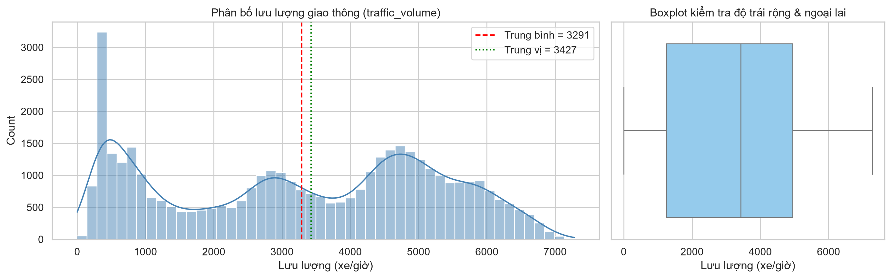
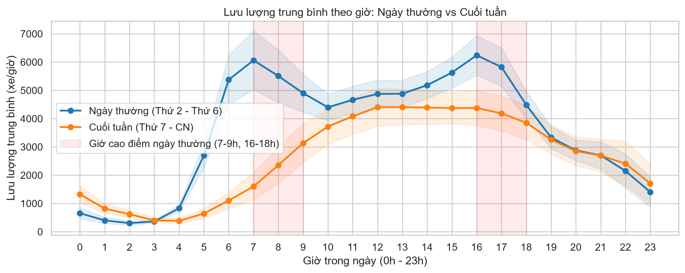
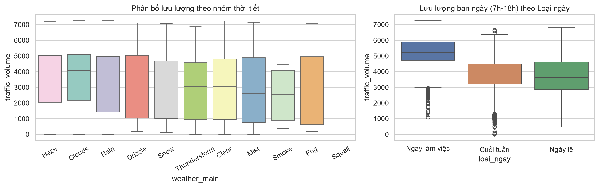
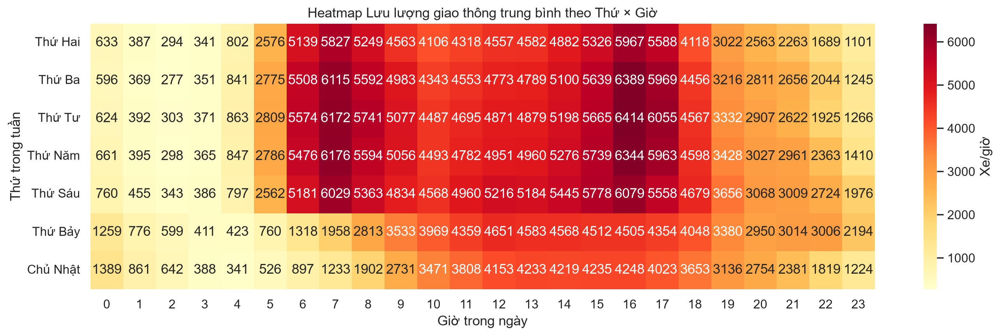
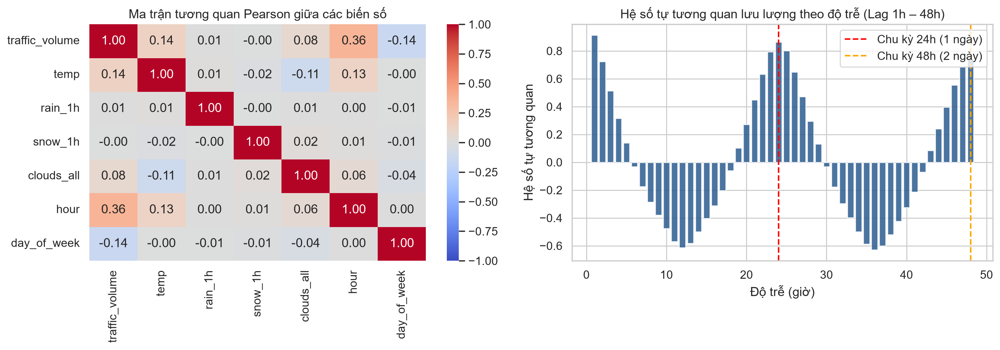
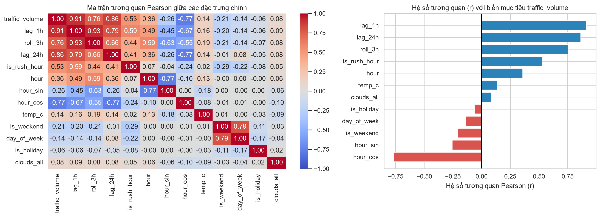
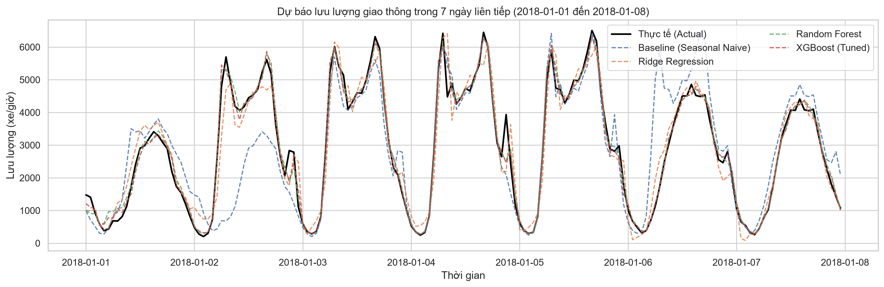
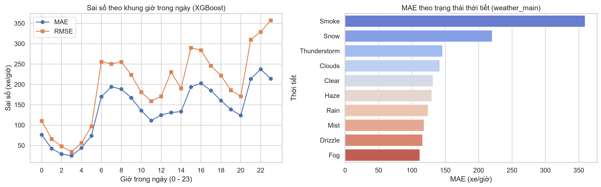
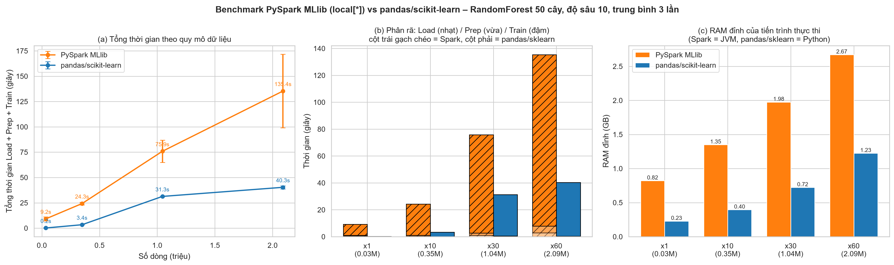

# Cẩm Nang Bản Chất Dự Án Từ A Đến Z (Theo Đúng Trình Tự Nhân – Quả 7 Bước)
## Từ Thu Thập Dữ Liệu → Đọc Hiểu EDA Để Bắt Bệnh → Tiền Xử Lý → Tạo Đặc Trưng & Xuất Parquet/JSON → Thiết Kế Model & Tham Số → Đánh Giá → Thực Nghiệm Big Data PySpark

> **Cách đọc tài liệu này để hiểu thông suốt 100% dự án:**
> * **Mở file này ở chế độ Xem trước Markdown (nhấn `Ctrl + Shift + V` trên VS Code)** để nhìn thấy **toàn bộ các biểu đồ EDA và biểu đồ kết quả hiện ra trực tiếp ngay trong bài**!
> * Dự án Khoa học Dữ liệu không phải là những đoạn code rời rạc, mà là một **chuỗi Nhân – Quả chặt chẽ**: phải **Thu thập & Hiểu dữ liệu (Bước 1)** $\rightarrow$ mới vẽ **EDA để soi ra lỗi và quy luật (Bước 2)** $\rightarrow$ từ từng lỗi trong EDA mới chọn đúng **phương pháp Tiền xử lý (Bước 3)** $\rightarrow$ từ từng quy luật trong EDA mới **Tạo đặc trưng và đóng gói ra 2 file `.parquet` + `.json` (Bước 4)** $\rightarrow$ rồi mới **Chia dữ liệu & Huấn luyện Model (Bước 5)** $\rightarrow$ **Đánh giá & Phân tích lỗi (Bước 6)** $\rightarrow$ **Thử tải Big Data với PySpark (Bước 7)**.
> * Ở **mỗi một bước**, tài liệu đều trả lời đủ 3 câu hỏi cho bạn: **(1) Xử lý cụ thể như thế nào? (2) Tại sao phải dùng phương pháp này? (3) Có những phương pháp nào khác và tại sao KHÔNG dùng chúng?**

---

## MỞ ĐẦU: BẢNG CHÚ THÍCH NHANH CÁC TỪ KHÓA CƠ BẢN (ĐỌC LƯỚT ĐỂ KHÔNG BỊ VẤP THUẬT NGỮ)

| Nhóm | Từ khóa | Giải thích 1 câu bằng tiếng đời thường |
| :--- | :--- | :--- |
| **Dữ liệu & Thống kê** | **Bản ghi (`Row` / `Sample`)** | 1 dòng ngang trong bảng (tương ứng với **1 giờ đồng hồ** trên cao tốc). |
| | **Thuộc tính (`Column`)** | 1 cột dọc trong bảng. Chia làm **Đặc trưng đầu vào ($X$)** (dữ kiện đề bài) và **Biến mục tiêu ($y$)** (đáp án cần đoán: `traffic_volume`). |
| | **Biến định lượng vs Phân loại vs Nhị phân** | *Định lượng* là con số đo đếm được (`15,2°C`, `5.000` xe); *Phân loại* là chữ chia nhóm (`"Rain"`, `"Snow"`); *Nhị phân* là cột chỉ có `0` (Sai) hoặc `1` (Đúng). |
| | **Giá trị khuyết (`NaN` / `Null` / `Missing`)** | Ô bị bỏ trống không có dữ liệu (do mất điện, quên ghi, hoặc phần mềm đọc nhầm chữ `'None'`). |
| | **Ngoại lai (`Outlier`)** | Con số vọt ra quá xa khỏi đám đông (có thể do **hỏng máy đo** $\rightarrow$ phải xóa, hoặc **giờ cao điểm thật** $\rightarrow$ cấm xóa). |
| | **Trung bình (`Mean`), Trung vị (`Median`/`50%`), Tứ phân vị (`25%`, `75%`), `IQR`** | Xếp dữ liệu từ nhỏ đến lớn: chỗ 1/4 hàng là `25%`, chính giữa hàng là `Trung vị (50%)`, chỗ 3/4 hàng là `75%`. Khoảng từ 25% đến 75% gọi là `IQR`. |
| | **Độ lệch chuẩn (`Std`)** | Đo mức độ "nhảy múa thất thường" quanh số trung bình (`Std` nhỏ = đều đặn; `Std` lớn = biến động dữ dội). |
| | **Hệ số tương quan (`Pearson r`)** | Con số từ `-1` đến `+1`: gần `+1` là 2 cột cùng tăng; gần `-1` là cột này tăng cột kia giảm; gần `0` là không có quan hệ đường thẳng. |
| | **Đa cộng tuyến (`Multicollinearity`)** | Hiện tượng nhiều cột đầu vào bị trùng lặp ý nghĩa với nhau, làm phương trình cộng trừ bị rối và nổ hệ số. |
| **Xử lý & Đặc trưng** | **`EDA` (Khám phá dữ liệu)** | Bước "chụp X-quang / xét nghiệm" dữ liệu thô bằng bảng đếm và biểu đồ để tìm bệnh và tìm quy luật *trước khi* sửa dữ liệu. |
| | **Chuỗi thời gian (`Time Series`)** | Dữ liệu đo nối tiếp theo từng nấc đồng hồ. Luật bất di bất dịch: **cấm xáo trộn thứ tự, cấm lấy tương lai đoán quá khứ (`Data Leakage` — rò rỉ dữ liệu)**. |
| | **`Reindex` vs Nội suy (`Interpolation`)** | `Reindex` là trải bảng lên khung lịch đủ từng giờ để lộ các giờ mất điện thành `NaN`. *Nội suy* là tự bịa con số giả điền vào ô `NaN`. |
| | **`One-Hot` vs `Label Encoding`** | `One-Hot` tách 1 cột chữ (11 loại thời tiết) thành 11 cột `0/1` bình đẳng; `Label Encoding` gán số đếm `1, 2, 3...` lên 1 cột. |
| | **Đặc trưng trễ (`Lag`) & Trung bình trượt (`Rolling`)** | `Lag` là kéo cột số xe tụt xuống $k$ dòng để lấy số xe quá khứ ($k$ giờ trước); `Rolling` là lấy trung bình cộng của 3 dòng ngay phía trên. |
| **Mô hình & Big Data** | **Hồi quy (`Regression`) vs Phân loại (`Classification`)** | *Hồi quy* là đoán một **con số** (bao nhiêu xe); *Phân loại* là đoán **nhãn nhóm** (Có đông nghẹt / Không đông nghẹt). |
| | **`Train` / `Test` / `Overfitting` / `Underfitting`** | `Train` là sách ôn ở nhà; `Test` là đề thi thật cuối kỳ. Nhớ vẹt sách ôn mà thi thật trượt là `Overfitting`; học mãi không hiểu bài là `Underfitting`. |
| | **Siêu tham số (`Hyperparameters`) & `TimeSeriesSplit`** | *Siêu tham số* là các nút vặn cài đặt cho mô hình. `TimeSeriesSplit` là chia tập `Train` thành 4 vòng thi thử nối tiếp từ quá khứ đến tương lai để chọn nút vặn tốt nhất. |
| | **`Bagging` (`Random Forest`) vs `Boosting` (`XGBoost`)** | `Random Forest` cho 100 cây làm độc lập song song rồi lấy trung bình; `XGBoost` xếp 300 cây nối đuôi nhau, cây sau chuyên sửa phần sai số của cây trước. |
| | **`PySpark` / `JVM` / `DAG` / `Lazy Evaluation` / `Overhead`** | `PySpark` là công cụ Big Data phân tán chạy trên Máy ảo Java (`JVM`), lập bản đồ kế hoạch (`DAG`) đợi lệnh `.count()`/`.fit()` mới chạy thật (`Lazy Evaluation`), chịu chi phí thủ tục ban đầu (`Overhead`) nhưng mở rộng được ra nhiều máy (`Scalability`). |

---

# BƯỚC 1: THU THẬP & HIỂU RÕ BỘ DỮ LIỆU GỐC LÀ GÌ? (`Đầu Note 01`)

### 1.1. Dữ liệu này ở đâu ra và đo bằng cách nào?
Nếu không hiểu dữ liệu sinh ra từ đâu ngoài đời thực, ta sẽ không bao giờ hiểu tại sao nó bị lỗi!
* **Tên bộ dữ liệu:** *Metro Interstate Traffic Volume* (Mã **ID 492** trên kho dữ liệu học máy quốc tế **UCI Machine Learning Repository**), lưu tại [data/raw/metro_interstate_traffic_volume.csv](file:///d:/big%20data/btl_nhóm_3/data/raw/metro_interstate_traffic_volume.csv).
* **Địa điểm thực tế:** Đặt trên tuyến đường cao tốc liên bang **I-94** (làn chạy về hướng Tây nối thành phố Minneapolis sang thành phố St. Paul, bang Minnesota, Mỹ — một bang sát biên giới Canada có mùa đông lạnh âm 20–30 độ C và rất nhiều tuyết).
* **Cách người ta ghép tạo ra bảng dữ liệu này (Từ 3 nguồn khác nhau):**
  1. **Nguồn 1 (Cảm biến mặt đường ATR 301 của Sở Giao thông Minnesota):** Cứ mỗi 1 giờ đồng hồ (ví dụ từ 08:00 đến 08:59), vòng từ dưới lòng đường đếm xem có tổng cộng bao nhiêu chiếc xe chạy qua $\rightarrow$ ghi thành cột **`traffic_volume`** và mốc giờ **`date_time`**.
  2. **Nguồn 2 (Đài khí tượng trực tuyến OpenWeatherMap):** Lấy thông tin thời tiết tại khu vực đó theo từng giờ $\rightarrow$ ghép thêm 6 cột: **`temp`**, **`rain_1h`**, **`snow_1h`**, **`clouds_all`**, **`weather_main`**, **`weather_description`**.
  3. **Nguồn 3 (Lịch nghỉ lễ của Mỹ và bang Minnesota):** Ghép thêm cột **`holiday`** đánh dấu ngày nghỉ lễ.
* **Thời gian thu thập:** Kéo dài gần tròn **6 năm**, bắt đầu từ `02/10/2012 09:00:00` đến `30/09/2018 23:00:00`, tổng cộng có **`48.204` dòng** và **`9` cột**.

### 1.2. Ý nghĩa từng cột trong 9 cột gốc
1. **`date_time` *(Kiểu ngày giờ)*:** Mốc ngày và giờ ghi nhận (trục xương sống của chuỗi thời gian).
2. **`traffic_volume` *(Biến định lượng số nguyên — ĐÁP ÁN CẦN DỰ BÁO $y$)*:** Số xe ô tô qua trạm trong giờ đó (`0` đến `7.280` xe/giờ).
3. **`holiday` *(Biến chữ phân loại)*:** Tên ngày lễ (gồm 11 ngày lễ lớn như *Christmas Day, Labor Day, New Years Day...*; nếu là ngày bình thường không nghỉ lễ thì file CSV gốc ghi chữ `'None'`).
4. **`temp` *(Biến định lượng số thực)*:** Nhiệt độ không khí đo theo đơn vị vật lý **độ Kelvin (K)** (lưu ý: `0°C = 273,15 K`).
5. **`rain_1h` *(Biến định lượng số thực)*:** Lượng mưa rơi trong 1 giờ đó (đơn vị: `mm`).
6. **`snow_1h` *(Biến định lượng số thực)*:** Lượng tuyết rơi trong 1 giờ đó (đơn vị: `mm`).
7. **`clouds_all` *(Biến định lượng số nguyên)*:** Độ che phủ của mây trên bầu trời (đơn vị: `%`, từ `0%` trời trong vắt đến `100%` mây kín trời).
8. **`weather_main` *(Biến chữ phân loại)*:** Nhóm hiện tượng thời tiết chính (có **11 loại**: *Clear, Clouds, Rain, Drizzle, Mist, Fog, Haze, Smoke, Snow, Squall, Thunderstorm*).
9. **`weather_description` *(Biến chữ phân loại)*:** Câu mô tả thời tiết chi tiết hơn của `weather_main` (có tới **38 loại** nhỏ như *light rain, moderate rain, heavy intensity rain, scattered clouds...*).

---

# BƯỚC 2: PHÂN TÍCH KHÁM PHÁ DỮ LIỆU (`EDA` — `Note 01`) — ĐỌC HIỂU TỪNG BẢNG & TỪNG HÌNH ĐỂ CHUẨN BỊ CHO BƯỚC TIỀN XỬ LÝ

> **Tư duy cốt lõi bạn cần nhớ:**  
> Người mới học thường nhảy bổ vào xóa dữ liệu hoặc chạy mô hình ngay mà bỏ qua `EDA`. Nhưng trong Khoa học Dữ liệu, **`EDA` chính là tờ phiếu xét nghiệm của bác sĩ**: bác sĩ phải đọc phim X-quang (`EDA`) thấy xương gãy chỗ nào, máu nhiễm khuẩn chỗ nào thì sang Bước 3 (**Tiền xử lý**) mới kê đúng thuốc chữa bệnh đó, và sang Bước 4 (**Tạo đặc trưng**) mới biết chế tạo cột gì!

Dưới đây là **4 phát hiện "Bắt bệnh"** từ bảng khảo sát và **5 phát hiện "Tìm quy luật + Bắt bệnh"** từ 5 hình vẽ EDA trong [code/note_01.ipynb](file:///d:/big%20data/btl_nhóm_3/code/note_01.ipynb):

---

## 2.1. Đọc 3 Ô Khảo Sát Đầu `Note 01` (Cell 1 → Cell 3) — Phát hiện ngay "4 Căn Bệnh" của Dữ liệu thô

### 🔎 Chẩn đoán số 1 (Từ Cell 1 — Kiểm tra giai đoạn & tính liên tục thời gian): Chuỗi thời gian bị "thủng lỗ" mất `11.976` giờ!
* **Cách kiểm tra trong EDA:** Lấy mốc cuối (`30/09/2018 23:00`) trừ mốc đầu (`02/10/2012 09:00`) thấy tổng cộng trên đồng hồ phải có **`52.551` giờ**. Nhưng đếm số mốc giờ khác nhau trong bảng chỉ có **`40.575` giờ**! Đếm theo từng năm thì thấy năm 2014 chỉ có `4.839` dòng và năm 2015 chỉ có `4.373` dòng (trong khi 1 năm đủ phải có `8.760` giờ!).
* **Kết luận của EDA gửi sang Tiền xử lý:** Trạm cảm biến đếm xe đã bị tắt điện / ngừng bảo trì mất **`11.976` giờ** (có những đợt tắt liền nhiều ngày, nhiều tháng). Dữ liệu **không liên tục đều đặn từng giờ**, nên sang Bước 3 (`Cell 4` của `Note 02`) nếu muốn tính số xe của "1 giờ trước" hay "24 giờ trước" thì **tuyệt đối cấm đếm lùi dòng trực tiếp** mà phải dựng lại khung lịch chuẩn!

### 🔎 Chẩn đoán số 2 (Từ Cell 2 — Kiểm tra `Null / NaN` ở cột `holiday`): Cả 2 cái bẫy nằm trong 1 cột!
* **Cách kiểm tra trong EDA:** Đếm số ô bị `NaN` thấy 8 cột kia sạch bóng (`0%` thiếu), riêng cột `holiday` báo `NaN` tới **`48.143` dòng (`99,87%`)**, chỉ có **`61` dòng** có chữ tên lễ! Soi tiếp xem 61 dòng có tên lễ đó nằm ở giờ nào trong ngày thì thấy **tất cả 100% đều nằm ở đúng `[0]` (`00:00:00` nửa đêm)**!
* **Kết luận của EDA gửi sang Tiền xử lý:**
  1. `48.143` ô `NaN` kia **không phải là dữ liệu bị mất**, mà do ngày bình thường người ta ghi chữ `'None'`, khi Python đọc file CSV đã hiểu nhầm chữ `'None'` thành ô rỗng `NaN`!
  2. Nguy hiểm hơn: Một ngày nghỉ lễ kéo dài suốt 24 tiếng (từ `00:00` đến `23:00`), nhưng dữ liệu gốc chỉ đánh dấu lễ lúc `00:00` đêm, còn từ `01:00` sáng đến `23:00` đêm của ngày lễ đó lại ghi là ngày thường! Sang Bước 3 (`Cell 1` & `Cell 5` của `Note 02`) bắt buộc phải **gom 53 ngày lễ và lan truyền nhãn lễ từ lúc 0h ra toàn bộ 24 giờ của ngày hôm đó**!

### 🔎 Chẩn đoán số 3 (Từ Cell 2 — Kiểm tra trùng lặp): `48.204` dòng nhưng chỉ có `40.575` giờ!
* **Cách kiểm tra trong EDA:** Đếm dòng trùng hệt cả 9 cột ra **`17` dòng**. Đếm dòng bị lặp lại cùng một mốc `date_time` ra tới **`7.629` dòng**! Khi in thử mốc giờ `2013-04-18 22:00:00` ra xem thì thấy giờ đó lặp lại **6 dòng liên tiếp**: cả 6 dòng đều có số xe `traffic_volume = 1.532`, chỉ khác nhau nhãn thời tiết (*Mist, Drizzle, light rain, moderate rain, heavy snow, snow*).
* **Kết luận của EDA gửi sang Tiền xử lý:** Nguyên nhân trùng giờ là do nguồn thời tiết (Nguồn 2) gắn nhiều nhãn thời tiết cho cùng 1 giờ mưa tuyết hỗn hợp. Trong bài toán dự báo theo giờ, **mỗi giờ chỉ được phép tồn tại đúng 1 dòng duy nhất**, nên sang Bước 3 (`Cell 2` của `Note 02`) phải khử toàn bộ `7.629` dòng trùng giờ này!

### 🔎 Chẩn đoán số 4 (Từ Cell 3 — Bảng thống kê `describe` các cột số): Bắt quả tang 11 dòng hỏng cảm biến thời tiết!
* **Cách kiểm tra trong EDA:** Nhìn vào cột `min` (nhỏ nhất) và `max` (lớn nhất) của bảng thống kê:
  * Cột `temp` có `min = 0,00 Kelvin` (đổi ra độ C là **`-273,15°C`** — lạnh bằng ngoài không gian vũ trụ!), có **`10` dòng** bị như vậy.
  * Cột `rain_1h` có `25% = 0`, `50% = 0`, `75% = 0`, nhưng `max` vọt lên **`9.831,30 mm/giờ`** (gần 10 mét nước mưa trút xuống trong 1 tiếng đồng hồ!), làm độ lệch chuẩn `std` vọt lên `44,79 mm` — có **`1` dòng** bị như vậy.
* **Kết luận của EDA gửi sang Tiền xử lý:** Đây chắc chắn 100% là **ngoại lai vật lý do chập/mất tín hiệu cảm biến thời tiết**, sang Bước 3 (`Cell 3` của `Note 02`) phải đổi `temp` từ Kelvin sang độ C và cắt bỏ đúng 11 dòng lỗi này!

---

## 2.2. Đọc Hiểu Từng Hình Trong 5 Hình EDA (Cell 4 → Cell 8 `Note 01`) — Nhìn Hình Thấy Gì & Dùng Nó Thế Nào Cho Bước Sau?

### 📊 HÌNH EDA 1 (`Cell 4`): Phân bố mật độ & Hộp trải rộng của `traffic_volume`

* **Nhìn vào hình này bạn đọc như thế nào?**
  1. **Hình bên trái (Biểu đồ phân phối tần suất `Histogram` & Đường mật độ `KDE`):** Trục ngang là số lượng xe/giờ (`0` đến `7.280`), trục đứng là số lượng giờ xuất hiện mức xe đó. Bạn thấy đường cong không có hình quả chuông 1 đỉnh như chiều cao hay cân nặng con người, mà nhô lên thành **2 đỉnh rõ rệt (gọi là Phân phối 2 đỉnh — `Bimodal`)**:
     * **Cụm đỉnh thứ nhất bên trái (`200 – 800` xe/giờ):** Tập trung các giờ **đêm khuya và rạng sáng** đường vắng.
     * **Cụm đỉnh thứ hai bên phải (`4.200 – 5.800` xe/giờ):** Tập trung các giờ **ban ngày và cao điểm** đường đông.
     * Vạch đỏ đứt nét là Trung bình (`3.291` xe), vạch xanh chấm là Trung vị (`3.427` xe) nằm lơ lửng ở thung lũng giữa 2 đỉnh!
  2. **Hình bên phải (Biểu đồ hộp `Boxplot`):** Hộp màu xanh chứa 50% dữ liệu ở giữa (từ `~1.249` đến `~4.952` xe), hai râu kéo dài chạm `0` và `7.280`, **không có bất kỳ dấu chấm đen lẻ loi nào văng ra ngoài râu hộp**!
* **👉 Từ Hình EDA 1 này, bạn rút ra chỉ dẫn gì cho Bước Tiền xử lý & Mô hình?**
  * **Chỉ dẫn cho Tiền xử lý:** Khẳng định biến mục tiêu `traffic_volume` hoàn toàn sạch, **KHÔNG CÓ ngoại lai lỗi**, nên ở Bước 3 tuyệt đối **không được dùng công thức cắt ngoại lai lên cột `traffic_volume`**!
  * **Chỉ dẫn cho Tạo đặc trưng & Mô hình:** Vì phân phối tách làm 2 thế giới Ngày – Đêm quá khác biệt, nếu không có đặc trưng phân tách Ngày – Đêm (như `hour`, `hour_cos`) thì mô hình sẽ chỉ đoán loanh quanh mức trung bình `3.291` xe (rơi đúng vào vùng thung lũng ít xảy ra nhất!).

---

### 📊 HÌNH EDA 2 (`Cell 5`): Quy luật lưu lượng theo 24 giờ — Ngày thường vs Cuối tuần

* **Nhìn vào hình này bạn đọc như thế nào?**
  * Trục ngang là 24 giờ trong ngày (`0h` $\rightarrow$ `23h`), trục đứng là số xe trung bình.
  * **Đường màu xanh (Ngày thường Thứ 2 – Thứ 6):** Vẽ nên hình **chữ M (2 đỉnh nhọn)** cực kỳ rõ: vọt lên đỉnh cao điểm đi làm buổi sáng lúc **`7h – 8h` (`~5.700 – 6.000` xe)**, hạ nhẹ buổi trưa (`~4.500` xe), rồi vọt lên đỉnh cao điểm tan tầm buổi chiều lúc **`16h – 17h` (`> 6.000` xe)** trước khi lao dốc về đêm.
  * **Đường màu cam (Cuối tuần Thứ 7 – Chủ Nhật):** Khác một trời một vực! Lúc 7h–8h sáng người dân ngủ nướng nên chỉ có `~1.500 – 2.200` xe, **hoàn toàn không có đỉnh sáng**, chỉ có **1 đỉnh tròn thoải duy nhất vào buổi trưa – chiều (`12h – 16h`, khoảng `4.300` xe)**.
  * Ngoài ra nhìn hai đầu trục ngang: lúc `23h` đêm (`~1.100` xe) nối tiếp mượt mà sang `0h` đêm (`~830` xe).
* **👉 Từ Hình EDA 2 này, bạn rút ra chỉ dẫn gì cho Bước Tạo đặc trưng (Note 2)?**
  1. Phải tách cột **`hour`** (`0..23`) và tạo cột nhị phân **`is_weekend`** (`0/1` phân tách đường xanh và đường cam).
  2. Quan trọng nhất: Phải chế tạo đặc trưng tương tác **`is_rush_hour`** (chỉ bật bằng `1` tại đúng 2 dải tô màu hồng `7h–9h` và `16h–18h` **NHƯNG chỉ dành cho đường màu xanh Ngày thường**, không bật cho đường màu cam Cuối tuần!).
  3. Vì `23h` đêm nối liền sang `0h` sáng theo chu kỳ khép kín, phải tạo thêm cặp **`hour_sin`** và **`hour_cos`** để cuộn trục ngang thành vòng tròn!

---

### 📊 HÌNH EDA 3 (`Cell 6`): Tác động của Thời tiết & Ngày nghỉ lễ đến lưu lượng

* **Nhìn vào hình này bạn đọc như thế nào?**
  * **Khung trái (Biểu đồ hộp `Boxplot` theo 11 nhóm thời tiết `weather_main`, sắp xếp trung vị giảm dần):** Trời quang đãng, có mây (`Clouds`, `Haze`, `Clear`) duy trì lưu lượng trung vị cao nhất (`~3.400 – 3.700` xe/giờ). Ngược lại, khi xuất hiện thời tiết nguy hiểm làm giảm tầm nhìn và trơn trượt mặt đường như **Tuyết rơi (`Snow`), Sương mù dày (`Fog`), Gió giật bão (`Squall`), Giông sét (`Thunderstorm`)**, lưu lượng trung vị sụt giảm mạnh!
  * **Khung phải (So sánh ban ngày `7h–18h` theo 3 loại ngày):** Sau khi gán nhãn lễ cho cả 24 giờ trong ngày lễ, hộp **Ngày lễ (màu xanh lá)** có mức lưu lượng thấp nhất (trung vị chỉ `~3.300` xe), thấp hơn cả **Cuối tuần (màu cam, `~3.800` xe)** và thấp hơn rất xa **Ngày làm việc (màu xanh dương, `~5.000` xe)**!
* **👉 Từ Hình EDA 3 này, bạn rút ra chỉ dẫn gì cho Bước Tiền xử lý & Tạo đặc trưng?**
  1. Bắt buộc phải sửa lỗi cột `holiday` (vốn chỉ gắn lúc 0h đêm) bằng cách **lan truyền `is_holiday = 1` cho toàn bộ 24 giờ của ngày lễ**, đồng thời loại trừ ngày lễ ra khỏi biến giờ cao điểm `is_rush_hour`!
  2. Bắt buộc phải giữ thông tin `weather_main` và chuyển từ chữ sang số bằng **One-Hot Encoding (11 cột `wm_*`)** để máy nhận diện được trời tuyết, sương mù, giông bão.

---

### 📊 HÌNH EDA 4 (`Cell 7`): Bản đồ nhiệt (`Heatmap`) Lưu lượng trung bình theo Thứ × Giờ

* **Nhìn vào hình này bạn đọc như thế nào?**
  * Mỗi ô nhỏ là số xe trung bình của một **Thứ cụ thể (hàng dọc)** vào một **Giờ cụ thể (hàng ngang)**: màu càng đỏ đậm xe càng đông, màu càng vàng nhạt xe càng vắng.
  * Thấy rõ khối đỏ rực nằm từ **Thứ Hai đến Thứ Sáu** ở cột `6h–8h` (`5.200 – 6.172` xe) và cột `15h–17h` (`5.500 – 6.414` xe); đồng thời thấy sự khác nhau tinh vi giữa các ngày trong tuần (chiều Thứ Sáu đỏ sớm từ `14h` và tối Thứ Sáu – Thứ Bảy `21h–23h` cam đậm hơn tối đầu tuần; sáng Chủ Nhật vàng nhạt vắng nhất tuần).
* **👉 Từ Hình EDA 4 này, bạn rút ra chỉ dẫn gì?**
  1. Ngoài biến gộp `is_weekend`, vẫn phải giữ cột **`day_of_week` (`0` → `6`)** để phân biệt Thứ Sáu với Thứ Hai, Thứ Bảy với Chủ Nhật.
  2. Cho thấy mối quan hệ giữa Thứ và Giờ là **tương tác 2 chiều dạng ô lưới (phi tuyến)** $\rightarrow$ dự báo trước rằng ở Bước 5, các mô hình **Cây quyết định (`Random Forest`, `XGBoost`)** sẽ mạnh hơn hẳn mô hình đường thẳng `Linear / Ridge Regression`!

---

### 📊 HÌNH EDA 5 (`Cell 8`): Tương quan biến số thô & Sóng Tự tương quan theo độ trễ (`Lag 1h → 48h`)

* **Nhìn vào hình này bạn đọc như thế nào?**
  1. **Khung trái (Ma trận tương quan Pearson của các cột số thô, lọc `temp > 0`):** Nhìn hàng đầu tiên (`traffic_volume`), các con số tương quan tuyến tính đều rất khiêm tốn: `hour` chỉ `+0,35`, `temp` chỉ `+0,13`, `rain_1h` = `0,00`, `snow_1h` = `0,00`, `clouds_all` = `+0,04`, `day_of_week` = `−0,15`. *Tại sao thấp vậy?* Vì quan hệ của chúng với lượng xe là đường cong / rẽ nhánh chứ không phải đường thẳng!
  2. **Khung phải (Hệ số tự tương quan của `traffic_volume` từ trễ 1 giờ đến 48 giờ trước):**
     * Cột đầu tiên **`Lag 1h`** cao vọt sát **`+0,92`** (1 tiếng trước đông thì tiếng này cũng đông!).
     * Đồ thị uốn hình sóng: tụt xuống đáy âm ở `Lag 12h` (`−0,60`, ngày ngược với đêm), rồi **nhô cao vọt lên đỉnh nhọn ở đúng vạch đứt đỏ `Lag 24h` (`+0,83` — cùng giờ ngày hôm qua)** và lặp lại ở **`Lag 48h` (`+0,77` — cùng giờ 2 ngày trước)**!
* **👉 Từ Hình EDA 5 này, bạn rút ra chỉ dẫn quyết định gì cho Note 2?**
  * Khung trái chứng minh: **Phải làm Feature Engineering** (tạo `hour_cos`, `is_rush_hour`) để nâng tín hiệu lên!
  * Khung phải chứng minh trực tiếp lý do sinh ra đúng **3 đặc trưng trễ ở Bộ B**: lấy đỉnh sát nhất **`lag_1h`**, cụm ngắn hạn 3 giờ đầu **`roll_3h`**, và đỉnh chu kỳ ngày **`lag_24h`**!

---

# BƯỚC 3: TIỀN XỬ LÝ & LÀM SẠCH DỮ LIỆU (`Cell 1 → Cell 4 của Note 02`) — TỪ CHẨN ĐOÁN CỦA EDA ĐƯA RA PHƯƠNG PHÁP XỬ LÝ (TẠI SAO DÙNG CÁCH NÀY MÀ KHÔNG DÙNG CÁCH KIA?)

Từ 4 căn bệnh mà `EDA` vừa vạch trần ở Bước 2, nhóm thiết kế quy trình làm sạch 6 bước gọn trong 4 ô code đầu của [code/note_02.ipynb](file:///d:/big%20data/btl_nhóm_3/code/note_02.ipynb) (`Cell 1`: Ngày lễ $\rightarrow$ `Cell 2`: Khử trùng giờ $\rightarrow$ `Cell 3`: Đổi `°C` & lọc ngoại lai vật lý $\rightarrow$ `Cell 4`: Lưới giờ `reindex` & tính biến trễ). Với mỗi bệnh, hãy nắm rõ **các phương án có thể có** và **lý do nhóm chọn phương án tối ưu**:

---

### 🛠️ Xử lý Bệnh 1: Cột `holiday` bị `NaN` (`99,87%`) và chỉ gắn nhãn lễ lúc `00:00` đêm
* **Các phương pháp xử lý `NaN` thường gặp trong sách vở:**
  1. ❌ *Xóa bỏ cột có trên 90% `NaN` (`drop column`):* Sai lầm nghiêm trọng! Vì `NaN` ở đây thực chất là chữ `'None'` (ngày thường), và Hình EDA 3 vừa chứng minh ngày lễ làm lưu lượng ban ngày giảm từ `5.000` xuống `3.300` xe — xóa cột này là vứt bỏ thông tin cực quý!
  2. ❌ *Chỉ đổi `NaN` thành `'None'` rồi mã hóa luôn từng dòng:* Vẫn sai! Vì 23 giờ ban ngày (`01:00`–`23:00`) của ngày lễ vẫn đang mang chữ `'None'`!
  3. ✅ **Phương pháp nhóm ĐÃ DÙNG (Chuẩn hóa chuỗi + Trích tập ngày lễ chuẩn hóa + Lan truyền 24h):**
     * Đổi `NaN` về lại chuỗi `"None"`.
     * Lọc `61` dòng có tên lễ (`!= "None"`), cắt bỏ giờ-phút-giây để lấy danh sách **`53` ngày lễ duy nhất** lưu vào tập `holiday_days` **NGAY TRƯỚC KHI xóa trùng giờ** (để không bị mất nhãn lễ nếu mốc `00:00` có dòng trùng).
     * Sau đó hễ dòng nào có phần Ngày thuộc `holiday_days` thì gán **`is_holiday = 1` cho trọn vẹn cả 24 giờ** của ngày hôm đó!

---

### 🛠️ Xử lý Bệnh 2: Dữ liệu bị trùng `17` dòng hoàn toàn và trùng `7.629` dòng mốc giờ `date_time`
* **Các phương pháp xử lý có thể cân nhắc:**
  1. ❌ *Chỉ xóa `17` dòng trùng hoàn toàn cả 9 cột (`df.drop_duplicates()`):* Không đủ! Vẫn còn `7.612` dòng trùng mốc giờ `date_time` (như ví dụ 1 giờ lặp 6 dòng thời tiết), làm sai lệch bước nhảy thời gian 1 giờ và làm các giờ mưa bão bị nhân trọng số gấp nhiều lần.
  2. ❌ *Gộp (`groupby`) theo `date_time` rồi nối ghép chuỗi thời tiết lại:* Sinh ra hàng trăm tổ hợp nhãn thời tiết lai ghép cực hiếm (ví dụ `"Rain+Mist+Drizzle"` chỉ xuất hiện 1–2 lần), làm nổ số lượng cột One-Hot thưa thớt không học được.
  3. ✅ **Phương pháp nhóm ĐÃ DÙNG (Sắp xếp ổn định `mergesort` + `drop_duplicates(subset=["date_time"], keep="first")`):**
     * Dùng thuật toán sắp xếp ổn định `mergesort` theo `date_time` để bảo toàn 100% thứ tự bản ghi gốc, rồi giữ bản ghi đầu tiên của mỗi mốc giờ (bản tin thời tiết chính đầu giờ) và xóa `7.629` dòng lặp $\rightarrow$ đưa bảng từ `48.204` dòng về đúng **`40.575` mốc giờ duy nhất** (`assert df["date_time"].is_unique`).

---

### 🛠️ Xử lý Bệnh 3: Ngoại lai lỗi cảm biến (`10` dòng `0 K` & `1` dòng mưa `9.831,3 mm`)
* **Các phương pháp xử lý Ngoại lai (`Outliers`) trong Khoa học Dữ liệu:**
  1. ❌ *Lọc thống kê tự động bằng `IQR` ($Q_1 - 1,5\text{IQR}$; $Q_3 + 1,5\text{IQR}$) hoặc `Z-score` ($|z| > 3$) trên toàn bộ các cột số:*
     * Nếu áp lên `rain_1h` và `snow_1h` (vốn có $Q_1 = Q_3 = 0 \Rightarrow \text{IQR} = 0$!), công thức `IQR` sẽ **xóa sạch sành sanh 100% những giờ có mưa và có tuyết**!
     * Nếu áp lên `traffic_volume` hay `temp_c`, có nguy cơ cắt mất các giờ cao điểm kẹt xe hoặc những ngày mùa đông lạnh sâu thật sự của bang Minnesota.
  2. ❌ *Thay thế ngoại lai bằng giá trị trung bình:* Làm sai điều kiện thời tiết thực của giờ đó (trong khi toàn bảng có 40.575 dòng, bỏ đi 11 dòng lỗi chỉ chiếm `0,03%` — không ảnh hưởng mảy may kích thước mẫu!).
  3. ✅ **Phương pháp nhóm ĐÃ DÙNG (Đổi đơn vị sang độ C + Lọc theo Ngưỡng Vật Lý Rõ Ràng):**
     * Đổi `temp_c = temp - 273.15`.
     * Đặt ngưỡng vật lý chắc chắn 100% là hỏng thiết bị: xóa dòng có **`temp_c <= -50°C`** (loại đúng 10 dòng `-273,15°C`, đưa `min` về **`-29,76°C`** đúng thực tế mùa đông Minnesota) và xóa dòng có **`rain_1h >= 500 mm`** (loại đúng 1 dòng `9.831,3 mm`, đưa `max` về **`55,63 mm`** và kéo `Std` từ `48,81` xuống **`0,77 mm`**), giữ nguyên vẹn 100% biến mục tiêu `traffic_volume` $\rightarrow$ còn **`40.564` dòng**.

---

### 🛠️ Xử lý Bệnh 4: Chuỗi thời gian bị đứt quãng, khuyết mất `11.987` giờ (`22,81%`) trên tổng `52.551` giờ
* **Các phương pháp xử lý dữ liệu khuyết (`Missing / Null`) trên chuỗi thời gian & Tại sao chọn/bỏ:**
  1. ❌ *Lờ đi khoảng trống, tính thẳng `.shift(1)` và `.shift(24)` trên bảng `40.564` dòng:* **Sai nghiêm trọng!** Khi trạm mất điện từ 11h đến 14h, dòng 10h nằm sát trên dòng 15h $\rightarrow$ máy lấy nhầm số xe của 10h gán làm `lag_1h` cho 15h (sai lệch tới **11.743 dòng** `lag_24h`!).
  2. ❌ *Trải lưới `reindex` rồi dùng Nội suy tuyến tính (`interpolate`), điền số trung bình (`fillna(mean)`), hoặc kéo số cũ đắp sang (`ffill`) cho `11.987` giờ trống:*
     * Như bảng khảo sát theo năm ở Bước 2 đã chỉ ra, năm 2014–2015 có những giai đoạn trạm đo **nghỉ bảo trì liên tục hàng trăm giờ (nhiều tuần lễ liền)**!
     * Nếu dùng `ffill` hay `interpolate` nối qua hàng tuần lễ mất điện đó, ta sẽ **bịa ra gần 12.000 dòng dữ liệu giao thông nhân tạo hoàn toàn không có thật**, làm méo mó quá trình học và làm sai lệch kết quả chấm điểm mô hình!
  3. ✅ **Phương pháp nhóm ĐÃ DÙNG (`Reindex` lên lưới giờ chuẩn 1h $\rightarrow$ Tính biến trễ trên lưới $\rightarrow$ Lọc bỏ dòng `NaN` bằng `dropna`):**
     * **Bước a:** Tạo khung lịch chuẩn cách đều 1 giờ từ đầu đến cuối gồm **`52.551` giờ**, dùng `reindex` áp `40.564` dòng thật vào (lộ ra `11.987` dòng trống `NaN` ở đúng các giờ mất điện).
     * **Bước b:** Tính 3 cột `lag_1h` (`.shift(1)`), `lag_24h` (`.shift(24)`), `roll_3h` (`.shift(1).rolling(3).mean()`) ngay trên lưới `52.551` giờ này $\rightarrow$ đảm bảo mọi phép lùi dòng đều **đúng từng giờ trên đồng hồ 100%**; chỗ nào giờ trước bị mất điện thì biến trễ nhận `NaN` trung thực chứ không lấy nhầm giờ khác!
     * **Bước c:** Xóa bỏ `11.987` dòng trống không có số đo xe thật và xóa thêm `5.731` dòng nằm sát ngay sau các đợt mất điện (vì bị thiếu ít nhất 1 trong 3 biến trễ) $\rightarrow$ thu được **`34.833` dòng sạch tuyệt đối** (100% số đo thật, 0% ô `NaN`, dùng chung đồng nhất cho cả Bộ A và Bộ B để so sánh công bằng!).

---

# BƯỚC 4: TẠO ĐẶC TRƯNG (`Feature Engineering`) & TẠI SAO PHẢI XUẤT RA 2 FILE `.parquet` VÀ `.json` TRƯỚC KHI VÀO MODEL? (`Cuối Note 02`)

## 4.1. Từ kết quả EDA chế tạo ra 26 Đặc trưng (Chia Bộ A = 23 biến & Bộ B = 26 biến)
Dựa thẳng vào 5 hình EDA ở Bước 2, từ 7 cột gốc còn lại nhóm chế biến ra 3 nhóm đặc trưng:
1. **Nhóm Lịch & Chu kỳ (`8` cột — từ Hình EDA 2, 3, 4):** `hour`, `day_of_week`, `month`, `is_weekend`, `is_holiday` (phủ đủ 24h cho 53 ngày lễ), `is_rush_hour` (tương tác 7–9h / 16–18h ngày làm việc), và cặp vòng tròn `hour_sin`, `hour_cos`. *(Chủ động bỏ cột `year` vì tập Test là năm 2018 mới tinh chưa từng xuất hiện trong tập Train 2012–2017, mô hình cây không ngoại suy được năm mới)*.
2. **Nhóm Thời tiết (`15` cột — từ Hình EDA 3):** 4 cột số (`temp_c`, `rain_1h`, `snow_1h`, `clouds_all`) + 11 cột nhị phân `0/1` (`wm_Clear` $\rightarrow$ `wm_Thunderstorm`) dùng **One-Hot Encoding** từ `weather_main` *(không dùng `Label Encoding` gán 1, 2, 3 để tránh ép thứ tự lớn bé giả tạo; bỏ cột `weather_description` 38 nhãn để tránh đa cộng tuyến)*.
   * 👉 **Gom Nhóm 1 + Nhóm 2 = Bộ đặc trưng A (`23` biến):** Dùng cho kịch bản dự báo dài hạn trước nhiều ngày và cho phần mềm Demo.
3. **Nhóm Đặc trưng Trễ (`3` cột — từ Hình EDA 5, tạo tại `Cell 4` của `Note 02`):** Sinh ra từ quá khứ của chính cột `traffic_volume` bằng cách kéo tụt dòng trên lưới giờ liên tục `52.551` giờ:
   * **`lag_1h = traffic_volume.shift(1)`:** Cầm cả cột `traffic_volume` kéo tụt xuống **1 dòng** $\rightarrow$ ví dụ tại dòng `03/10/2012 09:00` (`5.471` xe), ô `lag_1h` nhận giá trị `6.511` xe (số xe lúc `08:00` liền trước, $y_{t-1}$). Nếu giờ liền trước mất điện (như `11:00 = NaN`) thì lúc `12:00` ô `lag_1h` nhận `NaN` để lọc bỏ an toàn.
   * **`lag_24h = traffic_volume.shift(24)`:** Kéo cột `traffic_volume` tụt xuống **24 dòng** $\rightarrow$ tại dòng `03/10/2012 09:00`, ô `lag_24h` nhận `5.545` xe (đúng số xe lúc `09:00` sáng hôm qua `02/10`, $y_{t-24}$).
   * **`roll_3h = traffic_volume.shift(1).rolling(3).mean()`:** Đầu tiên `.shift(1)` lùi về giờ liền trước (loại bỏ hoàn toàn đáp án $y_t$ đang cần đoán!), sau đó `.rolling(3).mean()` lấy **trung bình cộng của 3 giờ liên tiếp ngay trước đó** $(y_{t-3} + y_{t-2} + y_{t-1}) / 3$ (ví dụ có 3 giờ liên tiếp `12h: 5.097`, `13h: 4.887`, `14h: 5.337` $\rightarrow$ tại dòng `15:00`, `roll_3h = (5.097 + 4.887 + 5.337)/3 = 5.107` xe, giúp làm mượt nhiễu ngẫu nhiên).
   * 👉 **Gom Bộ A + Nhóm 3 = Bộ đặc trưng B (`26` biến):** Dùng cho kịch bản cảnh báo ngắn hạn trước 1 giờ trên đường cao tốc.

### Kiểm chứng hiệu quả Tạo đặc trưng bằng Hình Ma trận tương quan (`Cuối Note 02`):

* Nhìn biểu đồ thanh bên phải: Trước khi chế biến (ở Hình EDA 5), biến mạnh nhất chỉ đạt `+0,35` (`hour`). Sau khi chế biến ở Note 2, chúng ta có **`lag_1h` (`+0,91`)**, **`lag_24h` (`+0,86`)**, **`hour_cos` (`−0,77`)**, **`roll_3h` (`+0,76`)**, **`is_rush_hour` (`+0,53`)** — tín hiệu dự báo mạnh gấp 2 đến gần 3 lần ban đầu!

---

## 4.2. CẦU NỐI TRƯỚC KHI VÀO MODEL: Tại sao phải xuất ra CẢ 2 FILE `clean_data.parquet` và `clean_data.json`? Hai file đó có ý nghĩa gì?
*(Đây là mắt xích bàn giao cực kỳ quan trọng giữa bước Tiền xử lý [Note 2] sang bước Mô hình hóa [Note 3] và Big Data [Note 4]!)*

Khi làm sạch và tạo xong đặc trưng ở Note 2, dữ liệu đang nằm tạm trên thanh RAM của Note 2. Để Note 3, Note 4 và phần mềm Demo dùng được mà không phải chạy lại code làm sạch từ đầu, nhóm đóng gói xuất ra thư mục `data/processed/` **2 file đi đôi với nhau**:

### 📦 File 1: [clean_data.parquet](file:///d:/big%20data/btl_nhóm_3/data/processed/clean_data.parquet) (`34.833 dòng × 30 cột`, nặng chỉ `0,5 MB`) — "Kho chứa bảng dữ liệu sạch"
* **Ý nghĩa 30 cột bên trong nó:** Gồm `26 cột đặc trưng Bộ B` (đã chứa cả 23 cột Bộ A) + `1 cột đáp án traffic_volume` + `1 cột mốc thời gian date_time` (để Note 3 cắt Train/Test và vẽ đồ thị theo ngày) + `2 cột chữ gốc weather_main, holiday` (để cuối Note 3 thống kê xem trời mưa/tuyết sai số bao nhiêu).
* **Tại sao BẮT BUỘC lưu định dạng `.parquet` mà KHÔNG lưu ra `.csv` hay `.xlsx` (Excel)?**
  1. **Bảo toàn 100% kiểu dữ liệu (Schema):** Nếu xuất ra `.csv`, mọi thứ lại biến về văn bản thô — sang Note 3 đọc lại sẽ mất kiểu ngày giờ `datetime64`, và tệ nhất là chữ `"None"` trong cột `holiday` sẽ **lại bị pandas đọc nhầm thành `NaN` một lần nữa**! Còn `.parquet` lưu kèm kiểu dữ liệu nhị phân nên đọc lên ở Note 3 giữ nguyên vẹn `datetime64`, `int64`, `float64`, `str`!
  2. **Lưu trữ hướng cột (Columnar Storage) & Nén siêu nhẹ:** `.parquet` nén dung lượng nhỏ hơn `.csv` từ **5 đến 10 lần** và cho phép đọc chọn lọc đúng các cột cần thiết (ví dụ ở Note 4 chỉ cần đọc 10/30 cột bằng `pd.read_parquet(..., columns=...)` mà không cần nạp cả 30 cột vào RAM!).
  3. **Định dạng gốc chuẩn mực của Big Data (`Apache Spark`):** Ở Note 4, `spark.read.parquet(...)` đọc trực tiếp cấu trúc phân khối của Parquet với tốc độ tối đa mà không tốn thời gian dò kiểu dữ liệu (`inferSchema`) như CSV.

### 📜 File 2: [clean_data.json](file:///d:/big%20data/btl_nhóm_3/data/processed/clean_data.json) (`88 dòng văn bản cấu hình`) — "Bản hợp đồng quy ước chung của cả nhóm"
* **Bên trong chứa gì?** Lưu chính xác danh sách tên các cột thuộc từng nhóm (`CALENDAR_FEATURES`, `WEATHER_FEATURES`, `LAG_FEATURES`), danh sách 23 cột của **`FEATURES_A`**, 26 cột của **`FEATURES_B`** và mốc ngày chia tập **`"TEST_START": "2018-01-01"`**.
* **Tại sao đã có file `.parquet` rồi mà vẫn phải xuất thêm file `.json` này?**
  1. **Tách biệt Dữ liệu (`.parquet`) và Siêu dữ liệu cấu hình (`.json`):** File `.parquet` có 30 cột đứng chung một bảng, bản thân file `.parquet` không tự ghi chú cột nào thuộc Bộ A, cột nào thuộc Bộ B, cột nào là đáp án cấm đưa vào `X`!
  2. **Chống sai sót khi làm việc nhóm & Triển khai Demo:** Nếu không có `clean_data.json`, người làm Note 3 và người viết App Demo phải tự ngồi liệt kê tay lại 23 tên cột Bộ A và 26 tên cột Bộ B — chỉ cần gõ sai chữ hoa/thường (`wm_clear` thay vì `wm_Clear`), đảo nhầm thứ tự cột (làm model dự báo sai bét!), hoặc cắt nhầm mốc ngày Train/Test là toàn bộ kết quả giữa các thành viên sẽ lệch nhau. Nhờ `clean_data.json`, mọi thành viên đọc chung **một nguồn quy ước duy nhất (Single Source of Truth)**!

---

# BƯỚC 5: CHIA DỮ LIỆU, ĐỐI SÁNH BỘ A vs BỘ B (5 MODEL) & TỐI ƯU THAM SỐ (`Đầu & Giữa Note 03`)

## 5.1. Cách xử lý Chia dữ liệu: Tại sao dùng Cắt mốc thời gian + `TimeSeriesSplit` mà KHÔNG dùng Chia ngẫu nhiên hay `K-Fold`?
1. **Chia Tập `Train` (`< 2018-01-01` = `28.353` dòng, 81,4%) và Tập `Test` (`>= 2018-01-01` = `6.480` dòng, 18,6%):**
   * *Tại sao dùng cách này?* Mô phỏng đúng thực tế ngoài đời: học từ dữ liệu lịch sử 2012–2017 để dự báo cho tương lai năm 2018 chưa từng xảy ra.
   * *Tại sao KHÔNG dùng chia ngẫu nhiên (`train_test_split` trộn đều)?* Vì trộn ngẫu nhiên sẽ cho máy học giờ `09:00` sáng năm 2015 (có chứa sẵn cột `lag_1h` là số xe lúc `08:00`!) rồi bắt máy "đoán" giờ `08:00` sáng năm 2015 $\rightarrow$ phạm lỗi **rò rỉ tương lai (`Data Leakage`)**!
2. **Dùng `RandomizedSearchCV` + `TimeSeriesSplit(n_splits=4)` ngay BÊN TRONG Tập `Train` để chọn bộ tham số tối ưu:**
   * *Tại sao dùng cách này?* Khi dò 30 tổ hợp siêu tham số của XGBoost, ta tuyệt đối không được lấy đề thi thật cuối kỳ (`Test` năm 2018) ra chấm thử nhiều lần (lộ đề thi!). `TimeSeriesSplit(n_splits=4)` cắt tập Train 2012–2017 thành **4 vòng thi thử nối tiếp nhau** (luôn học quá khứ thi tương lai), chọn cấu hình tốt nhất rồi mới `refit` trên toàn bộ Train và chấm đúng 1 lần trên Test.
   * *Tại sao KHÔNG dùng `K-Fold Cross-Validation` thông thường?* Vì `K-Fold` thường chia khúc rồi thay phiên lấy khúc sau (2015–2017) đi học để chấm trên khúc đầu (2012–2013) $\rightarrow$ lại lấy tương lai đoán quá khứ!

---

## 5.2. Thiết kế 5 Phương pháp trên cả Bộ A & Bộ B: Tại sao DÙNG 5 phương pháp này & Tại sao KHÔNG DÙNG các thuật toán khác?

### A. Tại sao phải thử nghiệm song song cả Bộ A (23 biến) và Bộ B (26 biến)?
* **Bộ A (23 biến Lịch & Thời tiết — không có biến trễ):** Dùng để trả lời câu hỏi *"Nếu dự báo trước nhiều ngày (hoặc trên App Demo khi người dùng chỉ chọn ngày giờ + thời tiết, không biết số xe 1h trước) thì mô hình nào gánh được?"* $\rightarrow$ Các mô hình tuyến tính thất bại (`MAE = 631` xe), nhưng **`XGBoost` vẫn đạt `MAE = 223,66` xe (`R² = 96,44%`)**!
* **Bộ B (26 biến = Bộ A + `lag_1h, lag_24h, roll_3h`):** Phục vụ dự báo vận hành ngắn hạn tại trạm cảm biến, giúp giảm thêm **`36%–44%` sai số** trên toàn bộ các mô hình!

### B. Cách xử lý và vai trò của 5 Phương pháp được chọn (Từ đơn giản nhất đến mạnh nhất):
1. **`Seasonal Naive Baseline`:** Lấy thẳng cột `lag_24h` (lượng xe 24h trước) làm dự báo (`MAE = 568,37 xe`, `R² = 0,7251`). **Dùng làm mốc sàn tối thiểu** chứng minh giá trị gia tăng của học máy.
2. **`Linear Regression` (`StandardScaler` + `LinearRegression`):** Lập phương trình cộng trừ bậc nhất tiêu chuẩn (`MAE = 631,51` xe ở Bộ A $\rightarrow$ `353,76` xe ở Bộ B) để làm đại diện cơ bản cho họ mô hình tuyến tính.
3. **`Ridge Regression` (`StandardScaler` + `Ridge(alpha=10.0)`):** Gắn thêm lực phanh điều chuẩn `L2` (`MAE = 353,61 xe` ở Bộ B) để khắc phục hiện tượng đa cộng tuyến nổ hệ số giữa 11 cột `wm_*` và cặp `lag_1h` – `roll_3h`.
4. **`Random Forest` (`100` cây song song, `max_depth=12`, `max_features=1/3`):** Trồng 100 cây quyết định độc lập xét `1/3` số cột ở mỗi nhánh rồi lấy trung bình cộng (`MAE = 229,66` xe ở Bộ A $\rightarrow$ `143,95` xe ở Bộ B). **Đại diện cho nhóm Cây kết hợp song song (`Bagging`)** bắt tốt tương tác phi tuyến.
5. **`XGBoost` (Cây tăng cường nối tiếp `Boosting`):** Xếp hàng trăm cây nối đuôi nhau sửa phần dư sai số (`MAE = 143,49 xe` $\rightarrow$ sau khi tinh chỉnh bằng `RandomizedSearchCV` ra bộ tham số **`300 cây, sâu 8, lr=0.05, subsample=0.8, colsample=0.8`**, sai số giảm xuống còn **`138,88 xe`**, `MAPE = 5,61%`, giải thích được **`98,79%`** biến động giao thông!).

### C. Tại sao KHÔNG DÙNG các thuật toán khác (`ARIMA`, `KNN/SVM`, `Deep Learning LSTM`)?
* ❌ **Không dùng `ARIMA / SARIMA`:** Vì ARIMA đòi hỏi chuỗi thời gian phải liên tục đều đặn 100%, trong khi dữ liệu của ta bị khuyết đứt quãng tới `11.987` giờ (có đoạn mất liền hàng tháng trời) và ARIMA rất yếu khi phải xử lý cùng lúc 23 biến thời tiết/lịch/tương tác.
* ❌ **Không dùng `KNN` hay `SVM (SVR)`:** Vì thuật toán tính khoảng cách giữa từng cặp dòng quá nặng nề khi lên hàng chục nghìn – hàng triệu dòng, và khoảng cách hình học bị nhiễu khi trộn 14 cột nhị phân `0/1` với các cột số thực.
* ❌ **Không dùng `Deep Learning (LSTM / GRU)`:** Chuỗi bị đứt quãng 22,81% làm gãy mạch cửa sổ chuỗi liên tiếp của LSTM; hơn nữa trên dữ liệu dạng bảng quy mô ~35 nghìn dòng đã được chế biến đặc trưng kỹ lưỡng (`hour_cos`, `lag_1h`, `lag_24h`, `roll_3h`, `is_rush_hour`), `XGBoost` đạt độ chính xác vượt trội (`R² = 98,79%`), huấn luyện nhanh gấp hàng chục lần trên CPU thường và giải thích rõ ràng độ quan trọng từng biến!

---

# BƯỚC 6: ĐÁNH GIÁ KẾT QUẢ, ĐỌC HÌNH PHÂN TÍCH LỖI 4 CHIỀU & LƯU 2 MODEL (`Cuối Note 03`)

1. **Tại sao đánh giá bằng đúng 4 độ đo Hồi quy (`MAE, RMSE, MAPE, R²`) và lọc $y_i > 100$ khi tính `MAPE`?**
   * Vì bài toán dự báo lưu lượng là **Hồi quy (đoán con số xe liên tục)** chứ không phải Phân loại: `MAE` (`138,88` xe) đo sai số tuyệt đối trung bình dễ hiểu nhất; `RMSE` (`217,05` xe) phạt nặng các pha đoán trật đột biến lớn; `MAPE` (`5,61%`, tính trên các giờ có $y_i > 100$ xe/giờ để tránh chia cho mẫu số gần 0 lúc nửa đêm làm nổ phần trăm ảo) đo sai số tương đối; và `R²` (`0,9879`) đo tỷ lệ biến động mà mô hình nắm bắt được.

2. **Nhìn Hình Dự báo 7 ngày liên tiếp đầu năm 2018:**

* Đường màu đen liền nét là số xe thực tế từ `01/01/2018` đến `08/01/2018`. Ngay ngày đầu năm `01/01` là nghỉ Tết Dương lịch nên lưu lượng thực tế thấp hẳn xuống; mô hình `Baseline` bị lệch pha nặng suốt ngày `01/01` và `02/01`, trong khi đường đứt nét của **`XGBoost (Tuned)`** ôm sát sạt từng đỉnh cao điểm sáng/chiều và đáy ban đêm của đường thực tế!

3. **Nhìn Hình & Bảng Phân tích sai số 4 chiều để hiểu giới hạn thực tế của mô hình:**

* **Chiều 1 — Theo khung giờ (Hình trái):** Ban đêm (`1h–4h` sáng) đoán lệch cực ít (`MAE` chỉ `30–50` xe); sai số tăng vào giờ cao điểm đi làm/tan tầm (`7h`, `15h–17h`) và tối muộn (`21h–23h`).
* **Chiều 2 — Theo thời tiết (Hình phải):** Trời **Tuyết rơi (`Snow`)** có sai số lớn nhất do băng tuyết làm dòng xe giảm tốc đột ngột.
* **Chiều 3 — Ngày lễ vs Ngày thường:** Ngày lễ (`164` giờ, `MAE = 151,05` xe) có sai số nhỉnh hơn ngày thường (`6.316` giờ, `MAE = 138,56` xe) do mẫu lễ ít và tính đặc thù từng kỳ nghỉ.
* **Chiều 4 — Top 5 giờ sai số lớn nhất:** Rơi vào các sự kiện bất khả kháng không có trong dữ liệu đầu vào (như tai nạn/đóng làn trưa `21/05/2018 13:00` hoặc dòng xe tan sự kiện đêm cuối tuần lúc `23:00`).
* **Lưu 2 gói Model `.joblib` kèm ngưỡng cảnh báo `P50 = 3.356` và `P85 = 5.484` xe/giờ (tính từ `y_train`):** Vừa lưu **`best_model_xgboost.joblib`** (Bộ B — vận hành thực tế trạm đo), vừa lưu **`demo_model_xgb_A.joblib`** (Bộ A — phục vụ App Demo Gradio khi người dùng không có số liệu xe giờ trước)!

---

# BƯỚC 7: THỰC NGHIỆM DỮ LIỆU LỚN (`PySpark MLlib` vs `pandas/scikit-learn` — `Note 04`)

### 7.1. Tại sao phải làm bước này và thiết kế xử lý như thế nào?
* File sạch của 1 trạm đo chỉ có `34.833` dòng (`0,19 MB`), chưa đủ lớn để thấy sự khác biệt giữa xử lý đơn máy và xử lý phân tán Big Data.
* Nhóm giả lập kịch bản gom dữ liệu từ hàng chục trạm cảm biến toàn thành phố bằng cách **nhân bản dữ liệu ở 4 mức quy mô: `x1` (`35K` dòng), `x10` (`348K` dòng), `x30` (`1,04M` dòng), `x60` (`2,09M` dòng — `58,56 MB`)** có cộng thêm nhiễu ngẫu nhiên nhỏ hợp lý để các bản sao không bị trùng khít giả tạo.
* Cả hai phe — **`pandas/scikit-learn`** (đơn máy) và **`PySpark MLlib` (`local[*]`)** (phân tán giả lập trên 12 luồng CPU) — đều bị khóa chặt cùng một bài toán: huấn luyện **`RandomForest` 50 cây, độ sâu 10, xét 3/9 đặc trưng ở mỗi nút, chạy lặp 3 lần** và dùng luồng ngầm đo **Đỉnh RAM** mỗi `0,1` giây.

### 7.2. Nhìn Hình Kết quả Benchmark để rút ra bài học cốt lõi của môn Big Data:

1. **Nhìn khung (a) & (b) — Về Thời gian chạy:**
   * Trên 1 chiếc laptop đơn lẻ với dữ liệu tối đa `58,56 MB` (nằm quá dư dả trong thanh RAM 8 GB), **`pandas/scikit-learn` luôn chạy nhanh hơn `PySpark`** (`0,17s` vs `9,19s` ở `x1`; `40,31s` vs `135,35s` ở `x60`). *Nguyên nhân:* `PySpark` phải tốn **chi phí điều phối cố định (`Overhead`)** cho việc lập đồ thị kế hoạch `DAG`, chia 12 phân vùng `Partitions`, gom cột `VectorAssembler` và giao tiếp với Máy ảo Java `JVM`.
   * **Tuy nhiên, hãy nhìn độ dốc mở rộng (`Scalability`):** Khi dữ liệu tăng **60 lần (`x1 → x60`)**, thời gian chạy của `pandas/sklearn` bị phình gấp **`242,8 lần`**, trong khi thời gian của `PySpark` chỉ tăng có **`14,7 lần`** (khoảng cách từ chỗ chậm hơn `55,36 lần` rút ngắn nhanh chóng xuống chỉ còn `2,42 – 3,36 lần`)!
2. **Nhìn khung (c) — Về Bộ nhớ RAM & Giới hạn sinh tử:**
   * `Spark JVM` chiếm nhiều RAM nền hơn (`2,67 GB` so với `1,23 GB` của Python ở mức `x60`).
   * **Khi nào dùng cái nào?**
     * Với dữ liệu vừa và nhỏ nằm gọn trong RAM của 1 máy tính (như bài toán 1 trạm đo của đề tài): **Dùng `pandas/scikit-learn` (và `XGBoost`)** vì nhanh, gọn, không tốn chi phí điều phối.
     * Khi dữ liệu thực tế mở rộng lên hàng nghìn trạm đo cả nước (hàng trăm triệu – hàng tỷ dòng, dung lượng hàng trăm GB vượt quá RAM của 1 máy đơn khiến `pandas/sklearn` bị tràn bộ nhớ `OutOfMemory` và sập hoàn toàn): **Bắt buộc phải dùng `PySpark`** nhờ khả năng tràn tạm xuống ổ cứng (`Disk Spill`) và chia tải chạy song song trên cụm hàng chục máy chủ!
