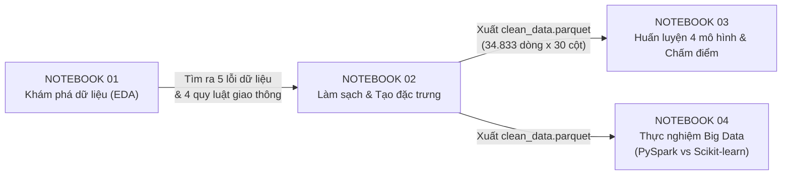
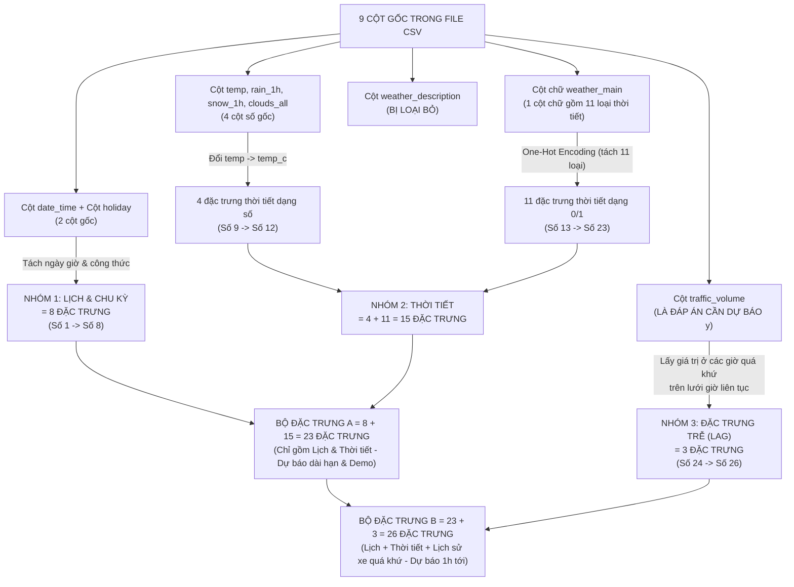

# Cẩm Nang Giải Ngố Toàn Tập: Bản Chất Dự Án Từ A Đến Z
## (Viết Riêng Cho Người Mới Tinh — Có Bảng Chú Thích Toàn Bộ 55 Từ Khóa Từ Con Số 0 Trước Khi Đi Vào Bài Toán)

> **Quy tắc của tài liệu này:**  
> Bạn là người mới bắt đầu (*newbie*), nên chúng ta sẽ **không dùng một thuật ngữ khó hiểu này để giải thích cho một thuật ngữ khó hiểu khác**.  
> **Ngay ở Phần 1 dưới đây là Bảng Chú Thích 55 Từ Khóa** được sắp xếp theo thứ tự từ dễ nhất đến nâng cao (từ đứng trước làm nền cho từ đứng sau), giải thích 100% bằng tiếng Việt đời thường và ví dụ thực tế. Bạn chỉ cần đọc Phần 1 này trước, sau đó đọc xuống các phần dưới sẽ thấy mọi thứ trong cả 4 Notebook sáng tỏ hoàn toàn!

---

## PHẦN 1: BẢNG CHÚ THÍCH TOÀN BỘ TỪ KHÓA CHUYÊN NGÀNH (ĐỌC TRƯỚC TIÊN!)

### Nhóm A: Các từ khóa về Bảng dữ liệu & Thống kê cơ bản (Hiểu từ con số 0)

| STT | Từ khóa trong bài | Giải thích bằng tiếng đời thường (Không dùng thuật ngữ) | Ví dụ ngay trong bài của nhóm |
| :---: | :--- | :--- | :--- |
| **1** | **Bản ghi / Mẫu**<br>*(Row / Record / Sample)* | Là **1 hàng ngang (1 dòng)** trong bảng dữ liệu Excel. Mỗi dòng ghi lại thông tin của một sự việc. | Mỗi dòng trong bảng là thông tin giao thông và thời tiết của **1 giờ đồng hồ** trên đường cao tốc. |
| **2** | **Thuộc tính / Biến**<br>*(Column / Variable)* | Là **1 cột dọc** trong bảng dữ liệu. Mỗi cột đo một thông tin cụ thể. | File gốc có **9 cột** (như cột ngày giờ, cột nhiệt độ, cột lượng mưa, cột số lượng xe...). |
| **3** | **Biến mục tiêu / Đáp án ($y$)**<br>*(Target / Label)* | Là **cột kết quả cuối cùng mà ta muốn máy tính dự đoán ra** (giống như đáp án của một bài toán). | Chính là cột **`traffic_volume`** (tổng số xe ô tô chạy qua đường cao tốc trong 1 giờ). |
| **4** | **Đặc trưng đầu vào ($X$)**<br>*(Feature / Input)* | Là **các cột dữ kiện đề bài** cung cấp manh mối để máy tính nhìn vào đó mà đoán ra đáp án $y$. | Là các cột như: mấy giờ (`hour`), thứ mấy (`day_of_week`), nhiệt độ bao nhiêu (`temp_c`), có mưa không (`rain_1h`)... |
| **5** | **Biến định lượng**<br>*(Numerical Variable)* | Là cột mà giá trị bên trong là **CON SỐ đo đếm được, cộng trừ nhân chia được** (chia làm 2 loại nhỏ: *số thực liên tục* có dấu phẩy như nhiệt độ `15,2°C`, và *số nguyên rời rạc* đếm từng cái như `5.000` chiếc xe). | 5 cột số trong bài là: `temp_c` (nhiệt độ), `rain_1h` (mưa), `snow_1h` (tuyết), `clouds_all` (% mây), `traffic_volume` (số xe). |
| **6** | **Biến phân loại / Biến chữ**<br>*(Categorical Variable)* | Là cột mà giá trị bên trong là **CHỮ dùng để chia nhóm**, không cộng trừ trực tiếp được. | Cột `weather_main` chứa các chữ chỉ loại thời tiết (`"Clear"`, `"Rain"`, `"Snow"`...) và cột `holiday` chứa tên ngày lễ. |
| **7** | **Biến nhị phân `0/1`**<br>*(Binary / Dummy Variable)* | Là cột số chỉ nhận **đúng 2 giá trị: `1` (Có / Đúng) hoặc `0` (Không / Sai)**. Dùng để biến các câu hỏi Có/Không thành con số cho máy tính hiểu. | Cột `is_weekend`: nếu là Thứ Bảy/Chủ Nhật thì ghi số `1`, nếu là ngày thường thì ghi số `0`. |
| **8** | **Giá trị khuyết (`NaN` / `Null`)**<br>*(Missing Value)* | Là **ô bị bỏ trống không có dữ liệu** trong bảng (khi lên Python nó hiện chữ `NaN` — viết tắt của *Not a Number*). | Trong 6 năm, có `11.987` giờ đồng hồ trạm đếm xe bị mất tín hiệu nên không có số đo (bị trống / `NaN`). |
| **9** | **Giá trị ngoại lai**<br>*(Outlier)* | Là một con số **lớn bất thường hoặc nhỏ bất thường, lệch hẳn ra ngoài** so với đám đông. Có 2 nguyên nhân: **(1) Ngoại lai vật lý** (do máy đo bị chập mạch ghi sai số vô lý ngoài đời không thể có); **(2) Đột biến thật** (hiện tượng hiếm nhưng có thật ngoài đời). | **(1) Do hỏng máy đo:** Nhiệt độ `-273,15°C` (10 dòng) và lượng mưa `9.831,3 mm/giờ` (1 dòng) $\rightarrow$ **phải xóa bỏ**. **(2) Đột biến thật:** Giờ cao điểm có tới `7.280` xe/giờ $\rightarrow$ là số xe thật, **cấm xóa**! |
| **10** | **Trung bình cộng (`Mean`)** | Lấy tổng tất cả các số trong cột cộng lại rồi chia cho số dòng. | Lưu lượng xe trung bình (`Mean`) của cả bộ dữ liệu là khoảng `3.291` xe/giờ. |
| **11** | **Trung vị (`Median` / `50%`) & Tứ phân vị (`25%`, `75%`)** | Hãy tưởng tượng xếp tất cả các dòng trong bảng theo thứ tự từ **ít xe nhất (0%) đến đông xe nhất (100%)**:<br>• Con số đứng ở vị trí **1/4 đầu hàng (25%)** gọi là *Phân vị 25%*;<br>• Con số đứng **chính giữa hàng (50%)** gọi là **Trung vị (`Median`)**;<br>• Con số đứng ở vị trí **3/4 hàng (75%)** gọi là *Phân vị 75%* (tức chỉ có 25% số giờ trong năm đông xe hơn mức này). | Trong bảng thống kê `describe()`: `traffic_volume` có mốc `25% = 1.250 xe`, `50% (Trung vị) = 3.429 xe`, và mốc `75% = 4.952 xe` (ở Note 3 lấy mốc 75% của tập học là `4.926 xe` làm ngưỡng báo động "Đường đang rất đông"). |
| **12** | **`IQR` (Khoảng tứ phân vị) & `Z-score`** | Là hai công thức toán thống kê hay dùng để tự động cắt bỏ các con số nằm ở hai đầu quá cao hoặc quá thấp của một cột số. | Nhóm bạn **không dùng IQR hay Z-score để cắt cột `traffic_volume`** vì làm thế sẽ cắt mất luôn các giờ cao điểm đông xe và các giờ đêm khuya vắng xe! |
| **13** | **Độ lệch chuẩn (`Std`)**<br>*(Standard Deviation)* | Con số đo xem các giá trị trong cột **"nhảy múa" xa khỏi số trung bình nhiều hay ít**.<br>• `Std` nhỏ = dữ liệu rất đều nhau, ít biến động.<br>• `Std` lớn = dữ liệu lúc cực thấp, lúc cực cao. | Trước khi xóa dòng mưa lỗi `9.831,3 mm`, độ lệch chuẩn `Std` của cột mưa vọt lên tới **`48,81 mm`**. Sau khi xóa đúng 1 dòng lỗi đó, `Std` giảm về chỉ còn **`0,77 mm`**! |
| **14** | **Phân phối (`Distribution`) & Phân phối 2 đỉnh (`Bimodal`)** | Là biểu đồ vẽ xem các con số tập trung đông ở khoảng nào và thưa ở khoảng nào. Nếu biểu đồ nhô cao lên ở **2 chỗ khác nhau** (giống lưng lạc đà 2 bướu) thì gọi là **Phân phối 2 đỉnh (`Bimodal`)**. | Biểu đồ số lượng xe ở Note 1 có **2 đỉnh nhô cao**: 1 đỉnh ở khoảng `300 – 800 xe/giờ` (đại diện cho các giờ ban đêm) và 1 đỉnh ở khoảng `4.500 – 5.500 xe/giờ` (đại diện cho các giờ ban ngày). |
| **15** | **Hệ số tương quan (`Correlation` / `Pearson r`)** | Một con số nằm từ **`-1,0` đến `+1,0`** dùng để đo xem **2 cột số có "đi cùng nhịp" với nhau không**:<br>• **Gần `+1,0` (Tương quan dương):** Cột A tăng thì cột B cũng tăng theo.<br>• **Gần `-1,0` (Tương quan âm):** Cột A tăng thì cột B lại giảm.<br>• **Gần `0`:** Hai cột không có quan hệ tỉ lệ thẳng với nhau. | Giữa số xe giờ trước (`lag_1h`) và số xe giờ này (`traffic_volume`) có hệ số tương quan **`r = +0,91`** (cực mạnh: giờ trước đông thì giờ này cũng đông!). |
| **16** | **Đa cộng tuyến**<br>*(Multicollinearity)* | Hiện tượng trong bảng có **2 hay nhiều cột đầu vào mang thông tin trùng lặp nhau** (ví dụ vừa có cột "Tuổi", vừa có cột "Năm sinh"). Khi đưa cả hai vào một phương trình cộng trừ, máy tính sẽ bị rối, làm các hệ số nhân phình to bất thường (gọi là *nổ hệ số*). | Cột `weather_description` (mô tả mưa nhỏ, mưa vừa) trùng ý với cột `weather_main` (mưa) nên nếu giữ cả hai sẽ gây **đa cộng tuyến** $\rightarrow$ vì vậy phải bỏ `weather_description`. |

---

### Nhóm B: Các từ khóa về Làm sạch & Chế biến dữ liệu (Ở Note 1 & Note 2)

| STT | Từ khóa trong bài | Giải thích bằng tiếng đời thường | Ví dụ ngay trong bài của nhóm |
| :---: | :--- | :--- | :--- |
| **17** | **`EDA`**<br>*(Exploratory Data Analysis)* | **Phân tích khám phá dữ liệu:** Bước mở dữ liệu thô ra đếm số dòng, kiểm tra lỗi và vẽ biểu đồ để tìm hiểu tính chất của dữ liệu *trước khi* bắt tay vào sửa chữa hay dạy máy học. | Toàn bộ **Notebook 01** chính là làm `EDA`. |
| **18** | **Chuỗi thời gian**<br>*(Time Series)* | Dữ liệu được đo nối tiếp nhau theo từng nấc đồng hồ (giờ này qua giờ khác). Với chuỗi thời gian, **thứ tự thời gian trước – sau là tuyệt đối**, không được xáo trộn dòng. | Dữ liệu đếm xe mỗi giờ 1 lần suốt 6 năm từ 2012 đến 2018. |
| **19** | **`Reindex` (Trải lên lưới giờ liên tục)** | Dữ liệu gốc bị mất điện thiếu mất `11.987` giờ (ví dụ có dòng 10h sáng rồi nhảy vọt sang 15h chiều). `Reindex` là thao tác **tạo một khung lịch đủ 100% các giờ nối tiếp nhau (10h, 11h, 12h, 13h, 14h, 15h)** rồi áp dữ liệu vào; những giờ bị mất điện (`11h–14h`) sẽ hiện ra thành các dòng trống (`NaN`). | Nhờ `reindex` lên khung `52.551` giờ liên tục ở Ô 5 của Note 2, khi ta đếm lùi 1 dòng hoặc 24 dòng sẽ không bao giờ bị nhảy cóc qua các khoảng mất điện! |
| **20** | **Nội suy**<br>*(Interpolation / Imputation)* | Là việc dùng toán học **tự đoán/bịa ra một con số giả để điền lấp vào các ô bị trống (`NaN`)** (ví dụ lấy trung bình cộng của giờ trước và giờ sau điền vào giữa). | Vì trạm đo có những lúc mất điện liền cả tuần/cả tháng, nếu **nội suy** sẽ sinh ra hàng nghìn dòng số xe giả tạo $\rightarrow$ nhóm **không nội suy** mà xóa các dòng thiếu sau khi tính xong biến trễ. |
| **21** | **Tạo đặc trưng**<br>*(Feature Engineering)* | **Chế biến nguyên liệu:** Từ các cột thô ban đầu (như chuỗi ngày giờ hay chữ thời tiết), ta tách, ghép và tính toán ra các **cột số mới thông minh hơn** để máy tính học dễ hơn và đoán trúng hơn. | Từ 7 cột gốc còn lại, ở Note 2 bạn chế biến ra **23 đặc trưng (Bộ A)** và **26 đặc trưng (Bộ B)**. |
| **22** | **`One-Hot Encoding`**<br>*(Mã hóa 0/1 bằng `pd.get_dummies`)* | Cách biến **1 cột CHỮ phân loại (không có thứ tự lớn bé)** thành **nhiều cột SỐ `0/1`**. Có bao nhiêu loại chữ khác nhau thì tách ra bấy nhiêu cột riêng biệt; dòng nào thuộc loại chữ nào thì cột đó ghi `1`, các cột còn lại ghi `0`. | Cột chữ `weather_main` có **11 kiểu thời tiết** $\rightarrow$ tách thành **11 cột số `0/1`** (`wm_Clear`, `wm_Clouds`, `wm_Rain`...). |
| **23** | **`Label Encoding`**<br>*(Mã hóa gán số thứ tự 1, 2, 3...)* | Cách biến chữ thành số bằng cách đánh số đếm trực tiếp lên cùng 1 cột: `Clear = 1, Clouds = 2, Rain = 3, Snow = 4...` | Nhóm **KHÔNG DÙNG cách này** cho thời tiết vì máy tính sẽ hiểu nhầm vô lý rằng `"Tuyết (4) gấp đôi Mây (2)"`! |
| **24** | **Mã hóa chu kỳ vòng tròn**<br>*(Cyclical Encoding: `sin` & `cos`)* | Giờ trong ngày chạy từ `0h` đến `23h` rồi quay vòng lại `0h`. Để máy tính không tưởng `23h` đêm và `0h` sáng cách xa nhau 23 đơn vị, ta dùng công thức lượng giác `sin` và `cos` để **cuộn dãy số `0..23` thành một vòng tròn đồng hồ** sao cho `23h` nằm sát ngay cạnh `0h`. | Chính là 2 đặc trưng `hour_sin` và `hour_cos` ở Note 2. |
| **25** | **Đặc trưng tương tác**<br>*(Interaction Feature)* | Cột mới được tạo ra bằng cách **kết hợp điều kiện của 2 hay nhiều cột lại với nhau** (vì từng cột đứng riêng thì chưa nói hết ý nghĩa). | Cột `is_rush_hour` (giờ cao điểm) chỉ bằng `1` khi kết hợp đồng thời: **Đúng giờ đi làm/tan tầm (7–9h hoặc 16–18h) VÀ Không phải cuối tuần VÀ Không phải ngày lễ**. |
| **26** | **Đặc trưng trễ / Biến trễ**<br>*(Lag Feature — hàm `.shift(k)`)* | Cột mới chứa **giá trị của quá khứ lùi lại $k$ tiếng đồng hồ trước đó**. Trong Python, hàm `.shift(1)` nghĩa là kéo cột dữ liệu xuống 1 dòng để lấy giá trị của 1 giờ trước; `.shift(24)` là lấy giá trị của 24 giờ trước. | `lag_1h` (số xe của 1 tiếng trước) và `lag_24h` (số xe của 24 tiếng trước — tức cùng giờ này ngày hôm qua). |
| **27** | **Trung bình trượt**<br>*(Rolling Mean — hàm `.rolling(3).mean()`)* | Cột mới chứa **trung bình cộng của 3 giờ liên tiếp ngay trước giờ cần dự báo**, trượt dần theo từng giờ để đo xu hướng gần nhất. | `roll_3h`: Khi đứng ở 16h, nó lấy trung bình cộng số xe của **13h, 14h và 15h**. |
| **28** | **Chuẩn hóa thang đo**<br>*(StandardScaler)* | Đưa tất cả các cột số vốn có độ lớn rất lệch nhau (như cột `lag_1h` lên tới `5.000` xe, trong khi cột `is_holiday` chỉ là `0` hoặc `1`) **co giãn về cùng một thang đo chung** (có trung bình bằng `0` và độ lệch chuẩn bằng `1`). | Dùng cho mô hình cộng trừ phương trình **`Ridge Regression`** ở Note 3 để các cột lớn không đè bẹp các cột nhỏ. |
| **29** | **File `.csv`, `.parquet`, `.json`** | • **`.csv`:** File bảng dạng văn bản thô (nặng, đọc chậm, không lưu được kiểu ngày giờ nên đọc lại dễ bị lỗi `NaN`).<br>• **`.parquet`:** Định dạng file bảng nén theo cột hiện đại trong Big Data (nhẹ hơn CSV gấp 5–10 lần, đọc cực nhanh, giữ nguyên 100% kiểu dữ liệu).<br>• **`.json`:** File văn bản nhỏ dùng để lưu cấu hình/danh sách tên cột. | Note 1 & 2 đọc dữ liệu thô từ `.csv`, sau đó Note 2 xuất bảng sạch ra `clean_data.parquet` và danh sách tên cột Bộ A/B ra `clean_data.json`. |

---

### Nhóm C: Các từ khóa về Học máy, Chia dữ liệu & Thuật toán (Ở Note 3)

| STT | Từ khóa trong bài | Giải thích bằng tiếng đời thường | Ví dụ ngay trong bài của nhóm |
| :---: | :--- | :--- | :--- |
| **30** | **Bài toán Hồi quy (`Regression`) vs Phân loại (`Classification`)** | • **Hồi quy (`Regression`):** Dạy máy đoán ra **một CON SỐ** (như đoán có bao nhiêu chiếc xe).<br>• **Phân loại (`Classification`):** Dạy máy đoán ra **một NHÃN / NHÓM** (như đoán Đúng/Sai, Có kẹt xe/Không kẹt xe). | Đề tài của nhóm là bài toán **Hồi quy** (đoán số lượng xe). Ở Note 3 có làm thêm bước phụ là quy đổi số xe `>= 4.926` thành bài toán **Phân loại cảnh báo đông xe**. |
| **31** | **Mô hình (`Model`) & Huấn luyện (`Fit / Train`) & Dự báo (`Predict`)** | • **Mô hình (`Model`):** Là "bộ não công thức" của máy tính.<br>• **Huấn luyện (`.fit(X, y)`):** Quá trình cho máy đọc dữ liệu cũ kèm đáp án để tự tìm quy luật.<br>• **Dự báo (`.predict(X_moi)`):** Sau khi học xong, đưa câu hỏi mới (không kèm đáp án) để máy tự đoán kết quả. | Trong Note 3: `xgb_model.fit(X_train, y_train)` là cho máy học; `xgb_model.predict(X_test)` là bắt máy làm bài thi. |
| **32** | **Tập Huấn luyện (`Train Set`) & Tập Kiểm tra (`Test Set`)** | • **Tập `Train`:** Phần dữ liệu quá khứ dùng làm **"Sách bài tập ôn ở nhà"** (máy được nhìn cả câu hỏi lẫn đáp án để học).<br>• **Tập `Test`:** Phần dữ liệu mới được cất riêng làm **"Đề thi thật cuối kỳ"** (máy chưa từng nhìn thấy lúc học, chỉ dùng để chấm điểm cuối cùng). | Từ `34.833` dòng sạch: cắt các năm **2012–2017 (`28.353` dòng = 81,4%) làm Tập `Train`**; giữ riêng **năm 2018 (`6.480` dòng = 18,6%) làm Tập `Test`**. |
| **33** | **Quá khớp / Học vẹt (`Overfitting`) vs Dưới khớp (`Underfitting`)** | • **`Overfitting` (Học vẹt):** Máy nhớ thuộc lòng từng dòng dữ liệu lúc ôn ở nhà (`Train`) nên điểm ở nhà cao tuyệt đối, nhưng khi đi thi gặp đề mới (`Test`) thì đoán sai bét.<br>• **`Underfitting` (Chưa thuộc bài):** Mô hình quá ngây ngô, không học nổi quy luật nên đoán sai nhiều cả lúc ôn ở nhà lẫn lúc đi thi. | Giống học sinh học vẹt đáp án đề cương (`Overfitting`) so với học sinh không chịu học bài (`Underfitting`). |
| **34** | **Rò rỉ dữ liệu**<br>*(Data Leakage)* | **Lỗi "gian lận / lộ đề thi":** Khi người lập trình vô tình để lọt thông tin của đáp án hoặc thông tin của tương lai vào trong dữ kiện học của quá khứ. Khiến mô hình lúc chấm điểm ở nhà thì cao ảo, nhưng đem ra thực tế chạy thì hỏng hoàn toàn. | Ví dụ: Nếu lấy dữ liệu năm 2017 đi học để quay lại đoán năm 2014, hoặc khi tính trung bình 3 giờ trước (`roll_3h`) mà lỡ gộp luôn cả số xe của giờ hiện tại cần đoán vào! |
| **35** | **Tham số (`Parameters`) vs Siêu tham số (`Hyperparameters`)** | • **Tham số:** Các hệ số bên trong mà máy tính *tự tìm ra* trong lúc học.<br>• **Siêu tham số:** Các **"nút vặn cài đặt từ bên ngoài"** mà con người phải chọn trước cho máy (ví dụ: quy định cho máy trồng bao nhiêu cây quyết định, mỗi cây sâu tối đa mấy tầng). | Ở Note 3, bạn của bạn thử nghiệm **72 bộ siêu tham số** khác nhau của XGBoost (như số cây `n_estimators = 100, 200, 300`; độ sâu `max_depth = 4, 6, 8`...). |
| **36** | **Kiểm định chéo (`Cross-Validation` / `CV`) & `Fold` (Vòng thi thử)** | Để biết bộ "nút vặn siêu tham số" nào tốt nhất mà **không được phép lấy đề thi thật cuối kỳ (`Test`) ra thử**, người ta chia ngay phần dữ liệu ôn tập (`Train`) thành nhiều khúc để tổ chức **nhiều vòng tự ôn – tự thi thử (mỗi vòng gọi là 1 `Fold`)**, rồi lấy điểm trung bình của các vòng thi thử đó. | Thay vì thi thử 1 lần dễ ăn may, thi thử qua **5 vòng (`5 Folds`)** rồi lấy điểm trung bình sẽ chọn được cấu hình thực lực mạnh nhất. |
| **37** | **`TimeSeriesSplit`**<br>*(Chia vòng thi thử nối tiếp theo thời gian)* | Cách chia 5 vòng thi thử (`5 Folds`) dành riêng cho **Chuỗi thời gian**: Luôn lấy các khúc **Quá khứ đứng trước để học** và lấy khúc **Tương lai ngay liền sau nó để thi thử**, mở rộng dần từ 2012 đến 2017. Tuyệt đối không bao giờ lấy năm sau đi học để thi thử năm trước (khác với `K-Fold` thông thường chia đảo lộn thứ tự). | Được dùng ở Note 3 để chấm điểm 72 cấu hình XGBoost qua 5 vòng thi thử bên trong Tập Train (2012–2017). |
| **38** | **Quan hệ Tuyến tính (`Linear`) vs Phi tuyến (`Non-linear`)** | • **Tuyến tính (`Linear`):** Quan hệ đường thẳng đơn giản kiểu $y = a \cdot x + b$ (cứ $x$ tăng 1 phần thì $y$ luôn tăng cố định bấy nhiêu phần).<br>• **Phi tuyến (`Non-linear`):** Quan hệ đường cong uốn lượn hoặc rẽ nhánh theo nhiều điều kiện phức tạp. | Giao thông là **Phi tuyến**: từ 4h sáng đến 8h sáng thì số giờ tăng làm xe tăng vọt, nhưng từ 17h chiều đến 23h đêm thì số giờ tăng lại làm xe giảm mạnh! |
| **39** | **Mô hình mốc sàn (`Baseline` — `Seasonal Naive`)** | Là một cách dự đoán **đơn giản, thô sơ nhất không cần AI** được dựng lên làm **"vạch xuất phát"** để đo xem các thuật toán AI phức tạp vượt qua nó được bao xa. `Seasonal Naive` nghĩa là đoán theo chu kỳ một cách ngây thơ: *"Lượng xe giờ này hôm nay bằng đúng lượng xe cùng giờ này ngày hôm qua (`lag_24h`)"*. | Nếu mô hình AI bạn viết ra mà đoán còn thua cả cách lấy nguyên số xe của 24 tiếng trước thì mô hình AI đó thất bại! |
| **40** | **`Ridge Regression` & Điều chuẩn `L2` (`alpha`)** | Là mô hình **Hồi quy tuyến tính** (tìm một phương trình cộng trừ nhân chia bậc nhất giữa 26 cột đặc trưng để tính ra số xe), nhưng được gắn thêm một **"bộ phanh kìm hãm" gọi là điều chuẩn `L2` (với lực phanh `alpha`)**: nó ép các hệ số nhân trong phương trình không được phình quá to, giúp phương trình ổn định khi các cột có thông tin trùng nhau (*đa cộng tuyến*) và tránh học vẹt. | Là mô hình cấp độ 2 trong Note 3 (`Ridge(alpha=10.0)`). |
| **41** | **Cây quyết định**<br>*(Decision Tree)* | Một sơ đồ hỏi đáp hình cái cây gồm các câu hỏi rẽ nhánh **"Nếu... Thì..."** (ví dụ: *Nếu `lag_1h >= 4000` VÀ `is_rush_hour == 1` thì đoán `5.800` xe*). Số tầng câu hỏi từ đỉnh xuống đáy gọi là độ sâu của cây (`max_depth`). | Là viên gạch cơ bản tạo nên cả `Random Forest` lẫn `XGBoost`. |
| **42** | **Học kết hợp (`Ensemble`): `Bagging` (`Random Forest`) vs `Boosting` (`XGBoost`)** | Kết hợp hàng trăm Cây quyết định lại với nhau theo 2 cách:<br>• **`Bagging` (`Random Forest` — Rừng ngẫu nhiên):** Trồng **50–100 cây làm việc độc lập, song song cùng lúc** (mỗi cây nhìn một phần dữ liệu ngẫu nhiên), sau đó lấy **trung bình cộng phiếu bầu** của tất cả các cây.<br>• **`Boosting` (`XGBoost` — Cây tăng cường):** Xếp **100–200 cây nối tiếp nhau thành hàng dọc**: Cây 1 đoán xong bị sai lệch bao nhiêu xe, Cây 2 nhảy vào chuyên học để **đoán bù phần sai lệch đó**, Cây 3 lại sửa tiếp phần sai còn sót lại của Cây 1+2... | Nhờ cơ chế "người sau sửa đúng chỗ sai của người trước" (`Boosting`), **`XGBoost`** đạt độ chính xác cao nhất trong cả dự án, vượt qua cả `Random Forest` (`Bagging`)! |

---

### Nhóm D: Các từ khóa về Thước đo chấm điểm mô hình (Ở Note 3)

| STT | Từ khóa trong bài | Giải thích bằng tiếng đời thường | Con số thực tế của XGBoost trong bài |
| :---: | :--- | :--- | :--- |
| **43** | **`MAE`**<br>*(Mean Absolute Error — Sai số tuyệt đối trung bình)* | Lấy độ lệch giữa *(Số xe thực tế − Số xe máy đoán)* ở từng giờ (bỏ dấu âm), rồi cộng trung bình lại. Nghĩa là: **"Trung bình mỗi giờ, máy tính đoán lệch bao nhiêu chiếc xe?"** *(Càng nhỏ càng giỏi)*. | `MAE = 143,49 xe` (tối ưu xong còn **`138,83 xe`**) — trong khi đoán mò Baseline lệch tới `568,37 xe`! |
| **44** | **`RMSE`**<br>*(Root Mean Squared Error — Căn bậc hai sai số bình phương trung bình)* | Trước khi tính trung bình, nó **bình phương (nhân đôi chính nó) độ lệch của từng giờ lên**, rồi cuối cùng mới lấy căn bậc hai. Vì bình phương lên (lệch 10 bình phương là 100, nhưng lệch 1.000 bình phương là 1.000.000!), chỉ số này dùng để **phạt cực nặng những mô hình thỉnh thoảng có những cú đoán sai quá lố** *(Càng nhỏ càng giỏi)*. | `RMSE = 221,75 xe` (tối ưu xong còn **`217,64 xe`**) — thấp hơn gần 5 lần so với Baseline (`1.032,94 xe`). |
| **45** | **`MAPE (%)`**<br>*(Mean Absolute Percentage Error — Sai số phần trăm trung bình)* | Lấy độ lệch chia cho số xe thực tế rồi nhân 100%. Nghĩa là: **"Trung bình máy đoán lệch bao nhiêu phần trăm (`%`) so với thực tế?"** *(Càng nhỏ càng giỏi)*. | `MAPE = 5,84%` (tối ưu xong chỉ còn lệch **`5,60%`**). |
| **46** | **`R²` (`R-squared`)**<br>*(Hệ số xác định)* | Thang điểm chuẩn từ **`0` đến `1,0` (tức `0%` đến `100%`)** đo xem: **"Mô hình đã hiểu và giải thích được bao nhiêu phần trăm quy luật biến động của thực tế?"**. Đạt `1,0` là đoán trúng phóc 100% mọi giờ; bằng `0` là đoán tệ ngang với việc lúc nào cũng phán bừa một con số trung bình cộng! *(Càng gần `1,0` càng giỏi)*. | `R² = 0,9873` (tối ưu xong đạt **`0,9878`**, tức nắm bắt được **98,78%** quy luật giao thông!). |
| **47** | **`Precision`, `Recall`, `F1`**<br>*(Bộ chỉ số chấm điểm Cảnh báo đông xe $\ge 4.926$ xe/giờ)* | Khi dùng mô hình để bật đèn báo động "Đường đang đông xe (`>= 4.926` xe/giờ)":<br>• **`Precision` (Độ chuẩn khi báo):** Trong 100 lần máy hú còi báo động, có bao nhiêu % lần là đường đông thật (không báo giả)?<br>• **`Recall` (Độ nhạy / Không bỏ sót):** Trong 100 lần đường ngoài đời thực sự đông, máy bắt trúng được bao nhiêu % lần?<br>• **`F1`:** Điểm trung bình cân bằng cả `Precision` và `Recall` (tối đa `1,0`). | XGBoost đạt `Precision = 92,94%`, `Recall = 93,27%`, và điểm tổng hợp **`F1 = 0,9310`** (tối ưu xong `F1 = 0,9334`). |

---

### Nhóm E: Các từ khóa về Dữ liệu lớn (Big Data) & PySpark (Ở Note 4)

| STT | Từ khóa trong bài | Giải thích bằng tiếng đời thường | Ý nghĩa trong cuộc đua ở Note 4 |
| :---: | :--- | :--- | :--- |
| **48** | **Xử lý đơn máy (`Single-node` — `pandas / scikit-learn`)** | Toàn bộ dữ liệu và việc tính toán chỉ nằm gọn trên **1 chiếc máy tính duy nhất**, và bắt buộc toàn bộ bảng dữ liệu phải nhét vừa vào bộ nhớ **RAM** của chiếc máy đó. | Nhanh gọn như **chiếc xe máy** khi dữ liệu còn nhỏ và vừa RAM, nhưng nếu dữ liệu phình to vượt quá RAM của 1 máy thì sẽ bị sập (*tràn bộ nhớ*). |
| **49** | **Xử lý phân tán (`Distributed Computing` — `Apache Spark / PySpark MLlib`)** | Công nghệ Big Data cho phép **kết nối hàng chục/hàng trăm máy tính lại thành một cụm (`Cluster`)**, cắt bảng dữ liệu khổng lồ thành hàng trăm mảnh nhỏ để các máy cùng tính toán song song. `PySpark` là thư viện dùng ngôn ngữ Python để điều khiển `Apache Spark`, còn `MLlib` là bộ thuật toán Học máy của Spark. | Giống như **đoàn xe tải container 18 bánh**: sinh ra để chở hàng trăm GB / hàng TB dữ liệu trên nhiều máy chủ. |
| **50** | **`local[*]` (Chế độ giả lập cụm của Spark trên 1 máy)** | Khi sinh viên làm thí nghiệm trên 1 chiếc laptop cá nhân (chưa thuê cụm 10 máy chủ), cài đặt `master("local[*]")` bảo Spark rằng: *"Hãy huy động **tất cả các luồng CPU có trên chiếc laptop này** (dấu `*` = toàn bộ 12 luồng CPU của máy) đóng giả làm các máy con để chạy song song!"*. | Giúp nhóm thực nghiệm cơ chế chia việc song song của Spark ngay trên 1 máy tính cá nhân. |
| **51** | **`JVM` (`Java Virtual Machine` — Máy ảo Java)** | Phần lõi tính toán của Apache Spark được viết bằng ngôn ngữ Java/Scala nên chạy trong một chương trình tên là `java` (**JVM**). Khi bạn chạy code Python (`PySpark`), Python chỉ là "người chỉ huy ra lệnh", còn người thực sự ôm dữ liệu vào RAM để tính toán là tiến trình **Java (`JVM`)**! | Vì vậy ở Note 4: khi đo tốn bao nhiêu RAM của `pandas/sklearn` thì đo chương trình **Python**, còn khi đo RAM của `PySpark` thì phải đo chương trình con **Java (`JVM`)**! |
| **52** | **`Partition` (Phân vùng dữ liệu)** | Khi đọc một file dữ liệu vào Spark, Spark tự động **cắt bảng dữ liệu thành nhiều khúc nhỏ (gọi là các `Partition`)** — ví dụ cắt thành 12 khúc để giao cho 12 luồng CPU xử lý cùng lúc. | Ở Note 4 có thông số `defaultParallelism: 12` và `so_partition` chính là số khúc dữ liệu mà Spark chia ra. |
| **53** | **`VectorAssembler` (Bộ gom cột của Spark)** | Trong `scikit-learn`, bạn đưa thẳng bảng gồm 9 cột đặc trưng vào là máy học được ngay. Nhưng quy định của `Spark MLlib` bắt buộc phải dùng `VectorAssembler` để **gom 9 cột đặc trưng rời rạc đó thành 1 cột danh sách duy nhất tên là `"features"`** trước khi cho vào `RandomForest`. | Chính là công việc của giai đoạn **(2) Prep (Chuẩn bị dữ liệu)** trong hàm `chay_spark` ở Note 4. |
| **54** | **`DAG` & `Lazy Evaluation` (Tính toán lười) & `.cache()` + `.count()`** | Spark có cơ chế **"Tính toán lười" (`Lazy Evaluation`)**: khi bạn gõ lệnh bảo Spark đọc file (`spark.read.parquet`) hay gom cột (`assembler.transform`), Spark **chưa hề làm thật ngay** mà mới chỉ vẽ sơ đồ kế hoạch ra giấy nháp (sơ đồ đó gọi là **`DAG`**). Chỉ khi nào gặp một lệnh bắt trả về kết quả cuối cùng (như lệnh **`.count()`** bắt đếm tổng số dòng, hoặc **`.fit()`** bắt huấn luyện), Spark mới thực sự chạy!<br>Còn **`.cache()`** là lệnh bảo Spark: *"Làm xong bước này thì ghim bảng vào RAM nhé để bước sau dùng luôn không phải đọc lại từ ổ cứng!"*. | Giải thích tại sao ở Note 4, ngay sau dòng `spark.read.parquet().cache()` và dòng `assembler.transform().cache()`, bạn làm Note 4 đều phải gọi **`.count()`** $\rightarrow$ mục đích là **ép Spark phải thực thi thật ngay lập tức** để đồng hồ bấm giờ đo đúng thời gian của riêng bước `Load` và bước `Prep`! |
| **55** | **`Overhead` (Chi phí thủ tục cố định) vs `Scalability` (Khả năng mở rộng) & `Disk Spill` (Tràn đĩa)** | • **`Overhead`:** Thời gian và RAM tốn cho các "thủ tục hành chính" của Spark (lập bản đồ DAG, chia việc cho các luồng, chuyển dữ liệu qua lại giữa Python và Java JVM...).<br>• **`Scalability`:** Khả năng chịu tải khi dữ liệu phình to gấp hàng chục, hàng trăm lần.<br>• **`Disk Spill`:** Khi dữ liệu quá lớn làm đầy RAM, Spark tự động cất bớt dữ liệu tạm xuống ổ cứng để chạy tiếp chứ không bị sập chương trình như `pandas`! | Trên 1 máy với dữ liệu nhỏ/vừa (`x1` đến `x60`), Spark chạy **chậm hơn** `pandas/sklearn` vì gánh nặng thủ tục **`Overhead`**; nhưng khi dữ liệu tăng 60 lần, thời gian của Spark tăng chậm hơn rất nhiều (**`Scalability`** tốt hơn) và xử lý được dữ liệu vượt quá RAM nhờ **`Disk Spill`** và nối nhiều máy chủ! |

---

## PHẦN 2: BỨC TRANH LỚN — THỰC SỰ NHÓM MÌNH ĐANG LÀM CÁI GÌ VÀ ĐỂ LÀM GÌ?

*(Bây giờ bạn đã biết hết các từ khóa ở Phần 1 rồi, hãy ghép chúng lại thành câu chuyện hoàn chỉnh của cả nhóm!)*

### 2.1. Bài toán thực tế ngoài đời là gì?
Trên tuyến đường cao tốc liên bang **I-94** ở bang Minnesota (Mỹ), Sở Giao thông đặt một trạm cảm biến đếm xem **mỗi giờ có bao nhiêu chiếc xe ô tô chạy qua** (**biến mục tiêu / đáp án $y$**: `traffic_volume`), đồng thời ghi lại **thời gian** và **thời tiết** của giờ đó suốt 6 năm (2012–2018).

**Mục đích cuối cùng của dự án:** Xây dựng một **mô hình Học máy (Machine Learning)** học từ dữ liệu 6 năm qua để giải **bài toán Hồi quy (Regression — đoán một con số)**:
> *"Vào một giờ sắp tới trong tương lai, với thời tiết và ngày giờ như thế này, sẽ có khoảng bao nhiêu chiếc xe đi qua cao tốc?"*

Trong thực tế điều hành giao thông, Sở Giao thông có **2 kịch bản sử dụng khác nhau** (đây chính là lý do nhóm bạn tạo ra **Bộ đặc trưng A** và **Bộ đặc trưng B** ở Note 2):
1. **Kịch bản 1 — Lập kế hoạch dài hạn trước nhiều ngày/tuần (Dùng Bộ đặc trưng A = 23 cột đầu vào):**
   * Khi dự báo cho một giờ của tuần sau (hoặc khi người dùng nhập thử trên phần mềm **Demo**), ta **chỉ biết trước Lịch (giờ, thứ, tháng, có lễ không) và Dự báo thời tiết**, chứ chưa thể có số đo xe của 1 tiếng ngay trước giờ đó.
   * $\rightarrow$ Dùng **Bộ A (23 đặc trưng: gồm 8 cột Lịch + 15 cột Thời tiết)**.
2. **Kịch bản 2 — Cảnh báo ùn tắc thời gian thực trước 1 giờ trên đường cao tốc (Dùng Bộ đặc trưng B = 26 cột đầu vào):**
   * Khi hệ thống gắn trực tiếp với trạm cảm biến đếm xe liên tục trên đường: đang ở `07:00` sáng muốn đoán ngay `08:00` sáng, ta biết thêm **số xe vừa đo được lúc 7h sáng (`lag_1h`), số xe lúc 8h sáng hôm qua (`lag_24h`) và trung bình số xe của 3 tiếng vừa qua (`roll_3h`)**.
   * $\rightarrow$ Dùng **Bộ B (26 đặc trưng = 23 cột Bộ A + 3 cột đặc trưng trễ quá khứ)**.

### 2.2. Tại sao nhóm lại chia thành 4 Notebook? (Sự kết nối giữa 4 thành viên)



1. **[note_01.ipynb](file:///d:/big%20data/btl_nhóm_3/code/note_01.ipynb) (Khâu 1 — Khám phá dữ liệu `EDA`):** Mở file gốc (`48.204` dòng × `9` cột) ra kiểm tra xem dữ liệu bị hỏng/bẩn ở đâu và vẽ 4 biểu đồ để phát hiện quy luật giao thông (như ngày thường có 2 khung giờ cao điểm đi làm 7–9h và tan tầm 16–18h, trong khi cuối tuần và ngày lễ thì vắng).
2. **[note_02.ipynb](file:///d:/big%20data/btl_nhóm_3/code/note_02.ipynb) (Khâu 2 — Làm sạch & Tạo đặc trưng — Phần của bạn):** Dựa trên phát hiện của Note 1, thực hiện **6 bước làm sạch** (xử lý ngày lễ, xóa trùng giờ, đổi Kelvin sang độ C, xóa 11 dòng ngoại lai hỏng cảm biến, trải lên lưới giờ liên tục `reindex` rồi tính biến trễ và bỏ dòng khuyết) $\rightarrow$ thu được **`34.833` dòng sạch**. Đồng thời chế biến ra **Bộ A (23 đặc trưng)** và **Bộ B (26 đặc trưng)**, xuất ra file [clean_data.parquet](file:///d:/big%20data/btl_nhóm_3/data/processed/clean_data.parquet) (`34.833 dòng × 30 cột`) và [clean_data.json](file:///d:/big%20data/btl_nhóm_3/data/processed/clean_data.json).
3. **[note_03.ipynb](file:///d:/big%20data/btl_nhóm_3/code/note_03.ipynb) (Khâu 3 — Mô hình hóa & Đánh giá):** Lấy file sạch từ Note 2, cắt Tập `Train` (`< 2018-01-01`) và Tập `Test` (`>= 2018-01-01`), dùng `TimeSeriesSplit (5 vòng thi thử)` bên trong tập Train để tinh chỉnh siêu tham số, cho **4 mô hình** (*Baseline Seasonal Naive, Ridge Regression, Random Forest, XGBoost*) thi đấu với nhau, chấm điểm (`MAE, RMSE, MAPE, R², Precision, Recall, F1`), phân tích xem mô hình hay sai ở giờ nào/thời tiết nào và lưu lại mô hình vô địch (`XGBoost`).
4. **[note_04.ipynb](file:///d:/big%20data/btl_nhóm_3/code/note_04.ipynb) (Khâu 4 — Thực nghiệm Big Data):** Lấy file sạch từ Note 2 nhân bản lên **x1, x10, x30, x60 (2,09 triệu dòng)**, cho cùng một thuật toán `RandomForest (50 cây, độ sâu 10)` chạy trên cả công cụ đơn máy (`pandas/scikit-learn`) và công cụ phân tán (`PySpark MLlib`) để đo thời gian và bộ nhớ RAM, từ đó rút ra kết luận khi nào nên dùng công cụ đơn máy và khi nào bắt buộc phải dùng Big Data Spark.

---

## PHẦN 3: GIẢI PHẪU TỪNG TÍ MỘT VỀ BỘ DỮ LIỆU — TỪ 9 CỘT GỐC ĐẺ RA 23 ĐẶC TRƯNG (BỘ A), 26 ĐẶC TRƯNG (BỘ B) VÀ 30 CỘT PARQUET NHƯ THẾ NÀO?

### 3.1. Giải phẫu 9 cột trong file CSV gốc (`48.204 dòng × 9 cột`)
Một dòng dữ liệu thật trong file gốc [metro_interstate_traffic_volume.csv](file:///d:/big%20data/btl_nhóm_3/data/raw/metro_interstate_traffic_volume.csv) trông như sau:
> `holiday = "None"`, `temp = 291.15`, `rain_1h = 0.0`, `snow_1h = 0.0`, `clouds_all = 40`, `weather_main = "Clouds"`, `weather_description = "scattered clouds"`, `date_time = "2012-10-03 16:00:00"`, `traffic_volume = 6137`

| STT | Tên cột gốc | Nó là cái gì & Kiểu dữ liệu? | Vấn đề của cột gốc này là gì? | Số phận của cột này ở Note 2 (Đi đâu về đâu?) |
| :---: | :--- | :--- | :--- | :--- |
| **1** | **`traffic_volume`** | **Số lượng xe ô tô** qua trạm trong 1 giờ *(Biến định lượng số nguyên: `0` đến `7.280` xe/giờ)*. | Không có lỗi cảm biến. | 🎯 **Là ĐÁP ÁN CẦN DỰ BÁO ($y$)**. Đồng thời dùng giá trị của nó ở các giờ trước để đẻ ra **3 đặc trưng Trễ** (`lag_1h`, `lag_24h`, `roll_3h`). |
| **2** | **`date_time`** | **Mốc ngày giờ** ghi nhận *(Dạng chuỗi chữ `"YYYY-MM-DD HH:MM:SS"`)*. | Bị trùng mốc giờ `7.629` dòng; mất tín hiệu `11.987` giờ; máy tính không cộng trừ trực tiếp trên chuỗi chữ được. | 🔨 **Tách ra 7 đặc trưng Lịch & Chu kỳ** (`hour`, `day_of_week`, `month`, `is_weekend`, `is_rush_hour`, `hour_sin`, `hour_cos`). |
| **3** | **`holiday`** | **Tên ngày nghỉ lễ** của Mỹ *(Biến phân loại dạng chữ: 11 loại lễ; ngày thường ghi `'None'`)*. | Phần mềm đọc chữ `'None'` thành ô trống `NaN` (`48.143` dòng). Đặc biệt: **chỉ có 61 dòng lúc `00:00:00` nửa đêm được gắn tên lễ**, còn từ `01:00` đến `23:00` cùng ngày lễ đó lại bị ghi là `'None'`! | 🔨 Kết hợp với `date_time` tìm ra **53 ngày lễ**, rồi đẻ ra **1 đặc trưng nhị phân `is_holiday` (`0` hoặc `1`)** đánh dấu cho cả 24 giờ của ngày lễ. |
| **4** | **`temp`** | **Nhiệt độ không khí** đo theo **độ Kelvin (K)** *(Biến định lượng số thực)*. | Đơn vị Kelvin khó đọc; có **10 dòng lỗi cảm biến ghi `0 K`** (`-273,15°C`). | 🔄 Trừ đi `273,15` để biến thành **1 đặc trưng mới `temp_c` (độ C)**, lọc bỏ 10 dòng lỗi `0 K`, rồi **bỏ cột `temp` Kelvin cũ**. |
| **5** | **`rain_1h`** | **Lượng mưa trong 1 giờ** tính bằng `mm` *(Biến định lượng số thực)*. | Có **1 dòng lỗi cảm biến ghi `9.831,3 mm/giờ`** (gần 10 mét nước mưa trong 1 tiếng!). | ✅ Xóa 1 dòng lỗi `9.831,3 mm`, **giữ nguyên làm 1 đặc trưng Thời tiết (`rain_1h`)**. |
| **6** | **`snow_1h`** | **Lượng tuyết rơi trong 1 giờ** tính bằng `mm` *(Biến định lượng số thực: `0` đến `0,51 mm`)*. | Không có lỗi. | ✅ **Giữ nguyên làm 1 đặc trưng Thời tiết (`snow_1h`)**. |
| **7** | **`clouds_all`** | **Độ phủ mây trên bầu trời** tính bằng `%` *(Biến định lượng số nguyên: `0%` đến `100%`)*. | Không có lỗi. | ✅ **Giữ nguyên làm 1 đặc trưng Thời tiết (`clouds_all`)**. |
| **8** | **`weather_main`** | **Nhóm thời tiết chính** *(Biến phân loại dạng chữ, gồm đúng **11 loại** khác nhau: Clear, Clouds, Rain, Snow...)*. | Là **chữ** và không có thứ tự lớn bé — công thức toán học không nhân chia chữ `"Rain"` được! | 🔨 Dùng **One-Hot Encoding** tách 1 cột chữ này thành **11 cột số nhị phân (`0` hoặc `1`)** từ `wm_Clear` đến `wm_Thunderstorm`! |
| **9** | **`weather_description`** | **Mô tả thời tiết chi tiết** *(Biến phân loại dạng chữ, gồm **38 nhãn** nhỏ như light rain, broken clouds...)*. | Chỉ là bản chia vụn của `weather_main`. Nếu giữ lại sẽ gây trùng lặp thông tin (*đa cộng tuyến*) và đẻ thêm 38 cột thưa làm rối mô hình. | ❌ **LOẠI BỎ HOÀN TOÀN** không đưa vào mô hình! |

---

### 3.2. Sơ đồ "Cây Gia Phả": Phép cộng ra đúng 23 đặc trưng (Bộ A) và 26 đặc trưng (Bộ B)



---

### 3.3. Giải thích chi tiết TỪNG ĐẶC TRƯNG MỘT (Từ số 1 đến số 26: Lấy từ đâu? Lấy thế nào? Ý nghĩa là gì?)

#### 🟢 NHÓM 1: NHÓM LỊCH & CHU KỲ (`CALENDAR_FEATURES` — 8 đặc trưng, từ số 1 đến số 8)
| Số | Tên đặc trưng | Lấy từ đâu & Làm thế nào để lấy? | Giá trị nhận được | Tại sao cần tạo ra đặc trưng này? |
| :---: | :--- | :--- | :--- | :--- |
| **1** | **`hour`** | Cắt lấy phần **Giờ** từ cột `date_time` (ví dụ `"2012-10-03 16:00:00"` $\rightarrow$ lấy số `16`). | Số nguyên từ `0` đến `23` | Giờ trong ngày ảnh hưởng mạnh nhất đến lượng xe (ban ngày đông gấp 10 lần ban đêm). |
| **2** | **`day_of_week`** | Dùng lịch của Python đổi phần Ngày trong `date_time` ra **Thứ trong tuần**. | Số nguyên từ `0` (Thứ Hai) đến `6` (Chủ Nhật) | Giúp máy phân biệt ngày đi làm trong tuần với ngày cuối tuần. |
| **3** | **`month`** | Cắt lấy phần **Tháng** từ cột `date_time` (`"2012-10-03"` $\rightarrow$ lấy số `10`). | Số nguyên từ `1` đến `12` | Phản ánh mùa vụ trong năm (mùa hè tháng 6–8 đông xe hơn mùa đông tuyết tháng 1–2). |
| **4** | **`is_weekend`** | Nhìn vào cột `day_of_week` vừa tạo: nếu là `5` (Thứ Bảy) hoặc `6` (Chủ Nhật) thì điền số `1`, còn từ Thứ Hai đến Thứ Sáu thì điền số `0`. | Biến nhị phân `0` hoặc `1` | Cuối tuần không có dòng người đi làm sáng/chiều nên lượng xe thấp hơn hẳn ngày thường. |
| **5** | **`is_holiday`** | Kiểm tra xem phần Ngày của `date_time` có trùng với **53 ngày lễ** đã trích từ cột `holiday` ở đầu Note 2 không: nếu trùng thì điền số `1` cho **toàn bộ 24 giờ** của ngày đó, ngược lại điền `0`. | Biến nhị phân `0` hoặc `1` | Sửa lỗi file gốc chỉ gắn tên lễ lúc 0h đêm; vào ngày lễ người dân nghỉ làm nên đường rất vắng. |
| **6** | **`is_rush_hour`** | **Đặc trưng tương tác (kết hợp 3 điều kiện):** Điền số `1` khi **(`hour` từ `7–9h` sáng hoặc `16–18h` chiều) VÀ (`is_weekend == 0`) VÀ (`is_holiday == 0`)**; các giờ khác điền `0`. | Biến nhị phân `0` hoặc `1` | Báo thẳng cho máy biết *"Đang là giờ cao điểm đi làm/tan tầm của ngày làm việc bình thường!"* (có hệ số tương quan `+0,53` với số xe). |
| **7** | **`hour_sin`** | Thay số `hour` vào công thức lượng giác $\sin(2\pi \times \text{hour} / 24)$. | Số thực từ `-1,0` đến `+1,0` | Cùng với `hour_cos` cuộn dãy số `0..23` thành **một vòng tròn mặt đồng hồ**, giúp máy tính hiểu `23h` đêm và `0h` sáng nằm sát ngay cạnh nhau chứ không phải cách xa 23 đơn vị. |
| **8** | **`hour_cos`** | Thay số `hour` vào công thức lượng giác $\cos(2\pi \times \text{hour} / 24)$. | Số thực từ `-1,0` đến `+1,0` | Đạt `+1` lúc 0h đêm (xe vắng nhất) và `-1` lúc 12h trưa (xe đông), khớp hoàn hảo với nhịp ngày – đêm (tương quan âm `-0,77` với số xe!). |

#### 🔵 NHÓM 2: NHÓM THỜI TIẾT (`WEATHER_FEATURES` — 15 đặc trưng = 4 cột số + 11 cột One-Hot `0/1`, từ số 9 đến số 23)
| Số | Tên đặc trưng | Lấy từ đâu & Làm thế nào để lấy? | Giá trị nhận được | Ý nghĩa tiếng Việt |
| :---: | :--- | :--- | :--- | :--- |
| **9** | **`temp_c`** | Lấy cột `temp` (độ Kelvin) trừ đi `273,15` và đã xóa 10 dòng lỗi `0 K`. | `-29,76` đến `36,92°C` | Nhiệt độ không khí tính bằng độ C. |
| **10** | **`rain_1h`** | Giữ từ cột `rain_1h` gốc sau khi đã xóa 1 dòng lỗi `9.831,3 mm`. | `0,00` đến `55,63 mm` | Lượng mưa rơi trong 1 giờ. |
| **11** | **`snow_1h`** | Giữ nguyên từ cột `snow_1h` gốc. | `0,00` đến `0,51 mm` | Lượng tuyết rơi trong 1 giờ. |
| **12** | **`clouds_all`** | Giữ nguyên từ cột `clouds_all` gốc. | `0` đến `100` (%) | Phần trăm bầu trời có mây che phủ. |
| **13** | **`wm_Clear`** | Tách **One-Hot Encoding** từ cột chữ `weather_main`: bằng `1` nếu giờ đó là `"Clear"`, bằng `0` nếu là thời tiết khác. | Biến nhị phân `0` hoặc `1` | Trời quang đãng, không mây. |
| **14** | **`wm_Clouds`** | Bằng `1` nếu `weather_main == "Clouds"`, ngược lại bằng `0`. | Biến nhị phân `0` hoặc `1` | Trời nhiều mây. |
| **15** | **`wm_Drizzle`** | Bằng `1` nếu `weather_main == "Drizzle"`, ngược lại bằng `0`. | Biến nhị phân `0` hoặc `1` | Trời mưa phùn nhỏ. |
| **16** | **`wm_Fog`** | Bằng `1` nếu `weather_main == "Fog"`, ngược lại bằng `0`. | Biến nhị phân `0` hoặc `1` | Sương mù dày đặc. |
| **17** | **`wm_Haze`** | Bằng `1` nếu `weather_main == "Haze"`, ngược lại bằng `0`. | Biến nhị phân `0` hoặc `1` | Sương mù khô / mù bụi nhẹ. |
| **18** | **`wm_Mist`** | Bằng `1` nếu `weather_main == "Mist"`, ngược lại bằng `0`. | Biến nhị phân `0` hoặc `1` | Sương mù ẩm nhẹ. |
| **19** | **`wm_Rain`** | Bằng `1` nếu `weather_main == "Rain"`, ngược lại bằng `0`. | Biến nhị phân `0` hoặc `1` | Trời mưa vừa đến mưa to. |
| **20** | **`wm_Smoke`** | Bằng `1` nếu `weather_main == "Smoke"`, ngược lại bằng `0`. | Biến nhị phân `0` hoặc `1` | Trời có khói mù. |
| **21** | **`wm_Snow`** | Bằng `1` nếu `weather_main == "Snow"`, ngược lại bằng `0`. | Biến nhị phân `0` hoặc `1` | Trời có tuyết rơi. |
| **22** | **`wm_Squall`** | Bằng `1` nếu `weather_main == "Squall"`, ngược lại bằng `0`. | Biến nhị phân `0` hoặc `1` | Gió giật mạnh / mưa bão ngắn. |
| **23** | **`wm_Thunderstorm`** | Bằng `1` nếu `weather_main == "Thunderstorm"`, ngược lại bằng `0`. | Biến nhị phân `0` hoặc `1` | Mưa giông có sấm sét. |

> 👉 **CHỐT BỘ ĐẶC TRƯNG A (`FEATURES_A`) = Đặc trưng số 1 đến số 23 (`8 cột Lịch + 15 cột Thời tiết = 23 đặc trưng`).**

#### 🟠 NHÓM 3: NHÓM ĐẶC TRƯNG TRỄ (`LAG_FEATURES` — 3 đặc trưng, từ số 24 đến số 26)
| Số | Tên đặc trưng | Lấy từ đâu & Làm thế nào để tính? | Giá trị nhận được | Tại sao cần tạo ra đặc trưng này? |
| :---: | :--- | :--- | :--- | :--- |
| **24** | **`lag_1h`** | Sau khi trải bảng lên lưới giờ liên tục (`reindex`), lấy giá trị `traffic_volume` của **đúng 1 giờ đồng hồ ngay trước đó** (`.shift(1)`). | `0` đến `7.280` xe | Bắt quán tính tức thời của dòng xe: 1 tiếng trước đang kẹt xe thì tiếng này cũng rất đông (tương quan cao nhất `+0,91`). |
| **25** | **`lag_24h`** | Lấy giá trị `traffic_volume` của **đúng 24 giờ đồng hồ trước đó** (`.shift(24)` — tức cùng giờ này ngày hôm qua). | `0` đến `7.280` xe | Bắt quy luật lặp lại theo chu kỳ ngày: 8h sáng hôm nay rất giống 8h sáng hôm qua (tương quan `+0,86`). |
| **26** | **`roll_3h`** | Lấy **trung bình cộng `traffic_volume` của 3 giờ liên tiếp ngay trước giờ cần dự báo** (`.shift(1).rolling(3).mean()`). *(Luôn lùi 1 giờ bằng `.shift(1)` trước để không lấy nhầm đáp án của chính giờ đang cần đoán!)*. | `0` đến `7.280` xe | Bắt xu hướng tăng/giảm của dòng xe trong 3 tiếng gần nhất (tương quan `+0,76`). |

> 👉 **CHỐT BỘ ĐẶC TRƯNG B (`FEATURES_B`) = Đặc trưng số 1 đến số 26 (`23 đặc trưng Bộ A + 3 đặc trưng Trễ = 26 đặc trưng`).**  
> 👉 **Tại sao file `clean_data.parquet` có 30 cột?** Vì gồm: `26 cột đặc trưng Bộ B` + `1 cột đáp án (traffic_volume)` + `1 cột ngày giờ (date_time)` + `2 cột chữ gốc giữ lại để vẽ biểu đồ phân tích lỗi ở Note 3 (weather_main, holiday)` = **`30 cột`**!

---

## PHẦN 4: HIỂU SÂU CÁC THUẬT TOÁN HỌC MÁY — TẠI SAO NÊN DÙNG CÁI NÀY MÀ KHÔNG NÊN DÙNG CÁI KIA?

### 4.1. Hình dung trực quan: "Cây quyết định", "Random Forest" và "XGBoost" hoạt động như thế nào?
Cả hai thuật toán mạnh nhất bài là `Random Forest` và `XGBoost` đều được ghép lại từ các **Cây quyết định (Decision Tree)**.

#### 1. Một Cây quyết định (Decision Tree) đoán số xe bằng cách nào?
Nó đặt liên tiếp các câu hỏi **"Nếu... Thì..." (Đúng / Sai)** để chia trường hợp, giống hệt cách con người suy luận:
```
                     [Câu hỏi tầng 1: 1 tiếng trước (lag_1h) có từ 4.000 xe trở lên không?]
                              /                                           \
                         CÓ (Đúng)                                     KHÔNG (Sai)
                            /                                               \
        [Câu hỏi tầng 2: Có phải giờ cao điểm không?]          [Câu hỏi tầng 2: Có phải ban đêm (0h-5h) không?]
                 /                   \                                     /                     \
               CÓ                   KHÔNG                                CÓ                    KHÔNG
              /                       \                                   /                       \
     👉 Đoán: 5.800 xe         👉 Đoán: 4.300 xe                 👉 Đoán: 450 xe          👉 Đoán: 2.400 xe
```
* Số tầng câu hỏi từ trên xuống dưới gọi là **Độ sâu của cây (`max_depth`)**. Nếu cho cây hỏi quá nhiều tầng (ví dụ 30 tầng), cây sẽ nhớ vẹt từng dòng dữ liệu cũ (**Quá khớp / Overfitting**). Vì vậy nhóm chỉ giới hạn độ sâu `max_depth` từ `4` đến `10` tầng.

#### 2. Sự khác nhau cốt lõi giữa `Random Forest` (Bagging) và `XGBoost` (Boosting)
* **`Random Forest` (Trường phái "Hội đồng bỏ phiếu độc lập" — `Bagging`):**
  * Trồng **50 cây quyết định cùng một lúc (song song, không cây nào biết cây nào)**. Mỗi cây chỉ được học trên một phần dữ liệu bốc ngẫu nhiên và nhìn vài cột ngẫu nhiên.
  * Khi đoán số xe: Cả 50 cây cùng tự đoán theo ý mình, rồi lấy **trung bình cộng kết quả của 50 cây**.
* **`XGBoost` (Trường phái "Đội chạy tiếp sức sửa sai nối tiếp" — `Boosting`):**
  * Trồng **100 đến 300 cây nối tiếp nhau theo hàng dọc** (cây trước làm xong mới tới cây sau):
    * **Cây số 1** đoán thử trước: ví dụ thực tế có `5.000` xe, Cây 1 đoán `4.200` xe $\rightarrow$ bị thiếu **`+800` xe (phần sai số)**.
    * **Cây số 2** nhảy vào chỉ chuyên học cách đoán đúng **phần sai số `+800` xe mà Cây 1 vừa đoán trật**! Giả sử Cây 2 bù thêm được `+650` xe $\rightarrow$ tổng 2 cây là `4.200 + 650 = 4.850` xe (chỉ còn lệch `+150` xe).
    * **Cây số 3** lại nhảy vào học cách sửa nốt phần lệch `+150` xe đó... Cứ thế 200 cây nối đuôi nhau gọt dần sai số về mức nhỏ nhất!

---

### 4.2. Bảng quyết định: TẠI SAO NÊN DÙNG 4 thuật toán trong bài, và TẠI SAO KHÔNG NÊN DÙNG các thuật toán khác?

#### A. Tại sao NÊN DÙNG 4 mô hình đã chọn trong Note 3?

| Mô hình đã dùng | Tại sao NÊN DÙNG trong dự án này? | Kết quả thực tế trên Tập Test (Năm 2018) |
| :--- | :--- | :--- |
| **1. Baseline (Seasonal Naive)**<br>*(Lấy nguyên số xe 24h trước làm dự báo cho hôm nay)* | **Bắt buộc phải có để làm mốc chuẩn sàn (Vạch xuất phát):** Giúp chứng minh rằng việc xây dựng các mô hình Học máy phức tạp phía sau thực sự có tác dụng lớn (giảm sai số từ 568 xe xuống còn 143 xe). | Sai số `MAE = 568,37 xe`<br>`RMSE = 1.032,94 xe`<br>Hiểu quy luật `R² = 72,51%` |
| **2. Ridge Regression**<br>*(Phương trình cộng trừ tuyến tính có phanh kìm hãm L2)* | **Đại diện cho nhóm mô hình Tuyến tính (đường thẳng):** Chạy cực nhanh (chưa tới 0,1 giây), có bộ phanh `L2 (alpha=10)` nên không bị lỗi nổ hệ số khi các cột trùng thông tin (*đa cộng tuyến*). | Sai số `MAE = 353,61 xe`<br>`RMSE = 475,92 xe`<br>Hiểu quy luật `R² = 94,16%` |
| **3. Random Forest**<br>*(Rừng 50 cây quyết định bỏ phiếu song song — Bagging)* | **Đại diện cho nhóm Cây quyết định song song:** Bắt được các quy luật rẽ nhánh phức tạp (*phi tuyến*) giữa Thứ × Giờ × Thời tiết; đồng thời có mặt ở cả hai thư viện `scikit-learn` và `PySpark MLlib` để đem sang Note 4 đọ tốc độ Big Data một cách công bằng. | Sai số `MAE = 213,64 xe`<br>`RMSE = 305,45 xe`<br>Hiểu quy luật `R² = 97,60%` |
| **4. XGBoost**<br>*(Đội cây quyết định nối tiếp nhau sửa sai — Boosting)* | **Thuật toán mạnh nhất hiện nay cho dữ liệu dạng bảng:** Nhờ cơ chế cây sau sửa trực tiếp lỗi sai của cây trước, XGBoost đạt độ chính xác vô địch trong bài toán này. | **Sai số `MAE = 143,49 xe`** *(Tối ưu xong còn **`138,83 xe`**)*<br>**`RMSE = 221,75 xe`**<br>**Hiểu quy luật `R² = 98,73%` (`98,78%`)** |

---

#### B. Tại sao KHÔNG NÊN DÙNG các thuật toán khác cho bài toán này? (Rất hay hỏi khi vấn đáp!)

| Thuật toán KHÔNG dùng | Nó là thuật toán gì? | Tại sao KHÔNG NÊN DÙNG cho bài toán của nhóm mình? |
| :--- | :--- | :--- |
| ❌ **Hồi quy tuyến tính thường (`LinearRegression` không có phanh L2)** | Phương trình đường thẳng cộng trừ bình thường, không có bộ kìm hãm hệ số. | Trong 26 cột của nhóm có hiện tượng **trùng lặp thông tin (đa cộng tuyến)**: ví dụ tổng 11 cột thời tiết `wm_*` cộng lại luôn bằng `1`, hoặc `lag_1h` và `roll_3h` rất giống nhau. Dùng `LinearRegression` thường sẽ bị **nổ hệ số** (hệ số phình lên hàng triệu âm/dương lệch nhau), nên bắt buộc phải dùng **`Ridge`** (có phanh kìm hãm L2) thay thế! |
| ❌ **KNN (`K-Nearest Neighbors`) hoặc SVM (`SVR`)** | Đo khoảng cách hình học giữa từng dòng dữ liệu mới với tất cả các dòng dữ liệu cũ để tìm dòng giống nhất. | **Chạy quá chậm và tốn RAM trên dữ liệu lớn:** Với `34.833` dòng (và lên tới `2 triệu` dòng ở Note 4), việc đo khoảng cách giữa từng cặp dòng làm máy treo rất lâu; ngoài ra phép đo khoảng cách bị nhiễu nặng khi bảng có tới 14 cột nhị phân `0/1`. |
| ❌ **ARIMA / SARIMA cổ điển** | Công thức thống kê cổ điển chỉ nhìn vào 1 cột số xe duy nhất và bắt buộc các giờ phải nối tiếp nhau đều đặn không đứt quãng. | **Không chịu được dữ liệu bị "thủng lỗ":** Trạm đo của ta bị mất tín hiệu tới `11.987` giờ (có những đoạn mất điện liền cả tháng). ARIMA gặp chuỗi bị đứt quãng nhiều như vậy sẽ hỏng hoàn toàn, và nó cũng không tận dụng tốt 23 cột Lịch & Thời tiết. |
| ❌ **Mạng nơ-ron sâu (`Deep Learning: LSTM / GRU`)** | Mô hình học sâu phức tạp chuyên dùng cho xử lý văn bản, giọng nói hoặc chuỗi liên tục khổng lồ. | **(1) Chuỗi bị đứt quãng 22,81% số giờ** làm gãy các đoạn chuỗi liên tục mà LSTM cần. **(2) Khi dữ liệu dạng bảng đã được chế biến sẵn các cột đặc trưng thông minh (`hour_sin/cos`, `is_rush_hour`, `lag_1h`, `lag_24h`, `roll_3h`)**, thực tế khoa học chứng minh **XGBoost đoán chính xác ngang hoặc hơn LSTM nhưng huấn luyện nhanh gấp hàng chục lần**, không cần máy có card đồ họa GPU đắt tiền và giải thích được rõ cột nào quan trọng nhất. |
| ❌ **Logistic Regression / Naive Bayes / K-Means** | Các thuật toán chỉ dùng để đoán nhãn Đúng/Sai (`Classification`) hoặc tự gom nhóm khi không có đáp án (`Clustering`). | Mục tiêu chính của đề tài là **đoán một con số lượng xe cụ thể từ `0` đến `7.280` xe/giờ (bài toán Hồi quy — `Regression`)**, nên không thể dùng các thuật toán chỉ đoán nhãn 0/1 hay không có đáp án này được. |

---

### 4.3. Bảng tổng hợp 5 quyết định xử lý dữ liệu: "Tại sao làm cách A mà KHÔNG làm cách B?"

| Tình huống trong bài | ✅ Cách nhóm ĐÃ DÙNG (Và tại sao đúng) | ❌ Cách KHÔNG NÊN DÙNG (Và tác hại nếu làm sai) |
| :--- | :--- | :--- |
| **1. Có 11.987 giờ trạm đo bị mất điện (`NaN` sau khi `reindex`)** | **Tính biến trễ trên lưới giờ liên tục rồi xóa bỏ các dòng trống (`dropna`):** Đảm bảo 100% trong `34.833` dòng còn lại đều là **số đo xe thật ngoài đời** và `lag_1h`, `lag_24h` trỏ đúng 1 giờ, 24 giờ trên đồng hồ. | **Nội suy (`interpolate` — tự điền số xe trung bình giả vào 11.987 giờ trống):** Vì có những đoạn trạm đo tắt liền nhiều tuần, nếu tự bịa số điền vào sẽ tạo ra hàng chục nghìn dòng **dữ liệu giả tạo**, làm máy học sai quy luật! |
| **2. Xử lý các con số ngoại lai (`Outliers`)** | **Chỉ xóa ngoại lai vật lý do hỏng máy đo (`temp_c <= -50°C` và `rain_1h >= 500 mm`):** Chỉ xóa đúng 11 dòng chắc chắn 100% bị lỗi thiết bị (`0 K` và mưa `9,8 mét/giờ`). | **Dùng công thức thống kê `IQR` cắt hai đầu cột `traffic_volume`:** Sẽ xóa mất các giờ cao điểm đông nghẹt xe (`> 6.500` xe) hoặc đêm bão tuyết (`0` xe) — làm máy không học được lúc nào đường kẹt xe! |
| **3. Mã hóa cột chữ `weather_main` (11 loại thời tiết)** | **Dùng `One-Hot Encoding` (tách thành 11 cột `0/1`):** Giúp 11 kiểu thời tiết độc lập, công bằng với nhau. | **Dùng `Label Encoding` (gán `Clear=1, Clouds=2, Rain=3, Snow=4...`):** Làm máy tính hiểu lầm tai hại rằng *"Tuyết (4) = 2 × Mây (2)"*! |
| **4. Biểu diễn cột giờ `hour` (`0` đến `23`)** | **Giữ cả `hour` gốc và thêm cặp vòng tròn `hour_sin`, `hour_cos`:** Giúp cả mô hình phương trình (`Ridge`) lẫn mô hình cây (`Random Forest`, `XGBoost`) đều hiểu `23h` đêm sát cạnh `0h` sáng. | **Chỉ để mỗi số `hour` từ `0` đến `23`:** Mô hình `Ridge` sẽ tưởng `23h` đêm và `0h` sáng cách nhau tới 23 tiếng đồng hồ! |
| **5. Dùng `StandardScaler` (co giãn về cùng thang đo)** | **Chỉ dùng `StandardScaler` cho `Ridge Regression`**, không cần dùng cho `Random Forest` và `XGBoost`. | **Không dùng cho `Ridge`:** Cột có số hàng nghìn (`lag_1h = 5000`) và cột chỉ có `0/1` (`is_holiday`) sẽ làm bộ phanh L2 của Ridge phạt sai lệch. Còn mô hình Cây chỉ hỏi so sánh lớn/nhỏ trên từng cột riêng nên không cần co giãn thang đo. |

---

## PHẦN 5: TẠI SAO PHẢI CHIA DỮ LIỆU THEO THỜI GIAN & TẠI SAO PHẢI DÙNG `TimeSeriesSplit`?

Hãy nắm chắc **3 câu hỏi "Tại sao?"** về cách chia dữ liệu ở Note 2 và Note 3:

### 1. Tại sao không lấy cả 100% dữ liệu (`34.833` dòng) cho máy học hết luôn mà phải tách riêng Tập `Train` và Tập `Test`?
* Nếu cho máy học hết cả 100% dữ liệu rồi lại lấy chính dữ liệu đó ra chấm điểm thì giống như **cho học sinh biết trước đề thi thật cuối kỳ để học thuộc lòng đáp án (`Overfitting` — học vẹt)**.
* Vì vậy phải tách làm 2 phần:
  * **Tập `Train` (`28.353` dòng = 81,4%, từ năm 2012 đến hết năm 2017):** Dùng làm **sách bài tập ôn ở nhà**.
  * **Tập `Test` (`6.480` dòng = 18,6%, toàn bộ năm 2018):** Cất kín trong két sắt làm **đề thi tốt nghiệp cuối cùng** (máy chưa từng nhìn thấy năm 2018 trong lúc học).

### 2. Tại sao phải cắt Train/Test theo mốc ngày `2018-01-01` mà CẤM dùng hàm chia ngẫu nhiên (`train_test_split` bốc thăm lộn xộn)?
* Nếu bốc thăm ngẫu nhiên trên dữ liệu chuỗi thời gian: Giờ `08:00` sáng ngày 10/5/2015 rơi vào đề thi `Test`, nhưng giờ `09:00` sáng cùng ngày hôm đó lại rơi vào sách ôn tập `Train` (mà trong dòng 9h sáng lại có sẵn cột `lag_1h` chính là số xe của lúc 8h sáng!).
* Như vậy máy tính đã được **nhìn trộm tương lai để quay ngược lại đoán quá khứ (`Data Leakage` — rò rỉ dữ liệu)**. Với chuỗi thời gian, bắt buộc phải cắt bằng một mốc ngày cố định (`2018-01-01`): học quá khứ (2012–2017) để dự báo tương lai (2018).

### 3. Đã chia Train (2012–2017) và Test (2018) rồi, TẠI SAO BÊN TRONG TẬP TRAIN LẠI PHẢI DÙNG THÊM `TimeSeriesSplit (5 folds)`?
* Khi huấn luyện `XGBoost` ở Note 3, ta muốn thử **72 cách vặn nút cài đặt (72 bộ siêu tham số)** khác nhau để tìm ra bộ cài đặt thông minh nhất.
* **Làm sao chấm điểm 72 bộ cài đặt đó để biết bộ nào tốt nhất?**
  * ❌ **Không được đem cả 72 bộ ra chấm trên Tập `Test` (năm 2018):** Vì Tập `Test` là đề thi tốt nghiệp cuối cùng, chỉ được mở két thi đúng 1 lần cuối. Nếu mang đề thi cuối kỳ ra thử 72 lần để chọn cài đặt thì chính là gian lận theo đề thi!
  * ❌ **Không được dùng `K-Fold` thông thường (chia 5 phần rồi đảo qua đảo lại):** Vì `K-Fold` thường sẽ có vòng lấy năm 2016–2017 đi học để quay lại thi thử trên năm 2013 (lại phạm luật lấy tương lai đoán quá khứ!).
* ✅ **Giải pháp duy nhất đúng luật là `TimeSeriesSplit (n_splits=5)` ngay bên trong Tập `Train` (2012–2017):**
  Nó chia tập `Train` thành **5 vòng thi thử nối tiếp nhau theo dòng chảy thời gian** (phần học luôn nằm trước phần thi thử và mở rộng dần):
  ```
  Tập Train (2012 -> 2017) được chia làm 6 khúc thời gian nối tiếp nhau:

  Vòng thi thử 1 (Fold 1): [ Học: Khúc 1 ] ➔ [ Thi thử: Khúc 2 ]
  Vòng thi thử 2 (Fold 2): [ Học: Khúc 1 + 2 ] ➔ [ Thi thử: Khúc 3 ]
  Vòng thi thử 3 (Fold 3): [ Học: Khúc 1 + 2 + 3 ] ➔ [ Thi thử: Khúc 4 ]
  Vòng thi thử 4 (Fold 4): [ Học: Khúc 1 + 2 + 3 + 4 ] ➔ [ Thi thử: Khúc 5 ]
  Vòng thi thử 5 (Fold 5): [ Học: Khúc 1 + 2 + 3 + 4 + 5 ] ➔ [ Thi thử: Khúc 6 ]
  ```
  Mỗi bộ cài đặt phải thi qua cả 5 vòng này rồi lấy **sai số trung bình của 5 vòng (`CV_RMSE_mean`)**. Bộ cài đặt nào có sai số trung bình 5 vòng thấp nhất mới được chọn để học lại trên toàn bộ tập `Train` (2012–2017) và bước vào kỳ thi thật trên tập `Test` (2018)!

---

## PHẦN 6: BẢN CHẤT KẾT QUẢ BIG DATA Ở NOTEBOOK 04 — KHI NÀO DÙNG PANDAS/SKLEARN, KHI NÀO DÙNG PYSPARK?

Ở Note 4, nhóm nhân bản bảng dữ liệu sạch lên 4 mức quy mô: **x1 (`34.833` dòng ~ `0,19 MB`)**, **x10 (`348.330` dòng ~ `9,1 MB`)**, **x30 (`1.044.990` dòng ~ `28,9 MB`)**, **x60 (`2.089.980` dòng ~ `58,6 MB`)** rồi cho **`pandas/scikit-learn`** và **`PySpark MLlib` (`local[*]`)** cùng huấn luyện mô hình `RandomForest (50 cây, độ sâu 10)` trên 1 chiếc laptop (CPU 6 nhân 12 luồng, RAM 8 GB).

**Kết quả thu được và cách hiểu đúng bản chất:**
1. **Tại sao từ mức `x1` đến `x60` (2,09 triệu dòng), `pandas/scikit-learn` lại chạy NHANH HƠN và TỐN ÍT RAM HƠN `PySpark`?**
   *Ở `x1`: `sklearn` mất `0,17s`, `Spark` mất `9,19s` (nhanh hơn 55,36 lần). Ở `x60`: `sklearn` mất `40,31s` (`1,23 GB RAM`), `Spark` mất `135,35s` (`2,67 GB RAM` — chỉ còn nhanh hơn 3,36 lần).*
   * **Lý do:** Dù 2,09 triệu dòng nghe có vẻ nhiều, nhưng dung lượng thực tế chỉ có **`58,56 MB`** — quá nhỏ so với thanh **RAM 8 GB** của laptop! `pandas/scikit-learn` nạp thẳng 58 MB đó vào RAM của Python/C++ và tính ngay lập tức. Trong khi đó, `PySpark` phải gánh **chi phí thủ tục cố định (`Overhead`)**: khởi tạo Máy ảo Java (`JVM`), lập bản đồ kế hoạch (`DAG`), cắt dữ liệu thành 12 khúc (`Partitions`), đóng gói dữ liệu gửi qua lại giữa Python và Java... Khi chạy trên 1 máy đơn với dữ liệu vừa RAM, tiền "thủ tục hành chính" của Spark tốn hơn cả thời gian tính toán!
2. **Vậy tại sao `PySpark` lại là công cụ bắt buộc khi bước vào thế giới Big Data thật sự?**
   * **Thứ nhất — Nhìn tốc độ tăng thời gian (`Scalability`):** Khi dữ liệu tăng **60 lần** (`x1 → x60`), thời gian chạy của `pandas/scikit-learn` bị phình to gấp **242,8 lần**, trong khi thời gian của `PySpark` chỉ tăng có **14,7 lần**!
   * **Thứ hai — Vượt giới hạn bộ nhớ RAM 1 máy:** `pandas/scikit-learn` bắt buộc 100% dữ liệu phải nhét vừa trong RAM của 1 máy tính. Nếu dữ liệu thực tế từ hàng nghìn trạm đo giao thông cả nước lên tới **hàng trăm triệu / hàng tỷ dòng (50 GB – 1 TB)**, máy chạy `pandas/sklearn` sẽ **tràn RAM và sập ngay lập tức**. Ngược lại, `PySpark` có thể tự động **tràn dữ liệu tạm xuống ổ cứng (`Disk Spill`)** và đặc biệt là **kết nối hàng chục máy chủ thành một cụm (`Cluster`)** để chia việc chạy song song!

---

## PHẦN 7: CÔNG THỨC 6 BƯỚC ĐỂ BẠN TỰ LÀM MỌI DỰ ÁN DATA SCIENCE / BIG DATA SAU NÀY

Sau đồ án này, gặp bất kỳ bài toán mới nào (dự báo giá nhà, doanh số bán hàng, điện năng tiêu thụ...), bạn chỉ cần áp dụng đúng 6 bước:
1. **Bước 1 (Hiểu bài toán):** Cột đáp án $y$ là con số (*Hồi quy*) hay nhãn nhóm (*Phân loại*)? Dữ liệu có theo trục thời gian (*Chuỗi thời gian*) không? Các cột đầu vào $X$ gồm những cột số, cột chữ, cột ngày giờ nào?
2. **Bước 2 (Khám phá `EDA` — Như Note 1):** Kiểm tra ô trống (`NaN`), dòng trùng lặp, số ngoại lai vô lý và vẽ biểu đồ tìm quy luật giữa $X$ và $y$.
3. **Bước 3 (Làm sạch & Tạo đặc trưng — Như Note 2):** Xóa trùng, lọc ngoại lai hỏng máy đo, trải lưới thời gian đều đặn (`reindex` nếu là chuỗi thời gian), tách cột ngày giờ (`hour`, `day_of_week`, `sin/cos`), biến cột chữ thành các cột `0/1` (`One-Hot Encoding`), tạo biến trễ quá khứ (`lag`, `shift(1).rolling()`).
4. **Bước 4 (Chia dữ liệu đúng luật — Như đầu Note 3):** Dữ liệu thường thì chia ngẫu nhiên + `K-Fold`; dữ liệu Chuỗi thời gian thì bắt buộc **cắt theo mốc ngày cố định** (Quá khứ = `Train`, Tương lai = `Test`) và dùng **`TimeSeriesSplit`** bên trong tập `Train` để thi thử chọn siêu tham số.
5. **Bước 5 (Huấn luyện từ đơn giản đến nâng cao & Phân tích lỗi — Như Note 3):** Luôn chạy 1 mô hình **Baseline** làm mốc sàn $\rightarrow$ Mô hình đường thẳng (**Ridge** kèm `StandardScaler`) $\rightarrow$ Mô hình cây kết hợp (**Random Forest**, **XGBoost**); chấm điểm bằng nhiều chỉ số (`MAE, RMSE, MAPE, R²`) và kiểm tra xem mô hình hay đoán sai ở trường hợp nào nhất.
6. **Bước 6 (Đánh giá khả năng mở rộng hệ thống — Như Note 4):** Nếu dữ liệu chỉ vài chục nghìn đến vài triệu dòng nằm gọn trong RAM 1 máy thì dùng `pandas/scikit-learn` cho nhanh và nhẹ; nếu dữ liệu lên hàng chục GB / hàng trăm triệu dòng vượt RAM 1 máy hoặc chạy trên cụm nhiều máy chủ thì chuyển sang `PySpark`.
