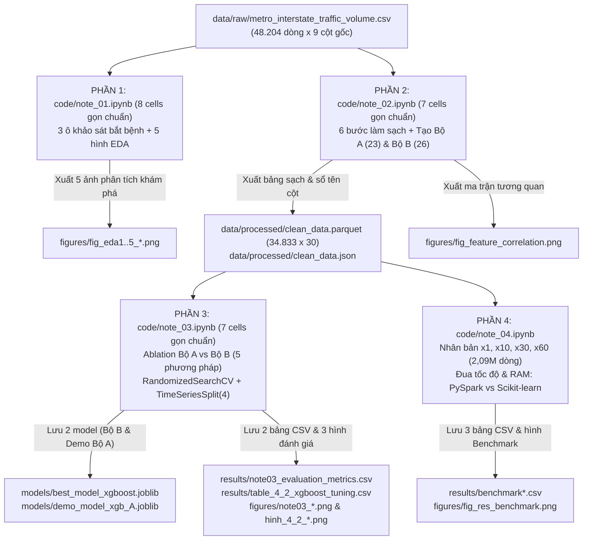

# Cẩm Nang Bóc Tách Toàn Bộ Code, Biểu Đồ & Tham Số Dự Án Từ A Đến Z
## (Đủ 4 Notebooks: Phân Tích Dữ Liệu → Phân Tích 5 Hình EDA → Tiền Xử Lý & Tạo Đặc Trưng → Thiết Kế Model & Đánh Giá Bộ Tham Số → Thí Nghiệm PySpark Big Data + Toàn Bộ Câu Hỏi Vấn Đáp)

> **Cách kết hợp 2 cuốn cẩm nang để đi vấn đáp đạt điểm tối đa:**
> 1. **[ban_chat_du_an_tu_A_den_Z.md](file:///d:/big%20data/btl_nhóm_3/ban_chat_du_an_tu_A_den_Z.md):** Giúp bạn nắm từ điển 55 thuật ngữ cơ bản và hiểu **bản chất lý thuyết / tư duy toán học** bằng ngôn ngữ đời thường.
> 2. **File này ([giai_thich_toan_bo_code_4_notebooks.md](file:///d:/big%20data/btl_nhóm_3/giai_thich_toan_bo_code_4_notebooks.md)):** Bóc tách **từng dòng code, từng con số đầu ra, từng biểu đồ hình ảnh, lý do chọn từng bộ tham số và bộ câu hỏi vấn đáp xoáy sâu** cho cả 4 file `note_01` $\rightarrow$ `note_04`. Đọc xong 2 file này, thầy/cô hỏi vào bất kỳ góc nào của dự án bạn đều trả lời trôi chảy!

---

## SƠ ĐỒ TỔNG THỂ LUỒNG DỮ LIỆU & KẾT NỐI GIỮA 4 FILE CODE



---

# PHẦN 1: PHÂN TÍCH BỘ DỮ LIỆU & TOÀN BỘ CODE + 5 HÌNH EDA (`code/note_01.ipynb`)
**File tương ứng:** [code/note_01.ipynb](file:///d:/big%20data/btl_nhóm_3/code/note_01.ipynb) *(Chiếm 15% tổng điểm theo barem của thầy)*

## 1.1. Phân tích sâu Bộ dữ liệu gốc & Giải thích Code Khảo sát (Cell 1 → Cell 3)

### A. Bản chất bộ dữ liệu *Metro Interstate Traffic Volume (UCI ID 492)*
* **Bối cảnh thu thập:** Dữ liệu giao thông thực tế đo theo từng giờ tại **Trạm đếm xe tự động ATR 301** đặt trên cao tốc liên bang **I-94** (hướng đi về phía Tây, nằm giữa Minneapolis và St. Paul, bang Minnesota, Hoa Kỳ — vùng có mùa đông rất lạnh và nhiều băng tuyết), kết hợp với dữ liệu khí tượng từ **OpenWeatherMap** và lịch lễ bang Minnesota.
* **Quy mô gốc:** **`48.204` dòng × `9` cột** (5 cột số + 3 cột chữ phân loại + 1 cột thời gian).

### B. Giải thích chi tiết 3 Ô Code khảo sát chất lượng dữ liệu (Cell 1 → Cell 3)

#### 🔹 Cell 1: Đọc dữ liệu gốc & Kiểm tra giai đoạn thời gian đo (Phát hiện đứt quãng chuỗi giờ)
```python
df = pd.read_csv(RAW_PATH)
df["date_time"] = pd.to_datetime(df["date_time"])

t_min, t_max = df["date_time"].min(), df["date_time"].max()
so_gio_ly_thuyet = int((t_max - t_min) / pd.Timedelta(hours=1)) + 1
so_gio_thuc_te = df["date_time"].nunique()
```
* **Giải thích code & Kết quả thực tế in ra:**
  * `pd.to_datetime(df["date_time"])`: Chuyển cột `date_time` từ văn bản thô sang kiểu thời gian `datetime64` để tính khoảng cách giờ và trích Thứ/Giờ.
  * Mốc bắt đầu `t_min = 2012-10-02 09:00:00`, kết thúc `t_max = 2018-09-30 23:00:00` (kéo dài **`5,99` năm**).
  * `so_gio_ly_thuyet`: Nếu trạm đo hoạt động liên tục 24/24 không nghỉ phút nào thì phải có đúng **`52.551` giờ**. Nhưng `df["date_time"].nunique()` chỉ có **`40.575` giờ duy nhất** $\rightarrow$ trạm đo bị mất tín hiệu **`11.976` giờ** (tập trung nhiều ở năm `2014 [4.839 dòng]` và `2015 [4.373 dòng]`).
  * 👉 **Ý nghĩa sống còn:** Con số `11.976` giờ thiếu này chính là lý do bắt buộc ở `note_02` phải dùng `reindex` trải lên lưới `52.551` giờ trước khi tính `lag_1h` và `lag_24h`!

#### 🔹 Cell 2: Kiểm tra giá trị khuyết (`holiday`) & Dòng trùng mốc giờ (`date_time`)
```python
gio_ghi_nhan_le = sorted(df.loc[df["holiday"].notna(), "date_time"].dt.hour.unique().tolist()) # -> [0]
so_trung_9_cot = int(df.duplicated().sum())                     # -> 17
so_trung_gio = int(df.duplicated(subset=["date_time"]).sum())   # -> 7,629
```
* **Phát hiện 1 (Bẫy kép ở cột `holiday`):** 8/9 cột không có ô trống nào (`0%`), riêng cột `holiday` báo `NaN` tới **`48.143` dòng (`99,87%`)** do ngày thường ghi chữ `'None'` bị `pandas` đọc nhầm thành `NaN`. Đặc biệt, cả **`61` dòng** có tên lễ đều chỉ nằm ở đúng **`[0]` (`00:00:00` nửa đêm)**, còn từ `01:00` đến `23:00` ngày lễ đó lại ghi là `'None'`!
* **Phát hiện 2 (Bản chất trùng lặp `17` dòng vs `7.629` dòng):** Có `17` dòng trùng cả 9 cột và **`7.629` dòng** trùng mốc giờ `date_time` (ví dụ mốc `2013-04-18 22:00:00` lặp 6 dòng cùng `traffic_volume = 1532`, chỉ khác nhãn thời tiết *Mist, Drizzle, Rain, Snow...* do API thời tiết phát nhiều bản tin trong 1 giờ). Nếu không gộp trùng giờ ở `note_02`, các giờ mưa bão sẽ bị nhân bản trọng số gấp 3–6 lần!

#### 🔹 Cell 3: Thống kê mô tả, Phát hiện 11 dòng Ngoại lai vật lý & Chuẩn bị `df_eda`
```python
display(df.describe(include=[np.number]).T.round(2))
print("Số dòng lỗi cảm biến nhiệt độ temp <= 0 Kelvin (-273.15°C):", int((df["temp"] <= 0).sum()))   # -> 10
print("Số dòng lỗi cảm biến lượng mưa rain_1h >= 500 mm/giờ     :", int((df["rain_1h"] >= 500).sum())) # -> 1
```
* **Giải thích kết quả:**
  * `temp` có `min = 0,0 K (-273,15°C)` ở **`10` dòng** (mất tín hiệu cảm biến nhiệt) và `rain_1h` có `max = 9.831,30 mm/giờ` ở **`1` dòng** (lỗi cảm biến mưa). Ngược lại `traffic_volume` (`[0; 7280]`, trung vị `3.380`, trung bình `3.259,82`) hoàn toàn hợp lý.
  * Ngay cuối Cell 3, code tạo bảng chuẩn `df_eda` (khử trùng `date_time`, trích sẵn `hour, day_of_week, is_weekend, is_holiday`) dùng chung cho cả 5 biểu đồ EDA bên dưới (Cell 4 → Cell 8).

---

## 1.2. Phân tích CHI TIẾT CẢ 5 HÌNH VẼ EDA (Cell 4 → Cell 8 — Cách code & Cách đọc hình khi vấn đáp!)
*(Trước khi vẽ, ở cuối Cell 3 code đã tạo bảng `df_eda = df.sort_values("date_time").drop_duplicates(subset=["date_time"], keep="first").copy()` để loại bỏ hiệu ứng nhân bản của các giờ mưa bão, giúp các đường trung bình chính xác).*

### 📊 HÌNH EDA 1: Phân bố của biến mục tiêu `traffic_volume` ([fig_eda1_distribution.png](file:///d:/big%20data/btl_nhóm_3/figures/fig_eda1_distribution.png) — Cell 4)
* **Code vẽ hình làm gì?**
  * Khung trái: `sns.histplot(df_eda["traffic_volume"], bins=50, kde=True)` chia miền `[0; 7280]` xe thành 50 cột tần suất kèm đường cong mật độ mượt (`kde=True`), vẽ vạch đứt đỏ tại **Trung bình (`Mean = 3.291` xe)** và vạch chấm xanh tại **Trung vị (`Median = 3.427` xe)**.
  * Khung phải: `sns.boxplot(x=df_eda["traffic_volume"])` vẽ biểu đồ hộp kiểm tra khoảng tứ phân vị (`IQR`: từ `~1.249` đến `~4.952` xe) và râu hai đầu.
* **Cách phân tích Hình EDA 1 khi thầy hỏi:**
  1. **Tại sao biểu đồ lại có hình "2 bướu" (Phân phối hai đỉnh — *Bimodal Distribution*) thay vì hình chuông chuẩn 1 đỉnh?**
     * **Đỉnh thứ nhất (bên trái, quanh `300 – 800` xe/giờ):** Đại diện cho các khung giờ **ban đêm và rạng sáng (`0h – 5h`)** khi người dân nghỉ ngơi.
     * **Đỉnh thứ hai (bên phải, rộng và cao quanh `4.500 – 5.500` xe/giờ):** Đại diện cho các khung giờ **hoạt động ban ngày (`7h – 18h`)**.
  2. **Nhìn vào Boxplot (khung phải) thấy điều gì cực kỳ quan trọng?**
     * Không hề có chấm đen ngoại lai (*outlier*) nào nằm ngoài hai râu của hộp Boxplot! Điều này chứng minh bằng hình ảnh rằng dải lưu lượng từ `0` đến `7.280` xe/giờ hoàn toàn là biến động giao thông tự nhiên, **tuyệt đối không được cắt bỏ ngoại lai trên cột `traffic_volume`**!

---

### 📊 HÌNH EDA 2: Lưu lượng trung bình theo giờ — Ngày thường vs Cuối tuần ([fig_eda2_hourly_weekday_weekend.png](file:///d:/big%20data/btl_nhóm_3/figures/fig_eda2_hourly_weekday_weekend.png) — Cell 5)
* **Code vẽ hình làm gì?**
  * Gom nhóm `df_eda.groupby(["is_weekend", "hour"])["traffic_volume"].agg(["mean", "std"])` để tính trung bình và độ lệch chuẩn của từng giờ từ `0h` đến `23h` tách riêng cho Ngày thường (`is_weekend = 0`, đường màu xanh) và Cuối tuần (`is_weekend = 1`, đường màu cam).
  * `ax.fill_between(..., mean - std, mean + std, alpha=0.12)` tô dải băng mờ `±1 độ lệch chuẩn` quanh đường trung bình; `ax.axvspan(7, 9)` và `ax.axvspan(16, 18)` tô vùng hồng đánh dấu giờ cao điểm.
* **Cách phân tích Hình EDA 2 khi thầy hỏi:**
  1. **Đường màu xanh (Ngày thường Thứ 2 – Thứ 6):** Có hình chữ **M** sắc nét với **2 đỉnh cao điểm**:
     * *Đỉnh cao điểm sáng (`7h – 8h`):* Lưu lượng vọt từ `~800` xe lúc 4h sáng lên **`~5.700 – 6.000` xe/giờ** (dòng người đi làm/đi học), sau đó hạ nhẹ xuống `~4.500` xe vào giữa trưa (`10h – 13h`).
     * *Đỉnh cao điểm chiều (`16h – 17h`):* Đạt mức cao nhất trong ngày (**trên `6.000` xe/giờ** — dòng người tan tầm cộng với đi mua sắm/ăn tối), rồi giảm dần từ `18h` về đêm.
  2. **Đường màu cam (Cuối tuần Thứ 7 – Chủ Nhật):** Hoàn toàn **mất hẳn đỉnh cao điểm 7h–8h sáng** (8h sáng cuối tuần chỉ có `~2.000` xe, thấp hơn ngày thường gần 4.000 xe!), thay vào đó chỉ có **1 đỉnh đơn thoải mái kéo dài từ `12h` trưa đến `16h` chiều** (đạt khoảng `~4.200 – 4.400` xe/giờ do người dân dậy muộn và đi chơi/mua sắm).
  3. 👉 **Suy ra quyết định gì cho Note 2?** Chứng minh **không thể chỉ dùng mỗi cột `hour` đơn lẻ** mà bắt buộc phải tạo biến `is_weekend` và đặc trưng tương tác **`is_rush_hour`** (chỉ bật bằng `1` ở khung 7–9h và 16–18h khi là ngày thường)!

---

### 📊 HÌNH EDA 3: Ảnh hưởng của Thời tiết & Loại ngày ([fig_eda3_weather_holiday.png](file:///d:/big%20data/btl_nhóm_3/figures/fig_eda3_weather_holiday.png) — Cell 6)
* **Code vẽ hình làm gì?**
  * Khung trái: Sắp xếp thứ tự trung vị giảm dần và vẽ `sns.boxplot` phân bố `traffic_volume` qua 11 nhóm `weather_main` (đúng Bảng 3.2 Báo cáo).
  * Khung phải: Lọc riêng khung giờ ban ngày `hour.between(7, 18)`, dùng `np.select` chia làm 3 loại ngày (*Ngày làm việc*, *Cuối tuần*, *Ngày lễ* — đã lan truyền nhãn lễ 24h) và vẽ 3 hộp `sns.boxplot`.
* **Cách phân tích Hình EDA 3 khi thầy hỏi:**
  1. **Khung trái (Theo thời tiết):** Khi trời quang/nhiều mây/nắng nhẹ (`Clouds`, `Haze`, `Clear`), trung vị lưu lượng cao nhất (`~3.400 – 3.700` xe/giờ); nhưng khi gặp thời tiết khắc nghiệt che khuất tầm nhìn hoặc trơn trượt như **Sương mù dày (`Fog`), Tuyết rơi (`Snow`), Giông bão (`Thunderstorm`), Gió giật (`Squall`)**, lưu lượng trung vị sụt giảm mạnh $\rightarrow$ khẳng định cần mã hóa One-Hot cột `weather_main` đưa vào mô hình.
  2. **Khung phải (Theo loại ngày vào ban ngày 7h–18h):** Hộp **Ngày làm việc** nằm cao nhất (trung vị `~5.000` xe/giờ), hộp **Cuối tuần** thấp hơn hẳn (trung vị `~3.800` xe/giờ), và hộp **Ngày lễ** thấp nhất (trung vị chỉ khoảng `~3.300` xe/giờ) $\rightarrow$ chứng minh việc sửa lỗi cột `holiday` và lan truyền `is_holiday = 1` cho cả 24 giờ ở Note 2 là cực kỳ chính xác!

---

### 📊 HÌNH EDA 4: Bản đồ nhiệt (Heatmap) Lưu lượng theo Thứ × Giờ ([fig_eda4_heatmap_day_hour.png](file:///d:/big%20data/btl_nhóm_3/figures/fig_eda4_heatmap_day_hour.png) — Cell 7)
* **Code vẽ hình làm gì?**
  * Dùng `df_eda.pivot_table(index="day_of_week", columns="hour", values="traffic_volume", aggfunc="mean")` dựng ma trận 7 hàng (Thứ Hai $\rightarrow$ Chủ Nhật) × 24 cột (`0h` $\rightarrow$ `23h`), mỗi ô điền con số xe trung bình làm tròn (`.0f`), tô thang màu Vàng–Cam–Đỏ (`cmap="YlOrRd"`).
* **Cách phân tích Hình EDA 4 khi thầy hỏi:**
  * Nhìn vào bảng màu thấy ngay **2 dải cột màu đỏ rực** chạy dọc từ **Thứ Hai đến Thứ Sáu** tại khung **`6h–8h` sáng (`5.200 – 6.170` xe)** và **`15h–17h` chiều (`5.500 – 6.410` xe)**.
  * Đặc biệt phát hiện thêm sự tinh tế giữa các thứ: Chiều **Thứ Sáu** bắt đầu đông sớm hơn từ `14h–15h` và kéo dài đến tối muộn `21h–23h` (người dân đi chơi cuối tuần); sáng **Chủ Nhật** là thời điểm vắng nhất trong cả tuần (`7h` sáng chỉ có `~1.100` xe, màu vàng nhạt).
  * 👉 **Suy ra cho Note 3:** Giải thích tại sao các mô hình Cây quyết định (`Random Forest`, `XGBoost`) lại thắng xa hồi quy tuyến tính — vì chỉ có Cây quyết định mới tự cắt được các ô vuông kết hợp `day_of_week × hour` như trên bản đồ nhiệt này!

---

### 📊 HÌNH EDA 5: Ma trận tương quan gốc & Tự tương quan độ trễ 1h–48h ([fig_eda5_correlation_autocorr.png](file:///d:/big%20data/btl_nhóm_3/figures/fig_eda5_correlation_autocorr.png) — Cell 8)
* **Code vẽ hình làm gì?**
  * Khung trái: Lọc bỏ dòng lỗi `temp <= 0` rồi tính `.corr()` giữa 7 biến số thô (`traffic_volume, temp, rain_1h, snow_1h, clouds_all, hour, day_of_week`).
  * Khung phải: Đưa chuỗi lưu lượng về lưới 1 giờ đều đặn bằng `.asfreq("1h")`, chạy vòng lặp `lags = range(1, 49)` tính hệ số **Tự tương quan (`autocorr(lag=k)`)** — tức tương quan giữa $y_t$ và chính nó ở $k$ tiếng trước $y_{t-k}$, đánh dấu vạch đứt ở `24h` và `48h`.
* **Cách phân tích Hình EDA 5 khi thầy hỏi (Điểm nối trực tiếp sang Note 2!):**
  1. **Khung trái:** Ở dạng thô chưa chế biến, biến có tương quan tuyến tính cao nhất với `traffic_volume` chỉ là `hour` (`r = +0,35`), `temp` (`r = +0,13`), `day_of_week` (`r = -0,15`), còn `rain_1h`, `snow_1h` gần `0,00`! Điều này chứng tỏ **nếu để nguyên các cột thô mà không làm Feature Engineering ở Note 2 thì tín hiệu tuyến tính rất yếu**!
  2. **Khung phải (Biểu đồ sóng Tự tương quan 48h):**
     * Tại **`lag = 1h`**, cột tự tương quan cao chót vót (**`> +0,90`**) rồi giảm xuống mức âm mạnh nhất ở **`lag = 12h` (`~ -0,60`**, vì cách 12 tiếng là ngược ngày thành đêm!).
     * Sau đó đồ thị **vọt tăng trở lại thành đỉnh nhọn cực cao ở đúng vạch đỏ `lag = 24h` (`~ +0,83`)** và lặp lại đỉnh nhọn tiếp theo ở vạch cam **`lag = 48h` (`~ +0,77`)**!
     * 👉 **Kết luận thép:** Hình này là bằng chứng toán học trực tiếp giải thích tại sao ở Note 2 nhóm chọn đúng bộ 3 đặc trưng **`lag_1h`** (đỉnh trễ 1h), **`lag_24h`** (đỉnh chu kỳ 24h) và **`roll_3h`** (cụm trễ ngắn 1h–3h)!

---

## 1.3. Bộ câu hỏi vấn đáp riêng cho Phần 1 (`note_01.ipynb`)
* **Hỏi 1:** *Tại sao ở cuối Cell 3 của Note 1, trước khi vẽ biểu đồ EDA lại phải viết `drop_duplicates(subset=["date_time"], keep="first")` trên bảng nháp `df_eda`?*
  > **Đáp:** Dạ, vì dữ liệu gốc có 7.629 dòng lặp giờ và hầu hết rơi vào các giờ mưa bão, sương mù (1 giờ lặp 3–6 dòng). Nếu không bỏ trùng giờ trên bản nháp trước khi vẽ, các giờ mưa bão sẽ bị tính lặp nhiều lần làm sai lệch giá trị trung bình của các biểu đồ EDA.
* **Hỏi 2:** *Tại sao ở Cell 1 Note 1 ghi thiếu `11.976` giờ, còn sang Note 2 lại ghi thiếu `11.987` giờ?*
  > **Đáp:** Dạ, ở Note 1 ta đếm trên toàn bộ `40.575` mốc giờ gốc (`52.551 - 40.575 = 11.976` giờ thiếu). Còn sang Note 2, trước khi trải lên lưới `52.551` giờ, nhóm đã xóa đi **11 mốc giờ bị hỏng cảm biến** (10 dòng nhiệt độ 0K + 1 dòng mưa 9.831,3 mm, còn `40.564` giờ hợp lệ), nên số giờ trống trên lưới tăng thêm đúng 11 giờ thành `11.976 + 11 = 11.987` giờ!

---

# PHẦN 2: PHÂN TÍCH CODE TIỀN XỬ LÝ, TẠO ĐẶC TRƯNG & GIẢI ĐÁP MỌI CÂU HỎI (`code/note_02.ipynb`)
**File tương ứng:** [code/note_02.ipynb](file:///d:/big%20data/btl_nhóm_3/code/note_02.ipynb) *(Phần chính của bạn — Gọn đẹp 7 ô code có tiêu đề Markdown rõ từng bước, chiếm 15% tổng điểm)*

## 2.1. Phân tích từng dòng Code của 6 Bước Tiền xử lý (Cell 1 → Cell 4)

| Ô Code | Đoạn lệnh cốt lõi trong `note_02.ipynb` | Phân tích kỹ thuật chi tiết & Số dòng thay đổi |
| :--- | :--- | :--- |
| **Cell 1**<br>*(Đọc dữ liệu & Bước 1: Ngày lễ)* | `df = pd.read_csv(RAW_PATH)`<br>`df["holiday"] = df["holiday"].fillna("None").astype(str).str.strip()`<br>`holiday_days = set(df[df["holiday"] != "None"]["date_time"].dt.normalize())` | • Đọc **`48.204` dòng × `9` cột**, mở sổ nhật ký `preprocessing_log`.<br>• Sửa 48.143 ô `NaN` về chuỗi `"None"`. Từ `61` dòng lễ lúc `00:00`, dùng `.dt.normalize()` gom được **`53` ngày lễ duy nhất** trước khi xóa trùng giờ. |
| **Cell 2**<br>*(Bước 2: Xóa trùng giờ)* | `df = df.sort_values("date_time", kind="mergesort")`<br>`df = df.drop_duplicates(subset=["date_time"], keep="first").reset_index(drop=True)`<br>`assert df["date_time"].is_unique` | • Sắp xếp ổn định `mergesort` theo chiều thời gian tăng dần.<br>• Giữ dòng đầu tiên của mỗi mốc giờ, loại bỏ **`7.629` dòng trùng giờ** (đã bao gồm 17 dòng trùng cả 9 cột) $\rightarrow$ còn **`40.575` dòng**.<br>• Lệnh `assert` xác nhận tự động không còn bất kỳ giờ nào trùng nhau. |
| **Cell 3**<br>*(Bước 3 & 4: Đổi °C & Lọc ngoại lai)* | `df["temp_c"] = df["temp"] - 273.15`<br>`mask_temp = df["temp_c"] <= -50`<br>`mask_rain = df["rain_1h"] >= 500`<br>`df = df[~(mask_temp \| mask_rain)].reset_index(drop=True)` | • Đổi Kelvin sang độ C.<br>• Lọc bỏ **`10` dòng** `temp_c <= -50°C` (`0 K = -273,15°C` $\rightarrow$ `min` về **`-29,76°C`**) và **`1` dòng** `rain_1h >= 500 mm` (`9.831,3 mm` $\rightarrow$ `max` về **`55,63 mm`**, `std` giảm từ `48,81` xuống **`0,77 mm`**).<br>• Còn lại **`40.564` dòng** quan sát hợp lệ (in kèm bảng đối chiếu `TRƯỚC LỌC` vs `SAU LỌC`). |
| **Cell 4**<br>*(Bước 5 & 6: Lưới giờ `reindex` & Tính Lag)* | `full_range = pd.date_range(min, max, freq="h")`<br>`df_grid = df.set_index("date_time").reindex(full_range)`<br>`df_grid["lag_1h"] = df_grid["traffic_volume"].shift(1)`<br>`df_grid["lag_24h"] = df_grid["traffic_volume"].shift(24)`<br>`df_grid["roll_3h"] = df_grid["traffic_volume"].shift(1).rolling(3).mean()`<br>`df_clean = df_grid[df_grid["traffic_volume"].notna()].reset_index()`<br>`df_clean = df_clean.dropna(subset=["lag_1h", "lag_24h", "roll_3h"])` | • Trải `40.564` dòng lên lưới chuẩn **`52.551` giờ** liên tục (chèn `11.987` dòng `NaN` vào các giờ mất tín hiệu).<br>• Dịch cột `traffic_volume` xuống 1 dòng tạo `lag_1h`, xuống 24 dòng tạo `lag_24h`, và dịch xuống 1 dòng rồi lấy trung bình 3 dòng liên tiếp tạo `roll_3h` (có bảng in 6 dòng minh họa trực quan!).<br>• Bỏ `11.987` dòng trống và `5.731` dòng bị thiếu biến trễ do nằm ngay sau ca mất điện $\rightarrow$ thu được **`34.833` dòng sạch hoàn chỉnh**. |

---

## 2.2. Phân tích Code Tạo Đặc Trưng, Xuất File & Đọc Hình Tương Quan (Cell 5 → Cell 7)

### 🔹 Cell 5 & Cell 6: Chế tạo 26 đặc trưng (Bộ A = 23, Bộ B = 26) & Xuất `.parquet`, `.json`
* **Nhóm 1 — `CALENDAR_FEATURES` (8 biến):**
  * `hour` (`0..23`), `day_of_week` (`0..6`), `month` (`1..12`), `is_weekend` (`day_of_week >= 5`).
  * `is_holiday`: `df_clean["date_time"].dt.normalize().isin(holiday_days).astype(int)` $\rightarrow$ đối chiếu phần Ngày với 53 ngày lễ để bật `1` cho cả 24 giờ trong ngày lễ.
  * `is_rush_hour`: `((hour.between(7, 9) | hour.between(16, 18)) & (is_weekend == 0) & (is_holiday == 0)).astype(int)`.
  * `hour_sin = np.sin(2 * np.pi * hour / 24)` và `hour_cos = np.cos(2 * np.pi * hour / 24)` $\rightarrow$ ánh xạ chu kỳ 24 giờ lên đường tròn đơn vị.
* **Nhóm 2 — `WEATHER_FEATURES` (15 biến):**
  * 4 biến số: `temp_c`, `rain_1h`, `snow_1h`, `clouds_all`.
  * 11 biến One-Hot từ `pd.get_dummies(df_clean["weather_main"], prefix="wm", dtype=int)`: `wm_Clear`, `wm_Clouds`, `wm_Drizzle`, `wm_Fog`, `wm_Haze`, `wm_Mist`, `wm_Rain`, `wm_Smoke`, `wm_Snow`, `wm_Squall`, `wm_Thunderstorm`.
* **Nhóm 3 — `LAG_FEATURES` (3 biến, tính tại Cell 4):** `lag_1h`, `lag_24h`, `roll_3h` — minh họa trực tiếp bằng bảng số thật in ra ở Cell 4:
  * Tại `2012-10-03 09:00`: `traffic_volume = 5.471` xe $\rightarrow$ `lag_1h = 6.511` (số xe lúc `08:00`), `lag_24h = 5.545` (số xe lúc `09:00` hôm qua `02/10`).
  * Ngay sau đó lúc `10:00` và `11:00` bị mất điện (`NaN`), nhờ `reindex` nên lúc `12:00` cột `lag_1h` tự động ghi `NaN` trung thực (không lấy nhầm giờ `09:00`!), và khi đủ 3 giờ liên tiếp (`12h: 5.097`, `13h: 4.887`, `14h: 5.337`) thì sang `15:00` sẽ tính được `roll_3h = (5.097 + 4.887 + 5.337) / 3 = 5.107,0` xe!
* **Lý do loại bỏ 2 cột `year` và `weather_description` (Mục 3.4 Báo cáo):**
  * Bỏ `year`: Tập Test là năm `2018` mới hoàn toàn chưa từng xuất hiện trong tập Train (`2012–2017`), mô hình Cây quyết định phân nhánh theo ngưỡng đã thấy nên không ngoại suy được theo năm.
  * Bỏ `weather_description`: Gồm 38 mô tả con nằm bên trong `weather_main`, nếu giữ cả hai sẽ gây trùng lặp đa cộng tuyến và làm loãng không gian đặc trưng.
* **Đóng gói 2 bộ & Lưu đầu ra (Cell 6):**
  * `FEATURES_A = CALENDAR_FEATURES + WEATHER_FEATURES` (**23 biến** — dự báo dài hạn & Demo).
  * `FEATURES_B = FEATURES_A + LAG_FEATURES` (**26 biến** — dự báo ngắn hạn 1 giờ tới).
  * Lưu [clean_data.parquet](file:///d:/big%20data/btl_nhóm_3/data/processed/clean_data.parquet) kích thước **`34.833 dòng × 30 cột`** (`26 cột Bộ B + date_time + traffic_volume + weather_main + holiday`) và [clean_data.json](file:///d:/big%20data/btl_nhóm_3/data/processed/clean_data.json) (lưu danh sách tên cột và mốc `"TEST_START": "2018-01-01"` chia **Train `28.353` dòng [81,4%]** / **Test `6.480` dòng [18,6%]**).

### 📊 Phân tích Hình Ma trận tương quan ([fig_feature_correlation.png](file:///d:/big%20data/btl_nhóm_3/figures/fig_feature_correlation.png) — Cell 7)
* **Cách đọc hình khi vấn đáp:**
  1. **Khung phải (Biểu đồ thanh ngang xếp hạng tương quan Pearson $r$ với `traffic_volume`):**
     * **Cột màu xanh (Tương quan dương mạnh):** Đứng đầu là 3 biến trễ **`lag_1h` (`+0,91`)**, **`lag_24h` (`+0,86`)**, **`roll_3h` (`+0,76`)**, tiếp theo là biến tự chế tạo **`is_rush_hour` (`+0,53`)**, `hour` (`+0,36`), `temp_c` (`+0,14`), `clouds_all` (`+0,08`).
     * **Cột màu đỏ (Tương quan âm mạnh):** Đứng đầu là biến mã hóa vòng tròn **`hour_cos` (`−0,77` — nhảy vọt gấp hơn 2 lần so với `hour` thô `+0,36`!)**, tiếp theo là `hour_sin` (`−0,26`), `is_weekend` (`−0,21`), `day_of_week` (`−0,14`), `is_holiday` (`−0,06`).
  2. **Khung trái (Heatmap tương quan chéo giữa các biến đầu vào với nhau):**
     * Thấy ô giao giữa `lag_1h` và `roll_3h` có màu đỏ đậm (`r = +0,89`), hoặc giữa `day_of_week` và `is_weekend` (`r = +0,79`). Đây chính là bằng chứng trực quan về hiện tượng **đa cộng tuyến (các biến đầu vào tương quan cao với nhau)**, giải thích vì sao sang Note 3 cần đối sánh **`Ridge` (có phạt L2)** với `LinearRegression` thường!

---

## 2.3. Giải đáp TẤT CẢ các câu hỏi xoáy sâu ở Phần 2 (`note_02.ipynb`)
* **Câu hỏi 1:** *Nếu ở Cell 4 ta tính `hour`, `is_weekend`, `is_holiday` TRƯỚC khi `reindex`, rồi sau khi `reindex` mới lọc thì có sao không?*
  > **Đáp:** Trong code `note_02.ipynb`, nhóm đặt Cell 5 (tính `hour`, `is_weekend`, `is_holiday`, `One-Hot`) **SAU** khi đã lọc xong `df_clean` (`34.833` dòng) ở cuối Cell 4. Cách sắp xếp này tối ưu hơn vì chỉ phải tính lượng giác `sin/cos` và `get_dummies` trên `34.833` dòng sạch thay vì tính tốn công trên `52.551` dòng lưới rồi đằng nào cũng xóa đi!
* **Câu hỏi 2:** *Tại sao khi dùng `pd.get_dummies(weather_main)` ở Cell 5, nhóm giữ cả 11 cột `wm_*` mà không truyền `drop_first=True` (bỏ 1 cột thành 10 cột)?*
  > **Đáp:** Dạ, ở Note 3 nhóm dùng **`Ridge(alpha=10.0)`** (có điều chuẩn L2 giải quyết triệt để đa cộng tuyến) và các mô hình Cây (**`Random Forest`**, **`XGBoost`**). Với mô hình Cây, việc giữ đủ cả 11 cột giúp cây có thể hỏi trực tiếp trên bất kỳ trạng thái nào (như `wm_Clear == 1` hoặc `wm_Snow == 1`) một cách tường minh và dễ đọc độ quan trọng đặc trưng hơn!
* **Câu hỏi 3:** *Nếu ngày mai đưa mô hình vào chạy thực tế ngoài đời, gặp một cơn bão cát (`Sand`) chưa từng xuất hiện trong 11 cột `wm_*` lúc học thì xử lý sao?*
  > **Đáp:** Khi triển khai thực tế (hoặc trong Demo), ta căn theo đúng danh sách 11 cột `WEATHER_ONEHOT_COLS` đã lưu trong file `clean_data.json`: nếu gặp nhãn lạ chưa có trong 11 cột đó thì cả 11 cột `wm_*` sẽ nhận giá trị `0` (không bị lỗi thiếu hay thừa cột đầu vào của model).

---

# PHẦN 3: PHÂN TÍCH THIẾT KẾ MODEL, ĐÁNH GIÁ BỘ THAM SỐ & KẾT QUẢ (`code/note_03.ipynb`)
**File tương ứng:** [code/note_03.ipynb](file:///d:/big%20data/btl_nhóm_3/code/note_03.ipynb) *(Chiếm 25% tổng điểm — Gọn gàng đúng 7 ô code, khớp 100% yêu cầu của thầy và Báo cáo lý thuyết Mục 2.5, 3.5, 3.7, 4.3, 5.1, 5.2)*

## 3.1. Chia dữ liệu theo thời gian & Hàm 4 độ đo chuẩn Hồi quy (Cell 1)

```python
FEATURES_A = cfg["FEATURES_A"]              # 23 biến (Lịch + Thời tiết, không có biến trễ)
FEATURES_B = cfg["FEATURES_B"]              # 26 biến (Bộ A + lag_1h, lag_24h, roll_3h)
TEST_START = pd.Timestamp(cfg["TEST_START"]) # 2018-01-01

train_df = df[df["date_time"] < TEST_START].reset_index(drop=True)  # 28,353 dòng (81.4%)
test_df = df[df["date_time"] >= TEST_START].reset_index(drop=True)  #  6,480 dòng (18.6%)

def danh_gia(y_true, y_pred):
    mask = y_true > 100
    mape = np.mean(np.abs((y_true[mask] - y_pred[mask]) / y_true[mask])) * 100
    return {
        "MAE": round(float(mean_absolute_error(y_true, y_pred)), 2),
        "RMSE": round(float(root_mean_squared_error(y_true, y_pred)), 2),
        "MAPE (%)": round(float(mape), 2),
        "R2": round(float(r2_score(y_true, y_pred)), 4),
    }
```
* **Giải thích chi tiết 3 điểm ăn điểm trong Cell 1:**
  1. **Đọc trực tiếp quy ước từ `clean_data.json`:** Không liệt kê lại tên cột thủ công mà lấy thẳng `FEATURES_A` (23 biến), `FEATURES_B` (26 biến) và `TEST_START` từ Note 2, đảm bảo nhất quán tuyệt đối và không bao giờ lọt cột đáp án `traffic_volume` vào `X`.
  2. **Chia tập theo mốc thời gian (`< 2018-01-01` vs `>= 2018-01-01`):** Cấm xáo trộn ngẫu nhiên để không lấy tương lai đoán quá khứ.
  3. **Tại sao trong hàm `danh_gia` phải lọc `mask = y_true > 100` khi tính `MAPE` (Đúng công thức Mục 2.5.1 Báo cáo)?** Vì vào lúc 2–3h sáng hoặc khi đóng làn khẩn cấp, lưu lượng thực tế $y_i$ có thể chỉ có vài xe (`1–10` xe/giờ); lúc đó đoán lệch 20 xe thôi cũng làm phân số $|y_i - \hat{y}_i|/y_i$ vọt lên `200%–1000%` làm méo mó trung bình toàn tập! Lọc $y_i > 100$ xe/giờ giúp `MAPE (%)` phản ánh trung thực sai số tương đối. (Đồng thời chỉ giữ đúng **4 độ đo Hồi quy `MAE, RMSE, MAPE, R²`**, lược bỏ các chỉ số phân loại `Precision/Recall/F1` không dành cho bài toán dự báo theo yêu cầu của thầy).

---

## 3.2. Nghiên cứu cắt giảm (Ablation Study: Bộ A vs Bộ B) & Thiết kế 5 Phương pháp (Cell 2)

```python
def khoi_tao_models():
    return {
        "Linear Regression": make_pipeline(StandardScaler(), LinearRegression()),
        "Ridge Regression": make_pipeline(StandardScaler(), Ridge(alpha=10.0, random_state=SEED)),
        "Random Forest": RandomForestRegressor(
            n_estimators=100, max_depth=12, max_features=1/3, random_state=SEED, n_jobs=-1
        ),
        "XGBoost": XGBRegressor(
            n_estimators=100, max_depth=6, learning_rate=0.1, random_state=SEED, n_jobs=-1
        ),
    }
```

### A. Tại sao lại thiết kế đúng 5 phương pháp này (Bám sát Mục 3.5.2 Báo cáo)?
1. **`Seasonal Naive Baseline` (`pred_naive = test_df["lag_24h"]`):** Lấy thẳng lưu lượng cùng giờ ngày hôm trước (`t - 24h`) làm dự báo, tạo **mốc sàn hiệu năng tối thiểu** mà mọi mô hình học máy phải vượt qua.
2. **`Linear Regression` (`make_pipeline(StandardScaler(), LinearRegression())`):** Hồi quy tuyến tính chuẩn OLS không điều chuẩn, dùng để kiểm chứng giới hạn của đường thẳng phẳng và đối sánh với Ridge khi có đa cộng tuyến. Gói trong `make_pipeline` để `StandardScaler` chỉ học trung bình/độ lệch chuẩn trên `Train`, không rò rỉ thống kê từ `Test`.
3. **`Ridge Regression` (`alpha = 10.0`):** Gắn thêm lực phanh điều chuẩn L2 ($\lambda \sum w_j^2$) để kìm hãm hiện tượng nổ trọng số giữa 11 cột One-Hot `wm_*` và cặp biến tương quan mạnh `lag_1h` – `roll_3h`.
4. **`Random Forest` (`n_estimators=100, max_depth=12, max_features=1/3`):** Trồng 100 cây song song độc lập (`Bagging`), mỗi nút cắt chỉ xét ngẫu nhiên `1/3` tổng số đặc trưng ($m \le p/3$ theo đúng lý thuyết Breiman ở Mục 2.4.3 & 3.5.2 Báo cáo) để khử tương quan giữa các cây.
5. **`XGBoost` cơ sở (`n_estimators=100, max_depth=6, learning_rate=0.1`):** 100 cây nối tiếp nhau sửa phần dư sai số (`Gradient Boosting`), dùng làm mốc trước khi tinh chỉnh siêu tham số ở Cell 3.

### B. Bảng kết quả thực nghiệm đối sánh Bộ A vs Bộ B trên Tập Test (`note03_evaluation_metrics.csv`)
*(Bảng này trả lời trọn vẹn cả 2 câu hỏi nghiên cứu **RQ1** và **RQ2** trong Báo cáo!)*

| Bộ đặc trưng | Phương pháp | `MAE` (xe) | `RMSE` (xe) | `MAPE (%)` | `R²` | Ý nghĩa bản chất rút ra |
| :--- | :--- | ---: | ---: | ---: | ---: | :--- |
| **Baseline** | `Seasonal Naive (lag_24h)` | 568,37 | 1.032,94 | 25,08% | 0,7251 | `RMSE` vọt trên `1.032` xe vì lệch pha nặng ở ngày chuyển giao cuối tuần, ngày lễ và bão tuyết. |
| **Bộ A (23 biến)**<br>*(Chỉ Lịch & Thời tiết)* | `Linear Regression` | 631,51 | 858,01 | 43,08% | 0,8103 | Không có biến trễ và không bắt được tương tác Giờ × Cuối tuần nên `MAE` còn kém cả Baseline! |
| **Bộ A (23 biến)** | `Ridge Regression` | 631,54 | 858,02 | 43,10% | 0,8103 | Xấp xỉ Linear Regression nhưng kiểm soát biên độ trọng số ổn định không bị suy biến ma trận. |
| **Bộ A (23 biến)** | `Random Forest` | 229,66 | 381,66 | 10,08% | 0,9625 | Nhảy vọt ngoạn mục (`R² = 96,25%`) nhờ cây quyết định tự rẽ nhánh theo Giờ × Thứ × Ngày lễ! |
| **Bộ A (23 biến)** | **`XGBoost`** | **223,66** | **371,72** | **10,05%** | **0,9644** | **Tốt nhất trên Bộ A!** Dù không cần biết số xe giờ trước vẫn dự báo dài hạn cực chuẩn cho App Demo! |
| **Bộ B (26 biến)**<br>*(Bộ A + 3 biến trễ)* | `Linear Regression` | 353,76 | 475,66 | 21,18% | 0,9417 | Vừa thêm 3 biến trễ, `MAE` của mô hình tuyến tính giảm gần một nửa (`631 → 353` xe)! |
| **Bộ B (26 biến)** | `Ridge Regression` | 353,61 | 475,92 | 21,17% | 0,9416 | Vượt xa Baseline gần `215` xe MAE nhưng vẫn thua nhóm Cây hơn `200` xe do tính phi tuyến. |
| **Bộ B (26 biến)** | `Random Forest` | 143,95 | 223,65 | 5,83% | 0,9871 | Kết hợp quy luật chu kỳ và quán tính ngắn hạn giúp giảm thêm `37%` sai số so với Bộ A! |
| **Bộ B (26 biến)** | **`XGBoost`** | **143,49** | **221,75** | **5,84%** | **0,9873** | **Đứng đầu toàn bảng!** Giải thích tới `98,73%` phương sai trước cả khi tinh chỉnh siêu tham số. |

---

## 3.3. PHÂN TÍCH CHUYÊN SÂU BỘ THAM SỐ TỐI ƯU XGBOOST (CELL 3 — `RandomizedSearchCV` + `TimeSeriesSplit`)

### A. Code Tinh chỉnh chuẩn mực không rò rỉ tập Test (Đúng Mục 3.5.3 Báo cáo)
```python
tscv = TimeSeriesSplit(n_splits=4)
param_dist = {
    "n_estimators": [100, 200, 300],
    "max_depth": [4, 6, 8],
    "learning_rate": [0.05, 0.1],
    "subsample": [0.8, 1.0],
    "colsample_bytree": [0.8, 1.0],
}
search = RandomizedSearchCV(
    estimator=XGBRegressor(random_state=SEED, n_jobs=-1, tree_method="hist"),
    param_distributions=param_dist,
    n_iter=30,
    scoring="neg_root_mean_squared_error",
    cv=tscv,
    random_state=SEED,
    refit=True,  # Tự động huấn luyện lại cấu hình tốt nhất trên 100% tập Train
)
search.fit(train_df[FEATURES_B], y_train)
```
* **Tại sao dùng `RandomizedSearchCV(n_iter=30)` + `TimeSeriesSplit(n_splits=4)` thay vì vòng lặp thủ công chấm trên `X_test`?**
  1. **Không chạm vào tập Test trong suốt quá trình dò tham số:** `search.fit` chỉ làm việc trên `train_df` (chia 4 nếp gấp mở rộng dần từ quá khứ đến tương lai, tổng $30 \times 4 = 120$ lần huấn luyện với `tree_method="hist"` chạy chỉ mất ~8 giây!). Sau khi tìm ra cấu hình có `CV_RMSE_mean` thấp nhất, `refit=True` tự động học lại trên toàn bộ `28.353` dòng Train rồi mới dự báo **đúng 1 lần duy nhất** trên tập Test!
  2. **Rút ngắn hơn 80 dòng code thừa** của cách viết vòng lặp thủ công cũ mà chuẩn mực tuyệt đối theo `scikit-learn`.

### B. TẠI SAO LẠI SINH RA ĐÚNG 5 THAM SỐ NÀY VỚI CÁC MỨC GIÁ TRỊ ĐÓ? Ý NGHĨA TỪNG THAM SỐ LÀ GÌ?

| Tên siêu tham số | Các mức thử nghiệm | Ý nghĩa bản chất của tham số này là gì? | Tại sao lại chọn đúng các mốc số này (mà không chọn quá nhỏ hay quá lớn)? |
| :--- | :---: | :--- | :--- |
| **1. `n_estimators`**<br>*(Số lượng cây nối tiếp)* | `[100, 200, 300]` | Quyết định **độ dài của chuỗi sửa sai**: có bao nhiêu cây quyết định xếp hàng nối đuôi nhau vá lỗi. | • Dưới `100` cây (khi đi với tốc độ học nhỏ `0.05`) mô hình chưa kịp sửa hết lỗi (*Underfitting*).<br>• Trên `500–1000` cây trên tập 28 nghìn dòng sẽ vừa tốn thời gian gấp nhiều lần, vừa bắt đầu học vẹt vào nhiễu ngẫu nhiên (*Overfitting*). Ba mốc `100, 200, 300` quét trọn vùng tối ưu. |
| **2. `max_depth`**<br>*(Độ sâu tối đa mỗi cây)* | `[4, 6, 8]` | Quyết định **mức độ phức tạp của câu hỏi tương tác** trong 1 cây (cây sâu $d$ tầng cho phép kết hợp tối đa $d$ điều kiện `Nếu... VÀ...` cùng lúc, tạo ra tối đa $2^d$ nhánh lá). | • **`4` tầng (16 lá):** Cây nông, chống học vẹt mạnh nhưng chỉ kết hợp được tối đa 4 biến một lúc.<br>• **`6` tầng (64 lá):** Mức cân bằng tiêu chuẩn của XGBoost.<br>• **`8` tầng (256 lá):** Cho phép bắt tương tác sâu (`lag_1h` × `hour_cos` × `day_of_week` × `is_holiday` × `temp_c` × `wm_Snow`...). Không thử `>= 12` vì trong Boosting cây quá sâu rất dễ học vẹt. |
| **3. `learning_rate`**<br>*(Tốc độ học / Hệ số thu hẹp $\eta$)* | `[0.05, 0.1]` | Quyết định **độ cẩn thận sau mỗi bước sửa sai**: trước khi cộng phần bù của cây mới vào tổng dự báo, máy nhân phần bù đó với `learning_rate`. | • Có **quy luật đánh đổi nghịch đảo** giữa `learning_rate` và `n_estimators`: `0.1` hội tụ nhanh với 100 cây nhưng bước nhảy hơi thô; giảm xuống **`0.05`** (nhích từng bước nhỏ 5% mịn màng) đi cặp với **`300` cây** là công thức vàng giúp mô hình tổng quát hóa tốt hơn hẳn trên dữ liệu mới! |
| **4. `subsample`**<br>*(Tỷ lệ lấy mẫu dòng cho mỗi cây)* | `[0.8, 1.0]` | • `1.0`: Cây nào cũng nhìn toàn bộ 100% số dòng Train.<br>• **`0.8` (*Stochastic Gradient Boosting*):** Trước khi trồng mỗi cây mới, máy chỉ bốc ngẫu nhiên **80% số dòng** để học. | Đưa mức `0.8` vào để kiểm chứng khả năng **chống học vẹt (Regularization bằng ngẫu nhiên)**: việc bớt đi 20% dòng ngẫu nhiên ở mỗi cây ngăn không cho các cây sau chỉ chăm chăm đuổi theo vài điểm dữ liệu dị biệt! |
| **5. `colsample_bytree`**<br>*(Tỷ lệ lấy mẫu cột cho mỗi cây)* | `[0.8, 1.0]` | • `1.0`: Cây nào cũng được xét cả 26 cột.<br>• **`0.8`:** Mỗi cây khi khởi tạo chỉ được rút ngẫu nhiên **80% số cột ($\approx 21/26$ cột)**. | **Lý do cực kỳ sâu sắc trong bài toán này:** Vì biến `lag_1h` (`r = +0,91`) và `hour_cos` (`r = -0,77`) quá mạnh, nếu để `1.0` thì **mọi cái cây đều lao vào cắt nhánh ở `lag_1h` và `hour_cos` trước tiên**, bỏ bê các biến tinh tế như `is_holiday`, `wm_Snow`, `temp_c`! Khi đặt **`0.8`**, sẽ có khoảng 20% số cây **không được nhìn thấy `lag_1h`**, buộc chúng phải khai thác triệt để quy luật thời tiết và ngày lễ $\rightarrow$ ghép cả đội lại dự báo toàn diện hơn! |

### C. Đánh giá Bảng Kết Quả Tinh Chỉnh (`table_4_2_xgboost_tuning.csv`)
* **🏆 Cấu hình Vô địch (Hạng 1):** `n_estimators = 300`, `max_depth = 8`, `learning_rate = 0.05`, `subsample = 0.8`, `colsample_bytree = 0.8` đạt **`CV_RMSE_mean = 252,87` xe**. Khi đánh giá trên **Tập Test (năm 2018)**, kết quả cải thiện vượt bậc trên cả 4 chỉ số: **`MAE = 138,88` xe**, **`RMSE = 217,05` xe**, **`MAPE = 5,61%`**, **`R² = 0,9879`**!
* **Nhóm Á quân (Hạng 2–3):** `(100, 8, 0.05, 0.8, 0.8)` (`CV_RMSE = 253,11`) và `(200, 8, 0.05, 0.8, 1.0)` (`CV_RMSE = 253,17`) — cả Top 3 đều hội tụ ở **`max_depth = 8` và `learning_rate = 0.05`**.
* **Đứng cuối bảng (Hạng 30):** `(100, 4, 0.05, 0.8, 0.8)` bị đội `CV_RMSE_mean` lên tận **`292,23` xe** — minh họa điển hình hiện tượng **Dưới khớp (*Underfitting*)** do cây quá nông (`depth=4`) đi kèm ít cây (`100`) và tốc độ học chậm (`0.05`).
* **💡 Câu hỏi vấn đáp điểm 10:** *"Tại sao `CV_RMSE_mean` (~252,87 xe) trên tập Train lại cao hơn `Test_RMSE` (217,05 xe)?"*
  > **Đáp:** Vì ở các nếp gấp đầu của `TimeSeriesSplit(n_splits=4)`, mô hình chỉ mới được học 1/5 đến 2/5 lượng dữ liệu đầu (2012–2013) và phải kiểm định ngay trên giai đoạn 2014–2015 bị đứt quãng bảo trì nhiều; còn khi dự báo tập Test 2018, mô hình đã được `refit` học trọn 100% tập Train (`28.353` dòng suốt 5 năm) nên chính xác hơn hẳn!

---

## 3.4. Phân tích 3 Biểu Đồ Đánh Giá, Phân Tích Lỗi 4 Chiều & Lưu 2 Model `.joblib` (Cell 4 → Cell 7)

### 📊 Cell 4 — Biểu đồ Dự báo 7 ngày liên tiếp đầu năm 2018 ([note03_forecast_7_days.png](file:///d:/big%20data/btl_nhóm_3/figures/note03_forecast_7_days.png))
* Vẽ 7 ngày đầu tập Test (`2018-01-01` $\rightarrow$ `2018-01-08`). Ngay ngày `01/01/2018` là **nghỉ Tết Dương lịch (`New Years Day`)** nên đường đen thực tế thấp hẳn xuống; `Baseline (lag_24h)` bị trật nhịp nặng nề sang tận ngày đi làm `02/01`, trong khi đường **`XGBoost (Tuned)`** bám khít từng đỉnh cao điểm sáng/chiều và đáy ban đêm!

### 📊 Cell 5 — Biểu đồ Top 15 Đặc trưng quan trọng nhất ([hinh_4_2_feature_importance.png](file:///d:/big%20data/btl_nhóm_3/figures/hinh_4_2_feature_importance.png))
* Tỷ trọng đóng góp theo `Gain` của `best_xgb_B` (nhờ có `colsample_bytree = 0.8` nên phân bổ rất hài hòa):
  1. **`hour_cos`: `52,83%`** *(Đứng số 1 — khẳng định giá trị to lớn của bước mã hóa chu kỳ lượng giác ở Note 2!)*
  2. **`lag_1h`: `25,16%`** *(Quán tính lưu lượng giờ liền trước)*
  3. **`hour`: `7,18%`**, **`lag_24h`: `3,70%`**, **`is_rush_hour`: `2,66%`**, **`hour_sin`: `2,05%`**, **`roll_3h`: `1,96%`**, **`is_weekend`: `1,43%`**, **`day_of_week`: `1,25%`**, **`is_holiday`: `0,73%`**...

### 📊 Cell 6 — Phân tích lỗi chuyên sâu đủ 4 chiều (Khớp 100% Mục 3.5.4 & 5.2 Báo cáo)
1. **Theo khung giờ (`0–23h`, hình trái [note03_error_analysis_hour_weather.png](file:///d:/big%20data/btl_nhóm_3/figures/note03_error_analysis_hour_weather.png)):** Ban đêm `1h–4h` sáng sai số cực nhỏ (`MAE ~ 30–50` xe); tăng lên ở giờ cao điểm sáng/chiều (`7h`, `15h–17h`) và tối muộn (`21h–23h`).
2. **Theo thời tiết (`weather_main`, hình phải):** Trạng thái **Tuyết rơi (`Snow`)** có sai số lớn nhất do băng tuyết làm thay đổi tốc độ dòng xe đột ngột, trong khi trời quang (`Clear`) và mây (`Clouds`) có sai số thấp ổn định.
3. **Theo Ngày lễ vs Ngày thường:** Ngày thường (`6.316` mẫu) có `MAE = 138,56` xe; Ngày lễ (`164` mẫu) có `MAE = 151,05` xe (nhỉnh hơn nhẹ do số lượng ngày lễ ít và hành vi du lịch từng dịp lễ khác nhau).
4. **Top 5 mốc giờ sai số lớn nhất năm 2018:** Lớn nhất là trưa Thứ Hai `2018-05-21 13:00` (thực tế sụt đột ngột còn `2.040` xe trong khi dự báo `4.838` xe, lệch `2.798` xe — dấu hiệu sự cố tai nạn/đóng làn cục bộ trên cao tốc I-94), kế đến là chiều `2018-01-17 15:00–16:00` và tối Thứ Sáu/Thứ Bảy `2018-09-28, 29 lúc 23:00` (tan sự kiện thể thao/hòa nhạc đêm cuối tuần không có trong dữ liệu đầu vào).

### 💾 Cell 7 — Đóng gói 2 file `.joblib` phục vụ Lưu trữ & Ứng dụng Demo (Khớp Mục 3.7.2 & 4.5 Báo cáo)
* Tính 2 ngưỡng phân tầng lưu lượng trực tiếp trên `y_train` (không đụng tập Test): **`P50 = 3.356` xe/giờ** (*Thông thoáng* $\le P50 <$ *Đông đúc*) và **`P85 = 5.484` xe/giờ** ($\ge P85$: *Nguy cơ ùn tắc cao*).
* Lưu đồng thời **2 gói model**:
  1. [models/best_model_xgboost.joblib](file:///d:/big%20data/btl_nhóm_3/models/best_model_xgboost.joblib): Mô hình `XGBoost (Bộ B)` tốt nhất (`MAE = 138,88`, `R² = 0,9879`) cho kịch bản vận hành trạm đo thời gian thực.
  2. [models/demo_model_xgb_A.joblib](file:///d:/big%20data/btl_nhóm_3/models/demo_model_xgb_A.joblib): Mô hình `XGBoost (Bộ A)` đã tinh chỉnh (`MAE = 224,36`, `MAPE = 9,86%`, `R² = 0,9646`) kèm `FEATURES_A`, `p50`, `p85` để App Demo Gradio cho phép người dùng nhập ngày giờ + thời tiết bất kỳ mà không cần nhập biến trễ!

---

# PHẦN 4: PHÂN TÍCH CHI TIẾT THÍ NGHIỆM BIG DATA PYSPARK (`code/note_04.ipynb`)
**File tương ứng:** [code/note_04.ipynb](file:///d:/big%20data/btl_nhóm_3/code/note_04.ipynb) *(Chiếm 20% tổng điểm — Yếu tố Dữ liệu lớn bắt buộc của môn học)*

## 4.1. Phân tích Thiết kế Thí nghiệm & Ý nghĩa Bộ Tham Số Khóa Chặt (Cell 1, Cell 2 & Cell 6)

Để phép so sánh giữa **PySpark MLlib** và **pandas/scikit-learn** công bằng 100% theo chuẩn nghiên cứu khoa học, nhóm khóa chặt toàn bộ các tham số sau:

| Tham số trong code Note 4 | Giá trị thiết lập | Tại sao lại thiết kế như vậy & Ý nghĩa là gì? |
| :--- | :---: | :--- |
| **`BASIC_FEATURES`** | **9 cột số cơ bản**<br>(`hour, day_of_week, month, is_weekend, is_rush_hour, is_holiday, temp_c, rain_1h, clouds_all`) | Chọn 9 cột đặc trưng cốt lõi không chứa biến trễ để mỗi dòng dữ liệu hoàn toàn độc lập khi nhân bản lên 60 lần, và cả `VectorAssembler` của Spark lẫn mảng NumPy của sklearn đều xử lý đồng nhất không cần bước One-Hot phụ. |
| **`SCALES`** | **`[1, 10, 30, 60]`** | Khảo sát đường cong mở rộng qua 4 bậc độ lớn: từ dữ liệu nhỏ gốc **x1 (`34.833` dòng — `0,19 MB`)** $\rightarrow$ vừa **x10 (`348.330` dòng — `9,10 MB`)** $\rightarrow$ chạm mốc triệu dòng **x30 (`1.044.990` dòng — `28,88 MB`)** $\rightarrow$ hơn 2 triệu dòng **x60 (`2.089.980` dòng — `58,56 MB`)**. |
| **`N_TREES = 50`**, **`MAX_DEPTH = 10`**, **`SEED = 42`** | `50` cây, sâu `10` tầng | Khóa hai thuật toán xây dựng **cùng số lượng cây và cùng độ sâu cây tối đa** trên cả hai nền tảng. |
| **`max_features=3`** *(sklearn)* $\leftrightarrow$ **`featureSubsetStrategy="onethird"`** *(Spark)* | Cùng xét **3 / 9 cột** ở mỗi lần chia nhánh | **Chi tiết cực kỳ quan trọng đảm bảo công bằng:** Mặc định `RandomForestRegressor` của `scikit-learn` xét tất cả `9/9` cột (`max_features=1.0`), trong khi Spark có chiến lược riêng! Đặt `max_features = 3` bên sklearn và `"onethird"` ($1/3 \times 9 = 3$) bên Spark ép cả hai xét đúng 3 cột ở mỗi nút cắt! |
| **`n_jobs = -1`** *(sklearn)* $\leftrightarrow$ **`master("local[*]")`** *(Spark)* | Dùng **toàn bộ 12 luồng CPU** (Intel Core i5-11400H 6 nhân / 12 luồng) | Không để công cụ nào bị thiệt thòi về số nhân CPU: cả hai đều được phép chạy đa luồng tối đa trên phần cứng thực nghiệm. |
| **`spark.driver.memory = "3g"`** | Cấp tối đa **3 GB Heap RAM** cho JVM của Spark | Trên máy thực nghiệm có tổng RAM vật lý `7,77 GB` (chạy Windows 11), cấp `3g` cho Spark JVM vừa đủ chứa dữ liệu cache ở mức `x60` mà không làm treo hệ điều hành. |
| **`spark.sql.shuffle.partitions = "12"`** | Chia `12` phân vùng khi trộn dữ liệu | Mặc định của Spark là `200` partitions (quá vụn cho 1 laptop, gây tốn chi phí quản lý task!). Chỉnh về đúng bằng số luồng CPU (`12`) giúp Spark chạy tối ưu nhất trên máy đơn. |
| **`N_REPEAT = 3`** + **Bước `Warm-up`** | Chạy nháp 1 lần + đo lặp **3 lần** lấy trung bình & độ lệch chuẩn | Loại bỏ nhiễu khởi động lần đầu của JVM (JIT compilation) và nhiễu dao động của hệ điều hành nền. |

---

## 4.2. Phân tích từng dòng Code kỹ thuật trong `note_04.ipynb` (Cell 3 → Cell 10)

### 🔹 Cell 3: Nhân bản dữ liệu có cộng nhiễu sinh thái (`Gaussian Noise`)
```python
if i > 0:   # bản gốc giữ nguyên, các bản sao sau thêm nhiễu
    ban_sao["temp_c"] = ban_sao["temp_c"] + rng.normal(0, 0.5, n_base)
    ban_sao["clouds_all"] = (ban_sao["clouds_all"] + rng.normal(0, 2, n_base)).clip(0, 100)
    co_mua = ban_sao["rain_1h"] > 0
    ban_sao["rain_1h"] = (ban_sao["rain_1h"] + co_mua * np.abs(rng.normal(0, 0.05, n_base))).clip(lower=0)
    ban_sao[LABEL] = (ban_sao[LABEL] + rng.normal(0, 30, n_base)).clip(lower=0)
big.to_parquet(path, index=False, row_group_size=50_000)
```
* **Tại sao phải cộng nhiễu `rng.normal` và dùng `.clip(...)`?**
  * Nếu nhân bản 60 lần mà giữ y nguyên con số cũ thì 2,09 triệu dòng thực chất chỉ có 34.833 giá trị lặp đi lặp lại. Cộng nhiễu phân phối chuẩn nhỏ mô phỏng việc ghép dữ liệu từ 60 trạm cảm biến lân cận trên toàn thành phố (nhiệt độ chênh `±0,5°C`, mây chênh `±2%` nhưng kẹp `.clip(0, 100)` để không vượt quá 100%, chỉ thêm nhiễu mưa vào những giờ thực sự có mưa `co_mua`, lưu lượng chênh `±30` xe và `.clip(lower=0)` để không bao giờ âm!).
  * `row_group_size=50_000`: Chia file Parquet thành các khối 50.000 dòng để Spark có thể chia đều cho 12 luồng CPU đọc song song ngay từ ổ cứng!

### 🔹 Cell 4: Cơ chế Đa luồng (`threading.Thread`) săn tìm Đỉnh RAM (`Peak RSS`)
```python
def lay_mau_ram():
    while dang_chay[0]:
        ram_dinh[0] = max(ram_dinh[0], ham_do_ram())
        time.sleep(0.1)
```
* Trong khi luồng chính đang bận chạy `rf.fit(...)`, luồng phụ `luong_phu` chạy song song ngầm bên dưới cứ **0,1 giây (10 lần mỗi giây)** chụp lại bộ nhớ vật lý `RSS` đang chiếm dụng, cập nhật kỷ lục cao nhất vào `ram_dinh[0]`. Khi chạy xong khối `try...finally` đặt `dang_chay[0] = False` và `join()` đóng luồng phụ an toàn.
* Tách biệt rõ 2 hàm đo: `ram_python_gb()` đo tiến trình Python cho `pandas/sklearn`, còn `ram_spark_jvm_gb()` quét toàn bộ cây tiến trình con `.children(recursive=True)` tìm tiến trình `"java"` để đo đúng bộ nhớ thật của động cơ Spark!

### 🔹 Cell 5 & Cell 6: Bí quyết công bằng trong `chay_pandas_sklearn` vs `chay_spark`
* **Thời gian khởi động `SparkSession` (`18,0 giây`) được đặt Ở NGOÀI hàm benchmark:** Vì ngoài thực tế cụm Spark luôn bật sẵn 24/7 chờ nhận việc, không ai tính thời gian bật cụm vào từng câu lệnh xử lý.
* **Vai trò quyết định của `.cache()` và `.count()` trong `chay_spark`:**
  ```python
  t0 = time.perf_counter()
  sdf = spark.read.parquet(duong_dan_spark).cache()   # (1) Load
  n_rows = sdf.count()                                # Ép đọc thật!
  tg["load_s"] = time.perf_counter() - t0
  ```
  Do cơ chế **Lazy Evaluation (Tính toán lười)** của Spark, nếu chỉ viết `sdf = spark.read.parquet(...)` mà không gọi Action `.count()`, dòng lệnh đó sẽ chạy mất `0,001 giây` (vì Spark chưa đọc chữ nào từ ổ cứng cả!), rồi dồn toàn bộ thời gian đọc ổ cứng sang tận bước `rf.fit()`! Gọi `.cache()` kèm `.count()` ép Spark nạp dữ liệu lên RAM ngay ở bước **(1) Load**, tương tự ép `VectorAssembler` thực thi ngay ở bước **(2) Prep**, và gọi `.unpersist()` ở cuối hàm để xóa sạch cache cũ trước lượt đo tiếp theo!

---

## 4.3. Phân tích Kết quả Thực nghiệm & Cách Đọc Hình `fig_res_benchmark.png` (Cell 8 → Cell 13)

### Bảng tổng hợp số liệu thực nghiệm (Trung bình 3 lần lặp ở mỗi quy mô)

| Quy mô | Số dòng (Dung lượng) | `PySpark MLlib` Tổng TG (`load / prep / train`) | `pandas/sklearn` Tổng TG (`load / prep / train`) | Ai nhanh hơn & Gấp mấy lần? | RAM Đỉnh Spark JVM | RAM Đỉnh Python |
| :---: | :--- | :---: | :---: | :--- | :---: | :---: |
| **x1** | `34.833`<br>*(0,19 MB)* | **`9,19s`**<br>*(0,47 / 0,59 / 8,12s)* | **`0,17s`**<br>*(0,006 / 0,002 / 0,158s)* | `sklearn` nhanh hơn **55,36 lần** | `0,82 GB` | `0,23 GB` |
| **x10** | `348.330`<br>*(9,10 MB)* | **`24,27s`**<br>*(0,41 / 0,56 / 23,31s)* | **`3,38s`**<br>*(0,03 / 0,01 / 3,34s)* | `sklearn` nhanh hơn **7,18 lần** | `1,35 GB` | `0,40 GB` |
| **x30** | `1.044.990`<br>*(28,88 MB)* | **`75,88s`**<br>*(0,93 / 1,83 / 73,12s)* | **`31,32s`**<br>*(0,36 / 0,08 / 30,89s)* | `sklearn` nhanh hơn **2,42 lần** | `1,98 GB` | `0,72 GB` |
| **x60** | `2.089.980`<br>*(58,56 MB)* | **`135,35s`**<br>*(2,81 / 5,04 / 127,50s)* | **`40,31s`**<br>*(0,23 / 0,06 / 40,02s)* | `sklearn` nhanh hơn **3,36 lần** | **`2,67 GB`** | **`1,23 GB`** |

### 📊 Cách phân tích 3 khung của Hình [fig_res_benchmark.png](file:///d:/big%20data/btl_nhóm_3/figures/fig_res_benchmark.png) khi vấn đáp:
1. **Khung (a) — Tổng thời gian theo quy mô dữ liệu:**
   * Đường màu cam (`PySpark`) luôn nằm trên đường màu xanh (`pandas/sklearn`) do trên **1 máy đơn (`local[*]`)** và dữ liệu `58,56 MB` vẫn nằm lọt thỏm trong RAM, Spark phải chịu **chi phí điều phối cố định (`Overhead` ~8–9 giây ngay ở mức x1)** cho việc lập lịch đồ thị DAG, quản lý 12 phân vùng và tuần tự hóa dữ liệu trong JVM.
   * **Điểm mấu chốt ăn điểm:** Hãy nhìn **tốc độ phình thời gian** khi dữ liệu tăng **60 lần (`x1 → x60`)**: thời gian của `pandas/sklearn` tăng gấp **`242,8 lần`** (`0,17s → 40,31s`), còn thời gian của `PySpark` chỉ tăng **`14,7 lần`** (`9,19s → 135,35s`)! Tốc độ thu hẹp khoảng cách từ `55,36 lần` xuống `2,42 – 3,36 lần` chứng minh khả năng mở rộng theo quy mô (*Scalability*) của Spark nhờ thuật toán chia giỏ xấp xỉ Histogram (`maxBins = 32`).
   * *(Lưu ý nâng cao nếu thầy hỏi tại sao ở `x60` thanh râu sai số `errorbar` của Spark rộng `±36s`: Vì ở `x60`, RAM của Spark JVM đạt **`2,67 GB`**, chạm sát ngưỡng cấp phát tối đa `spark.driver.memory = 3g` nên JVM phải kích hoạt bộ dọn rác bộ nhớ Garbage Collection nhiều hơn ở lần chạy đầu `170s` so với lần chạy thứ ba `97s`!)*.
2. **Khung (b) — Biểu đồ cột chồng phân rã 3 giai đoạn `Load / Prep / Train`:**
   * Phần màu đậm nhất trên cùng (**`Train`**) chiếm trên **90–99%** tổng thời gian ở cả hai công cụ.
   * Tuy nhiên ở cột gạch chéo của Spark, hai tầng dưới (**`Load` + `Prep`** dùng `VectorAssembler` và `cache`) mất tới `7,85 giây` ở `x60`, trong khi `pandas/sklearn` chỉ mất `0,29 giây` nhờ đọc trực tiếp cột Parquet vào mảng bộ nhớ liên tục NumPy `float32`.
3. **Khung (c) — RAM đỉnh (`Peak RAM`):**
   * JVM của Spark cấp phát vùng nhớ Heap nền lớn ngay từ đầu (`0,82 GB` ở `x1` tăng tuyến tính mượt lên `2,67 GB` ở `x60`), cao hơn khoảng gấp đôi so với Python (`0,23 GB` lên `1,23 GB`).
   * **Kết luận thực tiễn:** Với bài toán quy mô 1 trạm đo (~35 nghìn đến vài triệu dòng vừa RAM 1 máy), **`pandas/scikit-learn` là lựa chọn tối ưu, đơn giản, nhanh và tiết kiệm tài nguyên hơn**. Khi mở rộng lên hàng nghìn trạm đo toàn quốc (hàng trăm triệu – hàng tỷ dòng, dung lượng hàng trăm GB vượt quá RAM 1 máy khiến `pandas` bị sập `OutOfMemory`), **`PySpark` trên cụm phân tán nhiều máy chủ là giải pháp bắt buộc** nhờ khả năng tràn đĩa (*Disk Spill*) và mở rộng ngang (*Horizontal Scaling*).

---

## 4.4. Bộ câu hỏi vấn đáp riêng cho Phần 4 (`note_04.ipynb`)
* **Hỏi 1:** *Tại sao trong hàm `chay_spark` ở Note 4 không dùng `XGBoost` luôn mà lại dùng `RandomForestRegressor` để đua với `scikit-learn`?*
  > **Đáp:** Dạ, vì thư viện chuẩn tích hợp gốc của Apache Spark (`pyspark.ml.regression`) cung cấp sẵn `RandomForestRegressor` bản phân tán gốc (native JVM) có cơ chế cây song song tương đồng trực tiếp với `RandomForestRegressor` của `scikit-learn`, giúp đặt thông số đối xứng công bằng (`50 cây, maxDepth=10, 1/3 số đặc trưng`) để đo thuần túy sự khác biệt về kiến trúc hệ thống giữa Spark và đơn máy.
* **Hỏi 2:** *Hai thuật toán Random Forest của `Spark MLlib` và `scikit-learn` khi chạy cùng `50 cây, độ sâu 10` có làm việc giống hệt nhau 100% ở bên trong không?*
  > **Đáp:** Dạ không giống hệt 100% về thuật toán tìm điểm cắt nhánh: `scikit-learn` sắp xếp toàn bộ giá trị liên tục để tìm **điểm cắt chính xác tuyệt đối (*exact split*)** — rất chính xác nhưng khi dữ liệu lớn thời gian tăng cực nhanh (242,8 lần); còn `Spark MLlib` chia giá trị liên tục thành **32 giỏ xấp xỉ (*histogram binning, `maxBins=32`*)** để không phải sắp xếp toàn bộ dữ liệu qua mạng phân tán — nhờ đó thời gian tăng chậm hơn rất nhiều (chỉ 14,7 lần). Vì thế Note 4 so sánh **hiệu năng hệ thống (thời gian & RAM)** chứ không so sánh sai số giữa hai bên.
