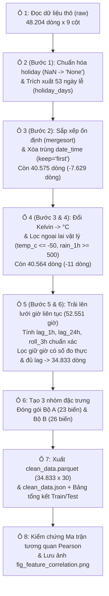

# Tài Liệu Giải Thích Toàn Bộ Notebook 02 (`code/note_02.ipynb`)
## Tiền Xử Lý Dữ Liệu (Data Cleaning) & Tạo Đặc Trưng (Feature Engineering)

**Đề tài 3:** Dự báo lưu lượng giao thông theo giờ (*UCI – Metro Interstate Traffic Volume, ID 492*)  
**Nhóm thực hiện:** Nhóm 3  
**File code tương ứng:** [code/note_02.ipynb](file:///d:/big%20data/btl_nhóm_3/code/note_02.ipynb)

---

## PHẦN 1: CÂU CHUYỆN THỰC TẾ VỀ BỘ DỮ LIỆU & TỔNG QUAN QUY TRÌNH

### 1. Bộ dữ liệu này thu thập ở đâu và như thế nào?
* **Địa điểm thực tế:** Trên tuyến xa lộ liên bang **I-94** (hướng đi về phía Tây, nối hai thành phố Minneapolis và St. Paul thuộc bang Minnesota, Mỹ — khu vực có mùa đông lạnh giá, thường xuyên có tuyết rơi).
* **Cách thu thập dữ liệu (Ghép từ 3 nguồn):**
  1. **Trạm cảm biến đếm xe ATR 301** (của Sở Giao thông Minnesota – MnDOT): Cứ mỗi **1 giờ**, cảm biến đếm tổng số xe ô tô chạy qua trạm và ghi lại vào cột `traffic_volume` kèm mốc giờ `date_time`.
  2. **Đài khí tượng OpenWeatherMap:** Cung cấp thông tin thời tiết theo giờ tại khu vực đó (nhiệt độ, mưa, tuyết, độ phủ mây, tình trạng thời tiết).
  3. **Lịch nghỉ lễ của Mỹ & bang Minnesota:** Đánh dấu các ngày lễ lớn trong năm.
* **Thời gian đo:** Kéo dài **6 năm** (từ `02/10/2012 09:00:00` đến `30/09/2018 23:00:00`), tổng cộng **48.204 dòng × 9 cột** trong file gốc `data/raw/metro_interstate_traffic_volume.csv`.

### 2. Sơ đồ luồng xử lý của toàn bộ `note_02.ipynb`



---

## PHẦN 2: GIẢI THÍCH CHI TIẾT TỪNG Ô CODE TRONG `note_02.ipynb` (Ô 1 → Ô 8)

---

### 🔹 Ô Code 1: Khai báo thư viện, Đường dẫn & Khởi tạo bảng Log
```python
RAW_PATH = os.path.join("..", "data", "raw", "metro_interstate_traffic_volume.csv")
PROCESSED_DIR = os.path.join("..", "data", "processed")
TEST_START = pd.Timestamp("2018-01-01")

df = pd.read_csv(RAW_PATH)
df["date_time"] = pd.to_datetime(df["date_time"])

preprocessing_log = [{
    "moc_xu_ly": "1. Dữ liệu gốc (raw)",
    "mo_ta": "File CSV từ UCI ID 492",
    "so_dong": len(df),
}]
```
* **Giải thích từng dòng:**
  1. `RAW_PATH` & `PROCESSED_DIR`: Trỏ đường dẫn tới file dữ liệu gốc (`data/raw/`) và nơi sẽ lưu dữ liệu sạch (`data/processed/`).
  2. `TEST_START = pd.Timestamp("2018-01-01")`: Chốt mốc thời gian cố định dùng để chia tập **Train** (`< 2018-01-01`) và tập **Test** (`>= 2018-01-01`).
  3. `pd.to_datetime(df["date_time"])`: Trong file CSV gốc, cột `date_time` chỉ là chữ thường (`string`). Lệnh này ép kiểu về `datetime64` để có thể sắp xếp theo thời gian, cộng trừ giờ và tách Thứ/Ngày/Tháng/Giờ.
  4. `preprocessing_log`: Tạo danh sách nhật ký ghi lại số dòng sau mỗi bước làm sạch (bắt đầu từ mốc 1 là `48.204 dòng`).

---

### 🔹 Ô Code 2 (Bước 1 làm sạch): Chuẩn hóa cột `holiday` & Lấy danh sách ngày lễ
```python
df["holiday"] = df["holiday"].fillna("None").astype(str).str.strip()

holiday_rows = df[df["holiday"] != "None"]
holiday_days = set(holiday_rows["date_time"].dt.normalize())
```
* **Tại sao phải làm bước này?**
  1. **Tại sao đổi `NaN` thành `'None'`?** Trong file CSV gốc, những ngày bình thường tác giả ghi chữ `'None'`. Khi `pandas.read_csv()` đọc vào đã tự động biến chữ `'None'` thành giá trị khuyết `NaN` (48.143 dòng). Vì vậy `NaN` ở đây nghĩa là **"Ngày thường, không phải lễ"** chứ không phải mất dữ liệu $\rightarrow$ dùng `.fillna("None")` để đưa về chuỗi chuẩn.
  2. **Tại sao phải trích xuất `holiday_days` bằng `.dt.normalize()`?**
     * Như đã phát hiện ở Note 1, trong dữ liệu gốc có `61 dòng` mang tên ngày lễ nhưng **100% đều chỉ được gắn ở đúng mốc `00:00:00` (nửa đêm)**, còn từ `01:00` sáng đến `23:00` đêm của chính ngày lễ đó lại bị ghi là `'None'`.
     * Hàm `.dt.normalize()` cắt bỏ phần giờ-phút-giây để lấy ra phần **Ngày** (`YYYY-MM-DD 00:00:00`), gom thành tập hợp `holiday_days` gồm **`53 ngày lễ khác nhau`**.
  3. **Tại sao Bước 1 bắt buộc phải chạy TRƯỚC Bước 2 (xóa trùng giờ)?**
     * Vì nếu tại mốc `00:00` của ngày lễ có nhiều dòng thời tiết bị trùng giờ, nhỡ xóa trùng trước mà xóa mất dòng mang tên ngày lễ thì ta sẽ mất luôn thông tin ngày lễ đó!

---

### 🔹 Ô Code 3 (Bước 2 làm sạch): Khử trùng lặp mốc thời gian `date_time`
```python
so_trung_hoan_toan = df.duplicated().sum()
so_trung_date_time = df.duplicated(subset=["date_time"]).sum()

df = df.sort_values("date_time", kind="mergesort")
df = df.drop_duplicates(subset=["date_time"], keep="first").reset_index(drop=True)
assert df["date_time"].is_unique
```
* **Bản chất căn bệnh trong dữ liệu:**
  * Dữ liệu gốc có `17 dòng` trùng hoàn toàn cả 9 cột và **`7.629 dòng` trùng mốc thời gian `date_time`** (do trong 1 giờ đài khí tượng phát nhiều nhãn thời tiết cùng lúc như vừa *Rain*, vừa *Mist*, vừa *Drizzle*; khi ghép bảng làm 1 giờ bị nhân bản thành nhiều dòng có **cùng số xe `traffic_volume`**).
* **Giải thích kỹ thuật trong code:**
  * `sort_values("date_time", kind="mergesort")`: Dùng thuật toán sắp xếp ổn định `mergesort` để các dòng có cùng mốc giờ vẫn giữ nguyên 100% thứ tự xuất hiện ban đầu trong file gốc.
  * `drop_duplicates(subset=["date_time"], keep="first")`: Với mỗi mốc giờ, chỉ giữ lại dòng đầu tiên. Việc này đồng thời xóa luôn cả 17 dòng trùng hoàn toàn.
  * `assert df["date_time"].is_unique`: Lệnh kiểm tra tự động khẳng định sau bước này **không còn bất kỳ mốc giờ nào bị lặp** (`48.204 - 7.629 = 40.575 dòng`).

---

### 🔹 Ô Code 4 (Bước 3 & 4 làm sạch): Đổi nhiệt độ Kelvin → °C & Lọc ngoại lai vật lý
```python
df["temp_c"] = df["temp"] - 273.15
mask_temp = df["temp_c"] <= -50
mask_rain = df["rain_1h"] >= 500
mask_outlier = mask_temp | mask_rain
df = df[~mask_outlier].reset_index(drop=True)
```
* **Tại sao phải làm bước này?**
  1. **Đổi Kelvin sang độ C ($\text{temp\_c} = \text{temp} - 273.15$):** Chuyển từ đơn vị vật lý Kelvin (`288.28 K`) sang độ C (`15.13°C`) dễ hiểu và phục vụ trực tiếp cho giao diện Demo.
  2. **Lọc bỏ 11 dòng lỗi cảm biến (Ngoại lai vật lý):**
     * **`mask_temp` (`temp_c <= -50`):** Phát hiện và loại bỏ **10 dòng** có nhiệt độ `0 K = -273.15°C` (độ không tuyệt đối — lỗi khi cảm biến nhiệt mất tín hiệu). Sau khi loại, nhiệt độ thấp nhất về đúng mức mùa đông thực tế của bang Minnesota là **`-29.76°C`**.
     * **`mask_rain` (`rain_1h >= 500`):** Phát hiện và loại bỏ **1 dòng** có lượng mưa `9831.3 mm/giờ` (gần 10 mét nước mưa trong 1 tiếng). Sau khi loại 1 dòng này, lượng mưa cao nhất về mức thực tế là **`55.63 mm/giờ`** và độ lệch chuẩn (`std`) giảm từ `48.81` về `0.77`.
  3. **Lưu ý khi bảo vệ:** Nhóm chỉ lọc **ngoại lai vật lý (lỗi thiết bị đo)**, tuyệt đối **không lọc ngoại lai thống kê trên cột `traffic_volume`**, vì lưu lượng xe cao vọt (giờ cao điểm) hay thấp sát 0 (đêm khuya, bão tuyết) là dữ liệu giao thông thật 100%!
  4. **Số dòng còn lại:** `40.575 - 11 = 40.564 dòng`.

---

### 🔹 Ô Code 5 (Bước 5 & 6 làm sạch): Trải lên lưới giờ liên tục (`Reindex`) & Tính đặc trưng trễ (`Lag`)
*(Đây là bước kỹ thuật ăn điểm cao nhất trong Note 2)*

```python
full_range = pd.date_range(start=df["date_time"].min(), end=df["date_time"].max(), freq="h")
missing_hours = full_range.difference(df["date_time"])

df_grid = df.set_index("date_time").reindex(full_range)
df_grid.index.name = "date_time"

# Tính đặc trưng trễ trên lưới giờ liên tục
df_grid["lag_1h"] = df_grid["traffic_volume"].shift(1)
df_grid["lag_24h"] = df_grid["traffic_volume"].shift(24)
df_grid["roll_3h"] = df_grid["traffic_volume"].shift(1).rolling(3).mean()

# Chỉ giữ lại các giờ có quan sát thực tế và đủ 3 đặc trưng trễ
df_clean = df_grid[df_grid["traffic_volume"].notna()].reset_index()
df_clean = df_clean.dropna(subset=["lag_1h", "lag_24h", "roll_3h"]).reset_index(drop=True)
```
* **Tại sao bắt buộc phải `reindex(full_range)` trước khi tính `shift()`?**
  * Từ `2012-10-02 09:00` đến `2018-09-30 23:00` tổng cộng có **`52.551 giờ`** trên đồng hồ, nhưng trạm đo chỉ có **`40.564 giờ`** (bị mất tín hiệu **`11.987 giờ`**, chiếm `22.81%`).
  * Nếu ta gọi `.shift(24)` trực tiếp trên bảng `40.564 dòng` bị đứt quãng, pandas chỉ đếm lùi 24 dòng trong bảng chứ không biết ở giữa bị mất hàng trăm giờ $\rightarrow$ làm cho **`11.743 dòng` bị lấy sai giá trị lưu lượng của 24 giờ trước**!
  * Khi dùng `.reindex(full_range)`, ta trải bảng lên một tấm lưới **`52.551 dòng` liên tục từng giờ một**: giờ nào trạm đo mất điện sẽ được điền dòng trống (`NaN`). Lúc này, lùi 1 dòng (`.shift(1)`) chắc chắn 100% là **1 giờ đồng hồ trước**, và lùi 24 dòng (`.shift(24)`) chắc chắn 100% là **24 giờ đồng hồ trước**.
* **Ý nghĩa của 3 biến trễ (`LAG_FEATURES`):**
  1. **`lag_1h` (`shift(1)`):** Lưu lượng xe của **1 giờ ngay trước đó** (phản ánh quán tính giao thông ngắn hạn).
  2. **`lag_24h` (`shift(24)`):** Lưu lượng xe của **cùng giờ này ngày hôm qua** (phản ánh tính lặp lại theo chu kỳ ngày).
  3. **`roll_3h` (`shift(1).rolling(3).mean()`):** Lưu lượng trung bình của **3 giờ liền trước** ($\frac{y_{t-3} + y_{t-2} + y_{t-1}}{3}$).
     * *Câu hỏi thầy hay hỏi:* **"Tại sao tính `roll_3h` phải có `.shift(1)` đứng trước `.rolling(3)`?"**
     * *Trả lời:* Nếu không có `.shift(1)`, lệnh `.rolling(3).mean()` tại giờ $t$ sẽ lấy trung bình của $(y_{t-2}, y_{t-1}, y_t)$ — tức là lấy luôn cả đáp án $y_t$ của giờ cần dự báo đưa vào làm câu hỏi (phạm lỗi rò rỉ dữ liệu **Data Leakage**)!
* **Tại sao lọc còn `34.833 dòng`?**
  * Sau khi tính xong 3 biến trễ trên lưới `52.551 giờ`, ta rút bỏ `11.987 giờ` trống không có số đo thật, và bỏ `5.731 dòng` nằm ngay sau các điểm đứt quãng (vì giờ ngay trước nó bị mất điện nên `lag_1h` hoặc `lag_24h` bị `NaN`).
  * Kết quả thu được **`34.833 dòng sạch hoàn chỉnh`** (không có bất kỳ ô `NaN` nào, không dùng dữ liệu nội suy giả tạo).

---

### 🔹 Ô Code 6: Kỹ thuật Tạo đặc trưng (Feature Engineering) & Chia Bộ A / Bộ B
```python
# 1. Nhóm đặc trưng Lịch & Chu kỳ (8 biến)
df_clean["hour"] = df_clean["date_time"].dt.hour
df_clean["day_of_week"] = df_clean["date_time"].dt.dayofweek
df_clean["month"] = df_clean["date_time"].dt.month
df_clean["is_weekend"] = (df_clean["day_of_week"] >= 5).astype(int)
df_clean["is_holiday"] = df_clean["date_time"].dt.normalize().isin(holiday_days).astype(int)

gio_cao_diem = df_clean["hour"].between(7, 9) | df_clean["hour"].between(16, 18)
ngay_lam_viec = (df_clean["is_weekend"] == 0) & (df_clean["is_holiday"] == 0)
df_clean["is_rush_hour"] = (gio_cao_diem & ngay_lam_viec).astype(int)

df_clean["hour_sin"] = np.sin(2 * np.pi * df_clean["hour"] / 24)
df_clean["hour_cos"] = np.cos(2 * np.pi * df_clean["hour"] / 24)

# 2. Nhóm đặc trưng Thời tiết (4 biến số + 11 biến One-Hot = 15 biến)
weather_dummies = pd.get_dummies(df_clean["weather_main"], prefix="wm", dtype=int)
df_clean = pd.concat([df_clean, weather_dummies], axis=1)
```
* **Giải thích chi tiết từng nhóm đặc trưng:**
  1. **Nhóm 1 – Đặc trưng Lịch & Chu kỳ (`CALENDAR_FEATURES` – 8 biến):**
     * `hour` (`0` → `23`), `day_of_week` (`0` = Thứ Hai → `6` = Chủ Nhật), `month` (`1` → `12`).
     * `is_weekend`: Bằng `1` nếu là Thứ Bảy hoặc Chủ Nhật (`day_of_week >= 5`).
     * `is_holiday`: Bằng `1` cho **toàn bộ 24 giờ** của ngày nghỉ lễ (nhờ đối chiếu ngày `.dt.normalize()` với tập `holiday_days` đã lấy ở Ô 2).
     * `is_rush_hour`: Đặc trưng tương tác kết hợp 3 điều kiện: Khung giờ đi làm/tan tầm (`7h–9h` hoặc `16h–18h`) **VÀ** không phải cuối tuần (`is_weekend == 0`) **VÀ** không phải ngày lễ (`is_holiday == 0`).
     * `hour_sin` & `hour_cos`: Mã hóa giờ lên đường tròn lượng giác $\sin(2\pi h/24)$ và $\cos(2\pi h/24)$ để mô hình hiểu rằng `23h đêm` và `0h sáng` là 2 giờ liền kề nhau.
     * *(Lưu ý: Không đưa cột `year` vào mô hình vì tập Test là năm 2018 — năm mới hoàn toàn chưa từng xuất hiện trong tập Train 2012–2017).*
  2. **Nhóm 2 – Đặc trưng Thời tiết (`WEATHER_FEATURES` – 15 biến):**
     * Giữ 4 biến định lượng: `temp_c`, `rain_1h`, `snow_1h`, `clouds_all`.
     * Chuyển cột chữ `weather_main` thành **11 cột số nhị phân `0/1` (One-Hot Encoding)**: `wm_Clear`, `wm_Clouds`, `wm_Drizzle`, `wm_Fog`, `wm_Haze`, `wm_Mist`, `wm_Rain`, `wm_Smoke`, `wm_Snow`, `wm_Squall`, `wm_Thunderstorm`.
     * Bỏ cột `weather_description` (38 mô tả chi tiết) vì trùng ý với `weather_main`, tránh làm loãng mô hình.
  3. **Tại sao đóng gói thành 2 Bộ đặc trưng (`FEATURES_A` và `FEATURES_B`)?**
     * **Bộ đặc trưng A (`23 biến` = 8 Lịch + 15 Thời tiết):** Không dùng biến trễ $\rightarrow$ Dùng cho bài toán **dự báo dài hạn** (lập kế hoạch giao thông trước nhiều ngày/tuần khi chỉ biết lịch và dự báo thời tiết).
     * **Bộ đặc trưng B (`26 biến` = 23 biến Bộ A + 3 biến trễ `lag_1h`, `lag_24h`, `roll_3h`):** Dùng cho bài toán **dự báo ngắn hạn thời gian thực (1 giờ tới)** trên bảng điện tử trên đường cao tốc.

---

### 🔹 Ô Code 7: Lưu file `.parquet`, `.json` & Bảng tổng kết quá trình xử lý
```python
df_out = df_clean[["date_time", "traffic_volume"] + FEATURES_B + ["weather_main", "holiday"]]
df_out.to_parquet(os.path.join(PROCESSED_DIR, "clean_data.parquet"), index=False)
```
* **Giải thích cấu trúc 30 cột của file `clean_data.parquet` (`34.833 dòng × 30 cột`):**
  * **26 cột đầu vào ($X$):** Nằm trong `FEATURES_B`.
  * **1 cột mục tiêu ($y$):** `traffic_volume` (đáp án để dạy máy học).
  * **3 cột thông tin mô tả:** `date_time` (để cắt Train/Test theo ngày `2018-01-01` và vẽ trục thời gian), `weather_main` & `holiday` (để thống kê phân tích lỗi theo chữ ở Note 3).
* **Bảng tổng kết 5 mốc làm sạch & tỷ lệ chia Train/Test:**
  * **Mốc 1:** Dữ liệu gốc (`48.204 dòng`)
  * **Mốc 2:** Sau loại trùng `date_time` (`40.575 dòng` – loại `7.629` dòng)
  * **Mốc 3:** Sau lọc ngoại lai vật lý (`40.564 dòng` – loại `11` dòng)
  * **Mốc 4:** Trải lên lưới giờ liên tục (`52.551 dòng` – chèn `11.987` giờ khuyết)
  * **Mốc 5:** Tập sạch cuối cùng đủ lag (`34.833 dòng`)
  * **Chia Train / Test theo mốc `2018-01-01`:**
    * **Tập Train (`2012 – 2017`):** `28.353 dòng` (**81.4%**)
    * **Tập Test (`Năm 2018`):** `6.480 dòng` (**18.6%**)

---

### 🔹 Ô Code 8: Kiểm chứng Ma trận tương quan (`Correlation`) & Lưu ảnh vào `results/`
* **Mục đích:** Dùng hệ số tương quan tuyến tính Pearson ($r \in [-1, +1]$) để chứng minh bằng con số rằng các đặc trưng nhóm vừa tạo ở Ô 5 và Ô 6 thực sự có mối liên hệ chặt chẽ với `traffic_volume`, đồng thời xuất ảnh `results/fig_feature_correlation.png`.
* **Ý nghĩa các con số trên biểu đồ tương quan:**
  1. **Nhóm tương quan dương mạnh nhất (cột xanh):**
     * **`lag_1h` ($r = +0.95$):** Lưu lượng giờ trước tăng thì giờ sau cũng cao (quán tính dòng xe).
     * **`lag_24h` ($r = +0.86$)** và **`roll_3h` ($r = +0.85$):** Chu kỳ lặp lại sau 24 giờ và xu hướng 3 giờ gần nhất cực kỳ rõ nét.
     * **`is_rush_hour` ($r = +0.44$)** và **`hour` ($r = +0.35$):** Rơi vào khung giờ cao điểm đi làm làm lưu lượng tăng vọt.
     * **`temp_c` ($r = +0.13$):** Trời ấm áp (mùa hè) người dân đi lại nhiều hơn mùa đông băng tuyết.
  2. **Nhóm tương quan âm rõ nhất (cột đỏ):**
     * **`hour_cos` ($r = -0.66$):** Do $\cos(2\pi h/24)$ đạt cực đại ($+1$) lúc nửa đêm (`0h`) và đạt cực tiểu ($-1$) lúc giữa trưa (`12h`), nên `hour_cos` càng cao (càng về đêm) thì xe càng vắng!
     * **`is_weekend` ($r = -0.21$)**, **`day_of_week` ($r = -0.15$)** và **`is_holiday` ($r = -0.04$):** Cuối tuần và ngày nghỉ lễ làm giảm lưu lượng giao thông.
